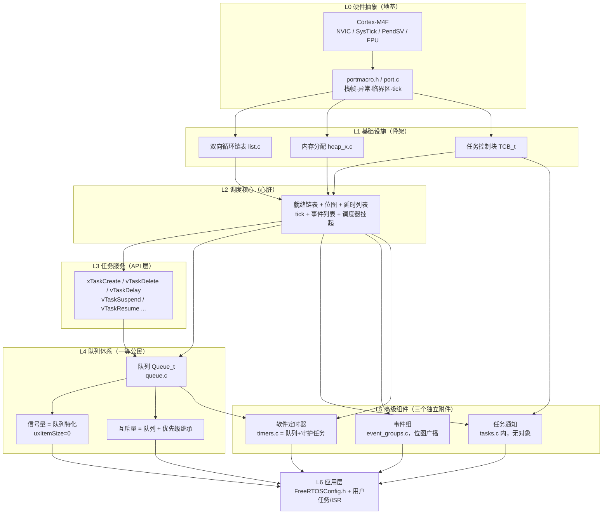

# FreeRTOS 大体系：从底层到上层的建造指南

> 配套《FreeRTOS 核心机制源码级讲解（第 2-11 点）》与《直观化补充讲义》。
> 这一篇回答一个问题：**如果从零开始造一个 FreeRTOS，先写什么、再写什么？**
> 源码版本：FreeRTOS Kernel V11.1.0，Cortex-M4F 单核移植。

---

## 0. 一张总图：七层结构

FreeRTOS 不是一堆平铺的模块，而是**一层盖在一层之上**的体系。从下往上：



**记住这张图的三种箭头方向**：

- **往上（支撑）**：下层为上层提供原语——调度核心给队列提供"事件等待/唤醒"，队列给信号量提供全部代码；
- **往里（依赖）**：互斥量多依赖了 L2 的优先级继承，软件定时器拼装了"队列 + 任务 + L2 延时列表"；
- **平级（独立）**：任务通知、事件组**不经过队列**，直接基于 L2 + TCB 另起炉灶。

---

## 第 0 层：硬件抽象（port 层）—— 地基

**解决什么问题**：让内核代码与具体的 CPU 架构解耦。内核其余部分只看到"能存现场、能给 tick、能切任务"，不关心是 Cortex-M 还是 RISC-V。

**核心文件**：`OS/port/portmacro.h`、`OS/port/port.c`（含汇编）。

**这一层干的事，数得过来就 4 件**：

| 职责 | 关键代码 | 说明 |
|---|---|---|
| 类型的肉身 | `StackType_t / TickType_t / BaseType_t` | 位数与硬件对齐（本项目 32 位） |
| 临界区 | `portDISABLE_INTERRUPTS()`（操作 BASEPRI） | 不关总中断，只掩蔽低优先级 |
| 栈帧构造 | `pxPortInitialiseStack` | 伪造"刚被打断的现场"，见讲义 §2 |
| 三个异常入口 | `vPortSVCHandler` / `xPortPendSVHandler` / `xPortSysTickHandler` | 启动调度 / 切换任务 / tick 心跳 |
| 启动调度器 | `xPortStartScheduler` | 设置 PendSV/SysTick 为最低优先级 |

**为上层提供**：任务的"肉身"（栈帧）、tick 心跳、切换执行点、临界区保护。

**一句话认知**：整个 port 层就干三件事——**把寄存器现场当数据存/取、提供 tick、提供"该切换了"的执行点**。别的什么都不管。

---

## 第 1 层：内核基础设施 —— 骨架

**解决什么问题**：调度器要存放任务、要分配内存，需要自己的积木。嵌入式环境没有标准库可用（`malloc` 不可重入、行为不定），所以 FreeRTOS 全自研。

### 1.1 双向循环链表（list.c）

- `List_t`（哨兵 `xListEnd` + 游标 `pxIndex`）+ `ListItem_t`（值/前后指针/`pvOwner`）。
- **为什么自研**：① 不依赖 libc；② 插入/删除 O(1)；③ 支持"取 pxIndex 下一个"的轮转语义，这是时间片轮转的基础。
- 详细结构见讲义 §1。

### 1.2 内存分配（heap_x.c，5 个策略可选）

| 策略 | 特点 | 适用 |
|---|---|---|
| heap_1 | 只分配不释放 | 任务/队列从不删除的裸机场景 |
| heap_2 | 支持释放，不合并碎片 | 少量分配 |
| **heap_4** | **空闲链表 + 合并相邻块**（本项目） | **大多数项目默认** |
| heap_5 | heap_4 + 多段不连续内存 | 多个 RAM 区域 |

### 1.3 TCB（task.h）—— 任务的身份证

栈顶、两条链表项（状态/事件）、优先级、栈底、通知值数组……**所有上层组件最终都围着 TCB 转**。

**为上层提供**：任务的"容器"（TCB）、通用容器（链表）、内存来源（heap）。

---

## 第 2 层：调度核心 —— 心脏

**解决什么问题**：CPU 怎么分给任务、任务怎么等事件、时间怎么管理。这是 FreeRTOS 真正的"内核"，全部在 `tasks.c` 里。

| 机制 | 关键代码 | 为上层提供的原语 |
|---|---|---|
| 就绪链表 + 位图 | `pxReadyTasksLists[]` + `uxTopReadyPriority` | `prvAddTaskToReadyList`（任务进入就绪态） |
| 选任务 | `vTaskSwitchContext`（CLZ，O(1)） | "谁是下一个" |
| tick 与延时 | `xTaskIncrementTick` + 双延时列表 + `xNextTaskUnblockTime` | "睡多久、何时醒" |
| **事件列表** | `vTaskPlaceOnEventList` / `xTaskRemoveFromEventList` | **"等 X"的通用机制 ★** |
| 调度器挂起 | `vTaskSuspendAll` / `xTaskResumeAll` + `xPendingReadyList` | 原子地操作一组链表 |
| 优先级继承 | `xTaskPriorityInherit` / `xTaskPriorityDisinherit` | 互斥量的"插队"能力 |

**★ 最重要的认知：事件列表机制是"等 X"的通用机制。**

任务阻塞的本质 = 把自己的 `xEventListItem` 挂到某个"事件源"的等待列表上，然后进延时列表。**队列的等待接收、事件组的等待位、定时器守护任务的等待命令，用的都是这一套**。看懂 L2 的 `vTaskPlaceOnEventList`，就等于看懂了一半的上层组件。

---

## 第 3 层：任务服务 —— 基于调度核心的 API

**解决什么问题**：把 L2 的原语包装成用户可调用的任务生命周期 API。**这一层没有任何新机制，全是 L2 的薄封装**：

| API | 底层用的什么 |
|---|---|
| `xTaskCreate` | heap 分配 TCB+栈 → `prvAddTaskToReadyList` → 优先级高则 yield |
| `vTaskDelay` / `xTaskDelayUntil` | `prvAddCurrentTaskToDelayedList`（L2） |
| `vTaskSuspend` / `vTaskResume` | 挂起列表 / 就绪列表（L1 链表） |
| `vTaskDelete(NULL)` | `xTasksWaitingTermination` + 空闲任务回收 |
| `uxTaskPriorityGet` / `vTaskPrioritySet` | 直接读写 TCB + 链表搬移 |

**关键认知**：L3 证明了一个模式——**RTOS 的 API 绝大多数是"改 TCB 字段 + 搬链表 + 必要时请求调度"**。这个模式贯穿全书。

---

## 第 4 层：队列体系 —— 水管

**解决什么问题**：任务之间怎么传数据、怎么互相通知。FreeRTOS 的答案是：**一种通用机制（队列），加两个特化壳**。

### 4.1 队列（queue.c）

环形缓冲（按值拷贝）+ `xTasksWaitingToSend` / `xTasksWaitingToReceive` 两个等待列表。阻塞/唤醒全部复用 L2 的事件列表机制。详细见原文档第 7 点。

### 4.2 信号量 = 队列特化

```
二进制信号量：uxLength=1, uxItemSize=0
计数信号量：  uxLength=N, uxItemSize=0
```

**没有新代码**——`xSemaphoreTake` 就是 `xQueueSemaphoreTake`，`xSemaphoreGive` 就是 `xQueueGenericSend`。区别只在创建参数。

### 4.3 互斥量 = 队列特化 + 优先级继承

```
互斥量：uxLength=1, uxItemSize=0, uxQueueType=queueQUEUE_IS_MUTEX
        + SemaphoreData_t（xMutexHolder / uxRecursiveCallCount）
        + 继承逻辑在 L2（tasks.c 的 xTaskPriorityInherit）
```

**互斥量是唯一"跨层"的组件**：壳在 queue.c，继承逻辑在 tasks.c。这也解释了为什么互斥量比二进制信号量慢——多了持有者追踪和继承开销，但换来"高优先级不被饿死"。

### 4.4 递归互斥量 = 互斥量 + 计数

`uxRecursiveCallCount` 记录同一任务的 take 次数，减到 0 才真释放。

**为上层提供**：数据流（队列）、同步（信号量）、互斥（互斥量）三大能力。

---

## 第 5 层：高级组件 —— 三个独立附件

**解决什么问题**：队列体系之外，还有三种常见需求。**注意：它们三个架构思路完全不同，正好是三种范式的样本**：

| 组件 | 架构思路 | 不依赖队列的原因 | 代价 |
|---|---|---|---|
| **任务通知** | 无对象：直接改目标 TCB 的 `ulNotifiedValue` | 最快（无对象无拷贝） | 只能单播，不能广播 |
| **事件组** | 位图 + 无序事件列表（`vTaskPlaceOnUnorderedEventList`） | 需要"一次唤醒多个等待者"的广播语义 | 高 8 位被控制位占用，只有 24 位可用 |
| **软件定时器** | 消息驱动：命令走队列（`xTimerQueue`）+ 守护任务 + L2 延时列表 | 需要把任务上下文的调用搬到守护任务上下文 | 回调不能阻塞，依赖 `configUSE_TIMERS` |

**软件定时器是全书唯一的"多组件拼装"案例**——它同时用到了队列（传命令）、任务（守护进程）、L2（定时列表）。看懂它 = 把 L1-L4 串起来了。

---

## 第 6 层：应用层 —— 配置与整机交付

**解决什么问题**：用户怎么裁剪、怎么用。

`FreeRTOSConfig.h` 的开关直接决定系统形态（本质是**条件编译裁剪掉整棵依赖树**）：

| 配置项 | 关掉后的效果 | 影响的组件 |
|---|---|---|
| `configUSE_TIMERS` | 定时器守护任务不创建，`xTimer*` API 消失 | L5 定时器（及事件组 FromISR 回调） |
| `configUSE_TASK_NOTIFICATIONS` | TCB 不再含通知字段 | L5 通知 |
| `configUSE_MUTEXES` / `configUSE_COUNTING_SEMAPHORES` | 对应创建 API 消失 | L4 |
| `configMAX_PRIORITIES` | 就绪链表数组大小 | L2 |
| `configUSE_PORT_OPTIMISED_TASK_SELECTION` | 位图 O(1) → 通用逐级扫描 | L2 |

---

## 依赖关系总表（面试背诵用）

| 组件 | 直接依赖 | 源码位置 |
|---|---|---|
| 队列 | L2 事件列表 + 调度挂起；L1 链表/内存 | `queue.c` |
| 信号量 | 队列（零新增） | `queue.c` |
| 互斥量 | 队列 + **L2 优先级继承** | `queue.c` + `tasks.c` |
| 事件组 | L2 无序事件列表 + 调度挂起 | `event_groups.c` |
| 任务通知 | TCB + L2 调度器 | `tasks.c` |
| 软件定时器 | 队列 + 任务 + L2 定时列表 | `timers.c` + `queue.c` + `tasks.c` |
| 空闲任务 | L2 就绪链表 | `tasks.c` |

## 一句线串起整个体系（面试/讲解收尾用）

> "FreeRTOS 用 port 层把 Cortex-M 包成统一接口（L0）；用链表、堆、TCB 搭好骨架（L1）；调度核心负责状态机、时间、事件唤醒（L2）；任务 API 只是它的薄封装（L3）；队列是一等公民，信号量和互斥量都是它的壳，互斥量额外借用调度器的优先级继承（L4）；任务通知和事件组不经过队列另起炉灶，定时器是队列+任务的拼装品（L5）；最后 FreeRTOSConfig.h 决定整机形态（L6）。"

---

## 附：建议的阅读顺序（配合源码）

```
第一次读：L0 → L1 → L2 → L3
  目标：搞懂"任务怎么被创建、怎么被调度、怎么切换"

第二次读：L4（队列→信号量→互斥量）
  目标：搞懂"IPC 的本质是共享的等待列表"

第三次读：L5（通知→事件组→定时器）
  目标：搞懂"三种架构范式"

最后回到 L2 复习事件列表：
  你会突然发现，队列/事件组/定时器全都长一个样。
```
