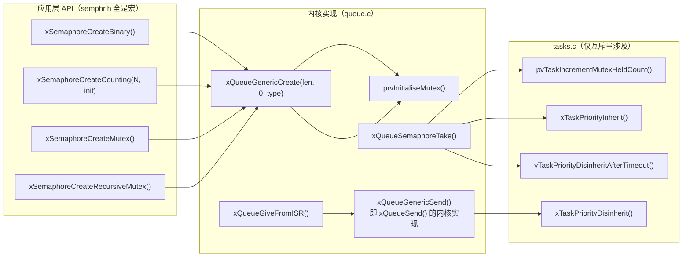
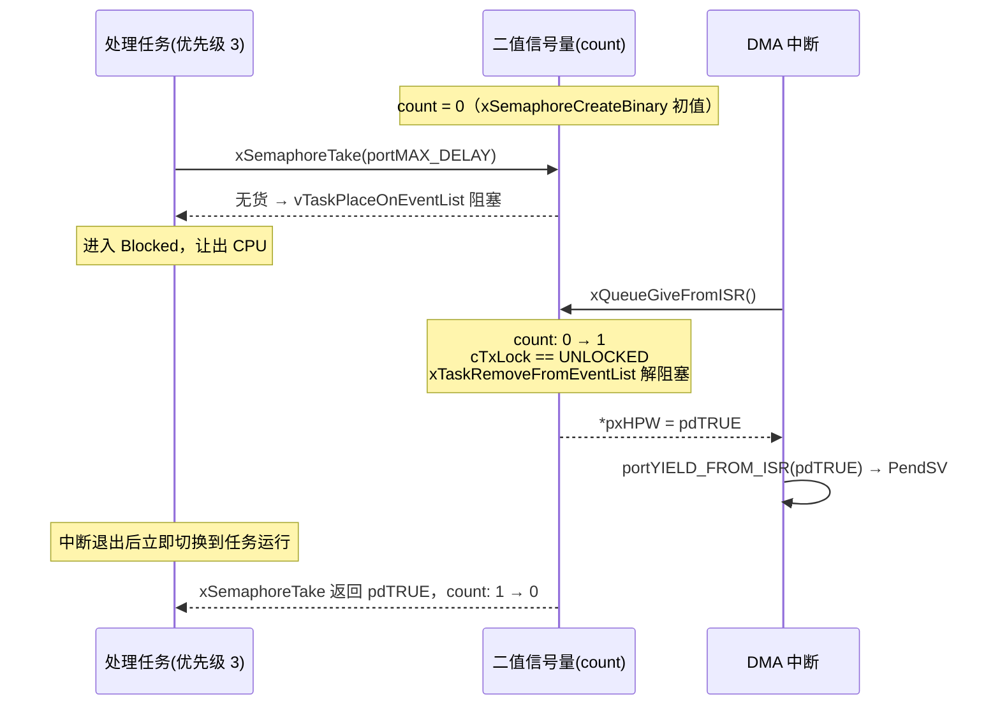
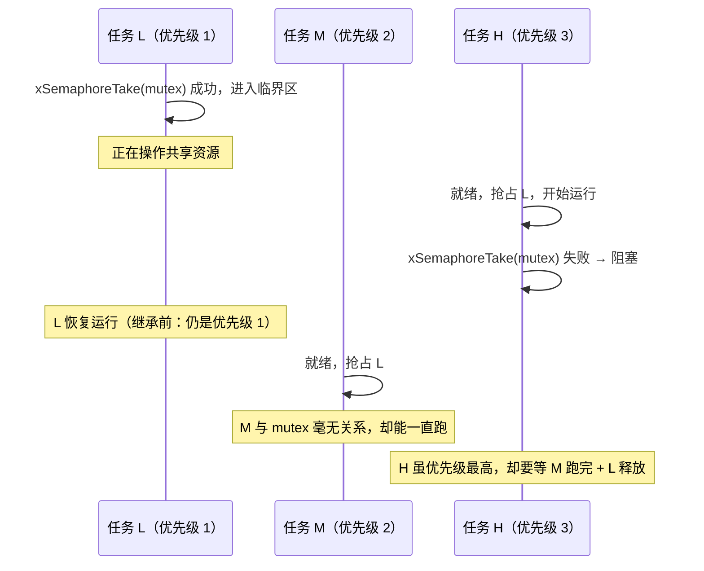
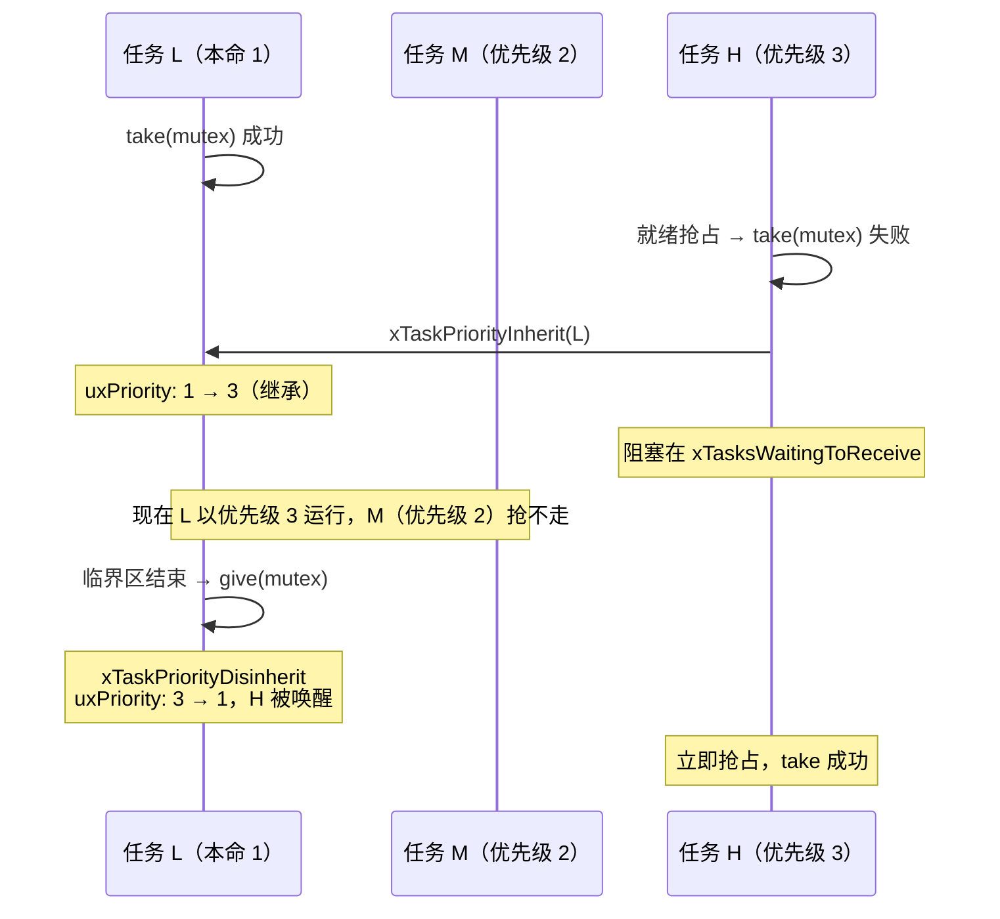

# FreeRTOS 信号量与互斥量源码级讲解（二值信号量 / 计数信号量 / 互斥锁 / 递归互斥锁）

> 阅读对象：需要在本项目上做 BSP/中间件开发的嵌入式工程师。
> 源码版本：本仓库 `OS/` 目录为 **FreeRTOS Kernel V11.1.0**，Cortex-M4F 单核移植（`OS/port/port.c`、`OS/port/portmacro.h`）。`OS/FreeRTOSConfig.h` 头部注释写的是 V202212.01，属于 ST 模板残留，实际以源码行为准。
> 路径约定：所有路径相对仓库根目录 `watch_projects/app/`，`queue.c:1654` 表示 `OS/src/queue.c` 第 1654 行。
> 说明：本工程目前**几乎没有真正使用**这些原语（详见第 11 章），本文以源码讲解为主，并给出在本项目落地的改造建议。
>
> API 命名：本项目业务代码统一使用 **`xQueueSend()` / `xQueueReceive()` / `xQueueSendFromISR()`** 这一族队列 API（见 `Core/`、`APP/`、`BSP/`、`System/OSAL/`），本文在讲解内核实现时会写成其底层函数 `xQueueGenericSend()` / `xQueueGenericSendFromISR()`。两者的对照关系见 [1.1.1 节](#111-本项目队列-api-命名对照send--receive-家族)，阅读时可直接视为同一个东西。

---

## 目录

1. [总览：信号量/互斥量都是"队列的马甲"](#1-总览信号量互斥量都是队列的马甲)
2. [创建路径源码走读](#2-创建路径源码走读)
3. [二值信号量（Binary Semaphore）](#3-二值信号量binary-semaphore)
4. [计数信号量（Counting Semaphore）](#4-计数信号量counting-semaphore)
5. [互斥锁（Mutex）](#5-互斥锁mutex)
6. [优先级继承（Priority Inheritance）完整源码走读](#6-优先级继承priority-inheritance完整源码走读)
7. [递归互斥锁（Recursive Mutex）](#7-递归互斥锁recursive-mutex)
8. [队列锁 cRxLock/cTxLock 与 prvUnlockQueue](#8-队列锁-crxlockctxtxlock-与-prvunlockqueue)
9. [中断安全规则（本项目 Cortex-M4 移植）](#9-中断安全规则本项目-cortex-m4-移植)
10. [删除 / 查询 API 与本项目可用性](#10-删除--查询-api-与本项目可用性)
11. [本项目现状盘点与落地建议](#11-本项目现状盘点与落地建议)
12. [速查表与常见坑](#12-速查表与常见坑)

---

## 1. 总览：信号量/互斥量都是"队列的马甲"

### 1.1 一句话结论

> FreeRTOS **没有**为信号量写一套独立代码。信号量、互斥量、递归互斥量全部复用 `Queue_t`，靠三个"开关"区分行为：
>
> 1. `uxItemSize == 0` —— 不搬数据，只搬"计数"；
> 2. `uxLength` —— 决定计数上限（二值=1，计数=N，互斥=1）；
> 3. `uxQueueType`（复用 `pcHead`，`= NULL` 时为互斥量）—— 决定是否启用优先级继承。

句柄类型也是同一个：

```c
// OS/include/semphr.h:38
typedef QueueHandle_t SemaphoreHandle_t;
```

所以 `xSemaphoreGive()` 展开后就是 `xQueueGenericSend()`，`xSemaphoreTake()` 展开后就是 `xQueueSemaphoreTake()`：

```c
// OS/include/semphr.h:298
#define xSemaphoreTake( xSemaphore, xBlockTime )    xQueueSemaphoreTake( ( xSemaphore ), ( xBlockTime ) )

// OS/include/semphr.h:460
#define xSemaphoreGive( xSemaphore )    xQueueGenericSend( ( QueueHandle_t ) ( xSemaphore ), NULL, semGIVE_BLOCK_TIME, queueSEND_TO_BACK )

// OS/include/semphr.h:640
#define xSemaphoreGiveFromISR( xSemaphore, pxHigherPriorityTaskWoken )    xQueueGiveFromISR( ( QueueHandle_t ) ( xSemaphore ), ( pxHigherPriorityTaskWoken ) )
```

### 1.1.1 本项目队列 API 命名对照（send / receive 家族）

本项目业务代码（`Core/`、`APP/`、`BSP/`、`System/`）里用的都是 **`xQueueSend()` / `xQueueReceive()` / `xQueueSendFromISR()`** 这一族标准 API，而不是内核内部的 `xQueueGeneric*()`。它们的对应关系如下——**阅读本文时可以把两者视为同一个东西**：

```c
// OS/include/queue.h:429   xQueueSend 就是"从队尾入队"，等价于 xQueueSendToBack
#define xQueueSend( xQueue, pvItemToQueue, xTicksToWait ) \
    xQueueGenericSend( ( xQueue ), ( pvItemToQueue ), ( xTicksToWait ), queueSEND_TO_BACK )

// OS/include/queue.h 同理
#define xQueueSendToBack( xQueue, pvItemToQueue, xTicksToWait ) \
    xQueueGenericSend( ( xQueue ), ( pvItemToQueue ), ( xTicksToWait ), queueSEND_TO_BACK )

#define xQueueSendToFront( xQueue, pvItemToQueue, xTicksToWait ) \
    xQueueGenericSend( ( xQueue ), ( pvItemToQueue ), ( xTicksToWait ), queueSEND_TO_FRONT )

// OS/include/queue.h:598  xQueueOverwrite（长度必须为 1 的队列专用）
#define xQueueOverwrite( xQueue, pvItemToQueue ) \
    xQueueGenericSend( ( xQueue ), ( pvItemToQueue ), 0, queueOVERWRITE )

// OS/include/queue.h:1110 中断版本
#define xQueueSendFromISR( xQueue, pvItemToQueue, pxHigherPriorityTaskWoken ) \
    xQueueGenericSendFromISR( ( xQueue ), ( pvItemToQueue ), ( pxHigherPriorityTaskWoken ), queueSEND_TO_BACK )
```

| 本项目在用的 API | 内核实现 | 出现位置（本仓库业务代码） |
|---|---|---|
| `xQueueCreate(len, size)` | `xQueueGenericCreate(..., queueQUEUE_TYPE_BASE)` | `APP/OTA/ota.c` 等 |
| `xQueueSend(q, item, ticks)` | `xQueueGenericSend(..., queueSEND_TO_BACK)` | `System/OSAL/osal_freertos.c:92` |
| `xQueueSendToBack(q, item, ticks)` | `xQueueGenericSend(..., queueSEND_TO_BACK)` | `APP/`、`BSP/` |
| `xQueueSendToFront(q, item, ticks)` | `xQueueGenericSend(..., queueSEND_TO_FRONT)` | `APP/` |
| `xQueueReceive(q, buf, ticks)` | **本身就是函数**（`queue.c:1504`） | `APP/OTA/ota.c:56`、`System/OSAL/osal_freertos.c:110` |
| `xQueueSendFromISR(q, item, hpw)` | `xQueueGenericSendFromISR(..., queueSEND_TO_BACK)` | `BSP/` |
| `xQueueSendToBackFromISR(q, item, hpw)` | `xQueueGenericSendFromISR(..., queueSEND_TO_BACK)` | `BSP/MPU6050` |
| `xQueueGenericSendFromISR(...)` | 直接调内核（需自己传 `xCopyPosition`） | `BSP/MPU6050` |

> **本文的写法约定**：讲解"内部实现"时用 `xQueueGenericSend()`（因为要看 `xCopyPosition` 参数），讲解"等价效果"时用 `xQueueSend()`。记住一条即可：
> **`xSemaphoreGive(sem)` ≡ `xQueueSend(sem, NULL, 0)` ≡ `xQueueGenericSend(sem, NULL, 0, queueSEND_TO_BACK)`**。

OSAL 层对它们的封装也一目了然：

```c
// System/OSAL/osal_freertos.c:92   —— osal_queue_t.put
result = xQueueSend( (QueueHandle_t)handle, item, osal_freertos_to_ticks(timeout_ms) );

// System/OSAL/osal_freertos.c:110  —— osal_queue_t.get
result = xQueueReceive( (QueueHandle_t)handle, item, osal_freertos_to_ticks(timeout_ms) );
```

而 `BSP/MPU6050` 里的 `os_queue_put_isr()` 底层就是 `xQueueSendToBackFromISR()`（见 11.2）。

### 1.2 核心数据结构 `Queue_t`

```c
// OS/src/queue.c:103
typedef struct QueueDefinition
{
    int8_t * pcHead;           /* 队列存储区首地址；当用作互斥量时被复用为 uxQueueType（=NULL） */
    int8_t * pcWriteTo;
    union
    {
        QueuePointers_t xQueue;     /* 当作队列用时：pcTail / pcReadFrom */
        SemaphoreData_t xSemaphore; /* 当作信号量用时：xMutexHolder / uxRecursiveCallCount */
    } u;
    List_t xTasksWaitingToSend;     /* 因"放不进去"而阻塞的任务，按优先级排序 */
    List_t xTasksWaitingToReceive;  /* 因"取不到"而阻塞的任务 —— 信号量等待者挂在这里 */
    volatile UBaseType_t uxMessagesWaiting; /* ★ 信号量的计数值就是它 */
    UBaseType_t uxLength;                   /* 计数上限 */
    UBaseType_t uxItemSize;                 /* 信号量恒为 0 */
    volatile int8_t cRxLock;
    volatile int8_t cTxLock;
    ...
} xQUEUE;
```

两个关键细节：

```c
// OS/src/queue.c:65
#define uxQueueType               pcHead
#define queueQUEUE_IS_MUTEX       NULL
```

即 **`pcHead == NULL` 就是"这是一个互斥量"的判据**。因为互斥量不需要存储区，FreeRTOS 把 `pcHead` 这个"没用的字段"借来做类型标记；但这样一来，`pcHead` 就绝对不能为 NULL（否则会被误判成互斥量），于是 `prvInitialiseNewQueue()` 里有一个非常反直觉的补丁：

```c
// OS/src/queue.c:576
if( uxItemSize == ( UBaseType_t ) 0 )
{
    /* 没有分配存储区，但 pcHead 不能为 NULL（NULL 是"我是互斥量"的暗号），
       所以让它指向 Queue_t 自己，取一个"确定在内存映射内"的无害值。 */
    pxNewQueue->pcHead = ( int8_t * ) pxNewQueue;
}
else
{
    pxNewQueue->pcHead = ( int8_t * ) pucQueueStorage;
}
```

> 面试高频：**"怎么判断一个 `SemaphoreHandle_t` 到底是二值信号量还是互斥锁？"**
> 答：内核里靠 `pxQueue->uxQueueType == queueQUEUE_IS_MUTEX`（即 `pcHead == NULL`）。应用层可以用 `uxSemaphoreGetCount()` / `xSemaphoreGetMutexHolder()`，但后者在本工程被裁掉了（见 10.2）。

### 1.3 五种"子类型"常量

```c
// OS/include/queue.h:73
#define queueQUEUE_TYPE_BASE                  ( ( uint8_t ) 0U )  /* 普通队列 / 队列集 */
#define queueQUEUE_TYPE_MUTEX                 ( ( uint8_t ) 1U )
#define queueQUEUE_TYPE_COUNTING_SEMAPHORE    ( ( uint8_t ) 2U )
#define queueQUEUE_TYPE_BINARY_SEMAPHORE      ( ( uint8_t ) 3U )
#define queueQUEUE_TYPE_RECURSIVE_MUTEX       ( ( uint8_t ) 4U )
```

它只在 `configUSE_TRACE_FACILITY == 1` 时存进 `ucQueueType` 供调试器/Trace 使用（本工程 `FreeRTOSConfig.h:65` 置 1），**运行逻辑不靠它**，运行逻辑靠 `uxLength / uxItemSize / pcHead==NULL`。

### 1.4 心智模型



一句话记忆：**"`xSemaphoreGive()` 就是 `xQueueSend()` 往一个长度为 0 的队列里写一条空消息；`xSemaphoreTake()` 就是 `xQueueReceive()` 的「只减计数、不拷数据」特化版 `xQueueSemaphoreTake()`；计数就是 `uxMessagesWaiting`。"**

> 注意：`xQueueSend()` 用于**真正的队列**（`uxItemSize > 0`）时会 `memcpy` 拷贝数据；用于**信号量**（`uxItemSize == 0`）时 `prvCopyDataToQueue()` 会跳过 `memcpy`，只把 `uxMessagesWaiting` 加一。**同一个函数，靠 `uxItemSize` 走不同分支。**

---

## 2. 创建路径源码走读

### 2.1 公共入口

```c
// OS/src/queue.c:502
QueueHandle_t xQueueGenericCreate( const UBaseType_t uxQueueLength,
                                   const UBaseType_t uxItemSize,
                                   const uint8_t ucQueueType )
{
    ...
    if( ( uxQueueLength > 0 ) && ( ( SIZE_MAX / uxQueueLength ) >= uxItemSize ) && ... )
    {
        xQueueSizeInBytes = uxQueueLength * uxItemSize;   /* 信号量时恒为 0 */
        pxNewQueue = ( Queue_t * ) pvPortMalloc( sizeof( Queue_t ) + xQueueSizeInBytes );
        ...
        prvInitialiseNewQueue( uxQueueLength, uxItemSize, pucQueueStorage, ucQueueType, pxNewQueue );
    }
    ...
}
```

要点：

- 二值/计数信号量 `uxItemSize == 0`，所以 `xQueueSizeInBytes == 0`，**只分配一个 `Queue_t`（约 80 字节）**，非常省内存；
- 内存来自 `pvPortMalloc()`，即 FreeRTOS 自己的 heap（`FreeRTOSConfig.h:63` 配了 `configTOTAL_HEAP_SIZE = 75 * 1024`，`OS/port/heap_4.c`）；
- 创建失败返回 `NULL`，**必须判空**（本工程 `configUSE_MALLOC_FAILED_HOOK = 0`，失败时静默返回 NULL）。

### 2.2 创建 API 对照表

| 应用层 API | 内部实现 | `uxLength` | `uxItemSize` | 初始 `uxMessagesWaiting` | `pcHead/uxQueueType` | `xMutexHolder` |
|---|---|---|---|---|---|---|
| `xSemaphoreCreateBinary()` | `xQueueGenericCreate(1, 0, BINARY_SEMAPHORE)` | 1 | 0 | **0**（必须先 give 才能 take） | 指向自身 | 无效 |
| `vSemaphoreCreateBinary()`（**已废弃**） | 同上 + 立刻 `xSemaphoreGive()` | 1 | 0 | **1**（首次 take 直接过） | 指向自身 | 无效 |
| `xSemaphoreCreateCounting(max, init)` | `xQueueGenericCreate(max, 0, COUNTING_SEMAPHORE)` 后手动赋初值 | max | 0 | **init** | 指向自身 | 无效 |
| `xSemaphoreCreateMutex()` | `xQueueCreateMutex()` → `xQueueGenericCreate(1,0,MUTEX)` + `prvInitialiseMutex()` | 1 | 0 | **1**（= 空闲可用） | **NULL** | NULL |
| `xSemaphoreCreateRecursiveMutex()` | 同上，`ucQueueType = RECURSIVE_MUTEX` | 1 | 0 | **1** | **NULL** | NULL，`uxRecursiveCallCount = 0` |

对应源码：

```c
// OS/include/semphr.h:167  二值信号量：创建后计数为 0
#define xSemaphoreCreateBinary()    xQueueGenericCreate( ( UBaseType_t ) 1, semSEMAPHORE_QUEUE_ITEM_LENGTH, queueQUEUE_TYPE_BINARY_SEMAPHORE )

// OS/include/semphr.h:97   已废弃的 v 版本：创建后额外 give 一次，计数为 1
#define vSemaphoreCreateBinary( xSemaphore )  \
    do {                                      \
        ( xSemaphore ) = xQueueGenericCreate( 1, semSEMAPHORE_QUEUE_ITEM_LENGTH, queueQUEUE_TYPE_BINARY_SEMAPHORE ); \
        if( ( xSemaphore ) != NULL ) { ( void ) xSemaphoreGive( ( xSemaphore ) ); }  \
    } while( 0 )
```

```c
// OS/src/queue.c:614  互斥量的"专门初始化"
static void prvInitialiseMutex( Queue_t * pxNewQueue )
{
    if( pxNewQueue != NULL )
    {
        pxNewQueue->u.xSemaphore.xMutexHolder = NULL;
        pxNewQueue->uxQueueType = queueQUEUE_IS_MUTEX;   /* ★ 关键：pcHead = NULL */

        /* 若是递归互斥量，这里顺手把递归计数清 0 */
        pxNewQueue->u.xSemaphore.uxRecursiveCallCount = 0;

        /* 让互斥量一开始处于"可用"状态（计数值 = 1） */
        ( void ) xQueueGenericSend( pxNewQueue, NULL, ( TickType_t ) 0U, queueSEND_TO_BACK );
    }
}
```

```c
// OS/src/queue.c:902  计数信号量：创建后把初值写进 uxMessagesWaiting
QueueHandle_t xQueueCreateCountingSemaphore( const UBaseType_t uxMaxCount,
                                             const UBaseType_t uxInitialCount )
{
    if( ( uxMaxCount != 0U ) && ( uxInitialCount <= uxMaxCount ) )
    {
        xHandle = xQueueGenericCreate( uxMaxCount, queueSEMAPHORE_QUEUE_ITEM_LENGTH, queueQUEUE_TYPE_COUNTING_SEMAPHORE );
        if( xHandle != NULL )
        {
            ( ( Queue_t * ) xHandle )->uxMessagesWaiting = uxInitialCount;  /* ★ */
        }
    }
    ...
}
```

### 2.3 静态创建在本工程不可用

`OS/FreeRTOSConfig.h` 只定义了 `configSUPPORT_DYNAMIC_ALLOCATION 1`（第 130 行），`configSUPPORT_STATIC_ALLOCATION` 未定义，由内核兜底为 0：

```c
// OS/include/FreeRTOS.h:2806
#define configSUPPORT_STATIC_ALLOCATION    0
```

因此 `xSemaphoreCreateBinaryStatic()` / `xSemaphoreCreateMutexStatic()` / `xSemaphoreCreateCountingStatic()` **全部未编译**。若以后要做功能安全（禁止动态内存），需先把该宏置 1 并提供 `vApplicationGetIdleTaskMemory()` / `vApplicationGetTimerTaskMemory()`。

---

## 3. 二值信号量（Binary Semaphore）

### 3.1 它是什么

`uxLength == 1` 的队列 + `uxItemSize == 0`。计数值只可能是 0 或 1，因此叫"二值"。

**设计用途：同步（signaling），不是互斥。**

- 典型场景：中断"生产事件"，任务"消费事件"；任务 A 做完某事通知任务 B。
- **没有所有权概念**：谁都能 give，不需要"谁拿谁还"。
- **没有优先级继承**：注释里写得明明白白（见 `semphr.h:67-72`），所以它无法解决优先级反转。

### 3.2 take：`xQueueSemaphoreTake()` 源码逐段

```c
// OS/src/queue.c:1654
BaseType_t xQueueSemaphoreTake( QueueHandle_t xQueue, TickType_t xTicksToWait )
{
    ...
    configASSERT( pxQueue->uxItemSize == 0 );   /* ① 确认这确实是个信号量 */

    for( ; ; )
    {
        taskENTER_CRITICAL();
        {
            const UBaseType_t uxSemaphoreCount = pxQueue->uxMessagesWaiting;  /* ② 计数 = 队列消息数 */

            if( uxSemaphoreCount > ( UBaseType_t ) 0 )                        /* ③ 有货，直接拿走 */
            {
                pxQueue->uxMessagesWaiting = uxSemaphoreCount - 1;            /* ④ 计数减一 */

                #if ( configUSE_MUTEXES == 1 )
                {
                    if( pxQueue->uxQueueType == queueQUEUE_IS_MUTEX )         /* ⑤ 只有互斥量才记 holder */
                    {
                        pxQueue->u.xSemaphore.xMutexHolder = pvTaskIncrementMutexHeldCount();
                    }
                }
                #endif

                if( listLIST_IS_EMPTY( &( pxQueue->xTasksWaitingToSend ) ) == pdFALSE ) /* ⑥ 唤醒"等待 give 的人" */
                {
                    if( xTaskRemoveFromEventList( &( pxQueue->xTasksWaitingToSend ) ) != pdFALSE )
                    {
                        queueYIELD_IF_USING_PREEMPTION();
                    }
                }

                taskEXIT_CRITICAL();
                return pdPASS;
            }
            else                                                              /* ⑦ 计数为 0 */
            {
                if( xTicksToWait == ( TickType_t ) 0 )
                {
                    taskEXIT_CRITICAL();
                    return errQUEUE_EMPTY;    /* 不等待 → 立即失败 */
                }
                else if( xEntryTimeSet == pdFALSE )
                {
                    vTaskInternalSetTimeOutState( &xTimeOut );
                    xEntryTimeSet = pdTRUE;
                }
            }
        }
        taskEXIT_CRITICAL();

        /* ⑧ 走到这里说明要阻塞：先挂起调度器 + 锁住队列，再入阻塞链表 */
        vTaskSuspendAll();
        prvLockQueue( pxQueue );

        if( xTaskCheckForTimeOut( &xTimeOut, &xTicksToWait ) == pdFALSE )
        {
            if( prvIsQueueEmpty( pxQueue ) != pdFALSE )
            {
                #if ( configUSE_MUTEXES == 1 )
                {
                    if( pxQueue->uxQueueType == queueQUEUE_IS_MUTEX )         /* ⑨ 互斥量：触发优先级继承 */
                    {
                        taskENTER_CRITICAL();
                        xInheritanceOccurred = xTaskPriorityInherit( pxQueue->u.xSemaphore.xMutexHolder );
                        taskEXIT_CRITICAL();
                    }
                }
                #endif

                vTaskPlaceOnEventList( &( pxQueue->xTasksWaitingToReceive ), xTicksToWait ); /* ⑩ 真正阻塞 */
                prvUnlockQueue( pxQueue );
                if( xTaskResumeAll() == pdFALSE ) { taskYIELD_WITHIN_API(); }
            }
            else
            {
                prvUnlockQueue( pxQueue );
                ( void ) xTaskResumeAll();   /* 队列又有货了，回到 for 头部重试 */
            }
        }
        else
        {
            /* ⑪ 超时：若期间发生过继承，要按"剩余等待者里的最高优先级"降回来 */
            prvUnlockQueue( pxQueue );
            ( void ) xTaskResumeAll();

            if( prvIsQueueEmpty( pxQueue ) != pdFALSE )
            {
                #if ( configUSE_MUTEXES == 1 )
                {
                    if( xInheritanceOccurred != pdFALSE )
                    {
                        taskENTER_CRITICAL();
                        uxHighestWaitingPriority = prvGetDisinheritPriorityAfterTimeout( pxQueue );
                        vTaskPriorityDisinheritAfterTimeout( pxQueue->u.xSemaphore.xMutexHolder, uxHighestWaitingPriority );
                        taskEXIT_CRITICAL();
                    }
                }
                #endif
                return errQUEUE_EMPTY;
            }
        }
    }
}
```

值得注意的三点：

1. **临界区只保护"判断 + 改计数"这一段**（③~⑦），真正要阻塞时会先 `taskEXIT_CRITICAL()` 再 `vTaskSuspendAll() + prvLockQueue()`。这是 FreeRTOS 的经典套路：**临界区关中断代价高，只用来保证原子性；长流程用"挂起调度器 + 队列锁"来保护，期间中断仍可 give（见第 8 章）**。
2. ⑨ 是互斥量独有的，二值/计数信号量走不到这里（`uxQueueType != NULL`），**这就是二值信号量无法解决优先级反转的源码证据**。
3. 返回 `errQUEUE_EMPTY`（`pdFALSE`），不是 `pdTRUE/pdFALSE` 语义之外的东西 —— 调用方统一用 `== pdTRUE` 判断即可。

### 3.3 give：`xQueueSend()` → `xQueueGenericSend()` → `prvCopyDataToQueue()`

`xSemaphoreGive(sem)` 完全等价于 `xQueueSend(sem, NULL, 0)`（本项目队列 API 的写法），而 `xQueueSend()` 又展开为 `xQueueGenericSend(sem, NULL, 0, queueSEND_TO_BACK)`：

```c
xSemaphoreGive( sem )
  ≡ xQueueSend( sem, NULL, 0 )                                  /* ← 本项目习惯写法 */
  ≡ xQueueGenericSend( sem, NULL, 0, queueSEND_TO_BACK )        /* ← 内核实现 */
```

进入 `xQueueGenericSend()` 后：

```c
// OS/src/queue.c:959
for( ; ; )
{
    taskENTER_CRITICAL();
    {
        if( ( pxQueue->uxMessagesWaiting < pxQueue->uxLength ) || ( xCopyPosition == queueOVERWRITE ) )
        {
            xYieldRequired = prvCopyDataToQueue( pxQueue, pvItemToQueue, xCopyPosition );  /* 计数 +1 在这里 */

            if( listLIST_IS_EMPTY( &( pxQueue->xTasksWaitingToReceive ) ) == pdFALSE )
            {
                if( xTaskRemoveFromEventList( &( pxQueue->xTasksWaitingToReceive ) ) != pdFALSE )
                {
                    queueYIELD_IF_USING_PREEMPTION();   /* ★ 在临界区内直接请求 PendSV */
                }
            }
            else if( xYieldRequired != pdFALSE )
            {
                queueYIELD_IF_USING_PREEMPTION();       /* 释放多个互斥量顺序错乱时的补偿路径 */
            }
            taskEXIT_CRITICAL();
            return pdPASS;
        }
        else
        {
            if( xTicksToWait == ( TickType_t ) 0 )
            {
                taskEXIT_CRITICAL();
                return errQUEUE_FULL;      /* ★ 二值信号量"满了还 give" → 返回 errQUEUE_FULL */
            }
            ... /* give 也允许阻塞等待队列腾出空间（信号量场景下极少这么用） */
        }
    }
    ...
}
```

`prvCopyDataToQueue()` 对信号量（`uxItemSize == 0`）的处理分支：

```c
// OS/src/queue.c:2405
if( pxQueue->uxItemSize == ( UBaseType_t ) 0 )
{
    #if ( configUSE_MUTEXES == 1 )
    {
        if( pxQueue->uxQueueType == queueQUEUE_IS_MUTEX )
        {
            /* 互斥量：归还时做"优先级取消继承"，并清空持有者 */
            xReturn = xTaskPriorityDisinherit( pxQueue->u.xSemaphore.xMutexHolder );
            pxQueue->u.xSemaphore.xMutexHolder = NULL;
        }
    }
    #endif
}
else if( xPosition == queueSEND_TO_BACK ) { ... memcpy ... }

pxQueue->uxMessagesWaiting = uxMessagesWaiting + 1;   /* ★ 所有 give 的最终落点：计数 +1 */
```

**关键差异**：
- 二值/计数信号量：give 就是 `uxMessagesWaiting++`，满了返回 `errQUEUE_FULL`（**事件被丢弃**）；
- 互斥量：give 额外做"取消优先级继承 + 清持有者"，返回值 `xYieldRequired` 用于补偿多锁乱序释放。

`queueYIELD_IF_USING_PREEMPTION()` 在 `configUSE_PREEMPTION == 1`（本工程 `FreeRTOSConfig.h:56` 为 1）时展开为 `portYIELD_WITHIN_API()`，即挂起 PendSV。在临界区内调用是安全的 —— Cortex-M 上 PendSV 是最低优先级异常，会等到 `portEXIT_CRITICAL()` 真正开中断后才响应（尾链机制）。

### 3.4 中断中 give：`xQueueGiveFromISR()`

> ⚠️ **本项目最容易搞混的一点**：
> 项目里队列在 ISR 中的写法是 `xQueueSendFromISR()` / `xQueueSendToBackFromISR()`（展开为 `xQueueGenericSendFromISR`）。但**信号量在 ISR 中 give 走的是另一条路 —— `xQueueGiveFromISR()`**，不是 `xQueueGenericSendFromISR()`。
>
> 源码注释写得明明白白（`queue.c:1207-1211`）：因为信号量都用 `xQueueGiveFromISR()`，所以 `xQueueGenericSendFromISR()` 里不可能出现互斥量，也就无需考虑 disinherit。
>
> 换句话说：`xQueueSendFromISR()` 和 `xSemaphoreGiveFromISR()` 虽然都是"往队列里塞一个东西"，但**内核函数不同**，不能互相替代 —— 对信号量调用 `xQueueSendFromISR()` 会因为 `pvItemToQueue == NULL && uxItemSize == 0` 时虽然不 memcpy、但缺少"信号量专属的 ASSERT 与 cTxLock 处理"而埋下隐患。**请严格按类型选用 API。**

```c
// OS/src/queue.c:1331
BaseType_t xQueueGiveFromISR( QueueHandle_t xQueue, BaseType_t * const pxHigherPriorityTaskWoken )
{
    configASSERT( pxQueue->uxItemSize == 0 );                     /* ① 必须是信号量 */

    /* ② 互斥量禁止在 ISR 中 give（有持有者时） */
    configASSERT( !( ( pxQueue->uxQueueType == queueQUEUE_IS_MUTEX ) && ( pxQueue->u.xSemaphore.xMutexHolder != NULL ) ) );

    portASSERT_IF_INTERRUPT_PRIORITY_INVALID();                   /* ③ 中断优先级必须 ≤ 5（数值 ≥ 5） */

    uxSavedInterruptStatus = ( UBaseType_t ) taskENTER_CRITICAL_FROM_ISR();
    {
        const UBaseType_t uxMessagesWaiting = pxQueue->uxMessagesWaiting;

        if( uxMessagesWaiting < pxQueue->uxLength )               /* ④ 有空间（计数未满） */
        {
            const int8_t cTxLock = pxQueue->cTxLock;
            pxQueue->uxMessagesWaiting = uxMessagesWaiting + 1;   /* ⑤ 直接 +1，不走 prvCopyDataToQueue */

            if( cTxLock == queueUNLOCKED )                        /* ⑥ 队列没上锁 → 可以动事件链表 */
            {
                if( listLIST_IS_EMPTY( &( pxQueue->xTasksWaitingToReceive ) ) == pdFALSE )
                {
                    if( xTaskRemoveFromEventList( &( pxQueue->xTasksWaitingToReceive ) ) != pdFALSE )
                    {
                        if( pxHigherPriorityTaskWoken != NULL ) { *pxHigherPriorityTaskWoken = pdTRUE; }
                    }
                }
            }
            else
            {
                /* ⑦ 队列被锁 → 只累加 cTxLock，等解锁的任务去处理 */
                prvIncrementQueueTxLock( pxQueue, cTxLock );
            }
            xReturn = pdPASS;
        }
        else
        {
            xReturn = errQUEUE_FULL;      /* ★ 二值信号量在 ISR 里被连续 give 会丢事件 */
        }
    }
    taskEXIT_CRITICAL_FROM_ISR( uxSavedInterruptStatus );
    return xReturn;
}
```

中断版与任务版的三点区别：

| | 任务版 `xSemaphoreGive()` | 中断版 `xSemaphoreGiveFromISR()` |
|---|---|---|
| 阻塞 | 允许（队列满时可以等） | **绝不阻塞**，满即返回 `errQUEUE_FULL` |
| 唤醒任务 | 直接 `queueYIELD_IF_USING_PREEMPTION()` | 只置 `*pxHigherPriorityTaskWoken = pdTRUE`，由调用方 `portYIELD_FROM_ISR()` |
| 遇到队列锁 | 自己处理 | 只 `cTxLock++`，留给解锁方 |
| 临界区 | `taskENTER_CRITICAL()` | `taskENTER_CRITICAL_FROM_ISR()`（BASEPRI 方式，可嵌套） |

### 3.5 典型用法（中断 → 任务同步）

```c
SemaphoreHandle_t g_dma_done_sem;

void xxx_dma_init(void)
{
    g_dma_done_sem = xSemaphoreCreateBinary();   /* 初值 0，必须先 give 才能 take */
}

/* DMA 传输完成中断（优先级必须 ≤ configMAX_SYSCALL_INTERRUPT_PRIORITY，本工程数值 ≥ 5） */
void DMA1_Stream5_IRQHandler(void)
{
    BaseType_t xHigherPriorityTaskWoken = pdFALSE;

    if (LL_DMA_IsActiveFlag_TC5(DMA1))
    {
        LL_DMA_ClearFlag_TC5(DMA1);
        xSemaphoreGiveFromISR(g_dma_done_sem, &xHigherPriorityTaskWoken);
    }
    portYIELD_FROM_ISR(xHigherPriorityTaskWoken);   /* 展开为 portEND_SWITCHING_ISR() */
}

void xxx_task(void *arg)
{
    for (;;)
    {
        if (xSemaphoreTake(g_dma_done_sem, portMAX_DELAY) == pdTRUE)
        {
            /* 处理数据；注意：不用把信号量 give 回去 */
        }
    }
}
```

时序：



### 3.6 二值信号量的三个"坑"

1. **事件会丢**：二值信号量只有 0/1。若中断连续 give 三次而任务还没来得及 take，后两次直接返回 `errQUEUE_FULL`。需要累计事件次数时请改用**计数信号量**，或直接在中断里 `xQueueSendFromISR()` 传数据。
2. **不要拿它做互斥**：没有优先级继承，高中任务都会被低优先级任务"卡脖子"（优先级反转），详见第 6 章。
3. **`xSemaphoreCreateBinary()` 与 `vSemaphoreCreateBinary()` 初值不同**：前者必须先 give 后 take，后者创建即可 take。新代码一律用 `x` 版本（`v` 版本已 deprecated）。

---

## 4. 计数信号量（Counting Semaphore）

### 4.1 它是什么

`uxLength == max`（>1）、`uxItemSize == 0` 的队列。计数值范围 `[0, max]`。

配置开关：`FreeRTOSConfig.h:74` → `#define configUSE_COUNTING_SEMAPHORES 1`，本工程**已开启**。

### 4.2 两种经典用法（`semphr.h:970-990` 官方文档注释）

| 用法 | 初值 | give 的人 | take 的人 | 语义 |
|---|---|---|---|---|
| **事件计数**（Counting events） | **0** | 事件产生方（通常是中断） | 事件处理任务 | 计数 = "已发生但未处理的事件数" |
| **资源管理**（Resource management） | **max** | 资源释放方 | 资源申请方 | 计数 = "可用资源个数"，取到 0 表示耗尽 |

```c
/* 用法 1：事件计数 —— 记录"漏了多少次按键/多少次 FIFO 水印中断" */
SemaphoreHandle_t xEventCount = xSemaphoreCreateCounting( 10, 0 );

void EXTI_IRQHandler(void)
{
    BaseType_t hpw = pdFALSE;
    xSemaphoreGiveFromISR(xEventCount, &hpw);   /* 计数 +1，到 10 封顶 */
    portYIELD_FROM_ISR(hpw);
}

/* 用法 2：资源池 —— 例如 3 个 DMA 缓冲区 / 3 个串口实例 */
SemaphoreHandle_t xBufPool = xSemaphoreCreateCounting( 3, 3 );

void use_one_buffer(void)
{
    if (xSemaphoreTake(xBufPool, pdMS_TO_TICKS(100)) == pdTRUE)
    {
        /* 占用一个缓冲区 */
        ...
        xSemaphoreGive(xBufPool);   /* 归还，计数 +1 */
    }
}
```

### 4.3 源码差异（相对二值信号量）

**没有任何差异** —— 只有 `uxLength` 不同。

- take 同样是 `xQueueSemaphoreTake()`，只是 `uxMessagesWaiting` 可以从 5 减到 4；
- give 同样走 `xQueueSend()` / `xSemaphoreGiveFromISR()`（内核分别是 `xQueueGenericSend()` / `xQueueGiveFromISR()`），判断条件是 `uxMessagesWaiting < uxLength`，对计数信号量就是 `< max`；
- **同样没有优先级继承**（`uxQueueType != NULL`）。

### 4.4 与"长度为 N 的队列"怎么选？

| 维度 | 计数信号量 | 队列（`uxItemSize > 0`，本项目用 `xQueueSend`/`xQueueReceive`） |
|---|---|---|
| 是否携带数据 | 否，只有个数 | 是，会 `memcpy` 拷贝整条消息 |
| 内存开销 | 只有 `Queue_t` | `Queue_t` + `N * itemSize` |
| 速度 | 略快（不 memcpy） | 略慢 |
| 取的 API | `xSemaphoreTake()` | `xQueueReceive()` |
| 放的 API | `xSemaphoreGive()` | `xQueueSend()` |
| 适合 | 只需知道"发生了几次" | 需要把数据交给任务 |

本工程 `BSP/MPU6050` 的 DMA 完成通知目前用的是 `os_queue_put_isr()` 发一个 `uint8_t tx_data = 1`（`BSP/MPU6050/bsp_mpu6050_driver.c:1343`）—— 而 `os_queue_put_isr()` 底层就是 `xQueueSendToBackFromISR()`。这里只传了一个无意义的常量，**等于用队列模拟信号量**，正是**二值信号量/任务通知**的适用场景（详见 11.2）。

---

## 5. 互斥锁（Mutex）

### 5.1 与二值信号量的本质区别

| | 二值信号量 | 互斥锁 |
|---|---|---|
| 设计目的 | **同步**（我做完通知你） | **互斥**（这段临界资源只有我能碰） |
| 所有权 | 无，谁都能 give | **有**，`xMutexHolder` 记录持有者 |
| 谁 give | 任意任务 / 中断 | **必须持有者自己 give** |
| 优先级继承 | **无** | **有** |
| ISR 中可用 | 可（`...FromISR`） | **不可** |
| 递归获取 | 不支持（会自锁死） | 需用递归互斥锁 |
| 初始计数 | 0（必须先 give） | 1（创建即可 take） |

### 5.2 take 时多做的两件事

回到 `xQueueSemaphoreTake()`：

```c
// OS/src/queue.c:1701
if( pxQueue->uxQueueType == queueQUEUE_IS_MUTEX )
{
    /* ① 记录持有者 = 当前任务，同时 uxMutexesHeld++ */
    pxQueue->u.xSemaphore.xMutexHolder = pvTaskIncrementMutexHeldCount();
}
```

```c
// OS/src/tasks.c:7590
TaskHandle_t pvTaskIncrementMutexHeldCount( void )
{
    pxTCB = pxCurrentTCB;
    if( pxTCB != NULL )          /* 在任何任务创建前调用 xSemaphoreCreateMutex() 时 pxCurrentTCB 为 NULL */
    {
        ( pxTCB->uxMutexesHeld )++;
    }
    return pxTCB;
}
```

`uxMutexesHeld` 是 TCB 里的字段（`tasks.c:399`），记录**当前任务持有多少把互斥锁**。它决定"归还时是否可以把优先级降回原始值"——只要还持有别的锁，就不能降（见 6.3）。

如果取锁时锁被别人占着，还会触发优先级继承：

```c
// OS/src/queue.c:1786
if( pxQueue->uxQueueType == queueQUEUE_IS_MUTEX )
{
    taskENTER_CRITICAL();
    xInheritanceOccurred = xTaskPriorityInherit( pxQueue->u.xSemaphore.xMutexHolder );
    taskEXIT_CRITICAL();
}
vTaskPlaceOnEventList( &( pxQueue->xTasksWaitingToReceive ), xTicksToWait );  /* 然后才阻塞 */
```

> 顺序很重要：**先提升持有者优先级，再把自己挂进阻塞链表**。否则在这两步之间被抢占就可能出现"低优先级持有者先跑，高优先级等待者后挂"的窗口期。

### 5.3 give 时多做的两件事

```c
// OS/src/queue.c:2409（prvCopyDataToQueue 内）
if( pxQueue->uxQueueType == queueQUEUE_IS_MUTEX )
{
    xReturn = xTaskPriorityDisinherit( pxQueue->u.xSemaphore.xMutexHolder );  /* ① 取消继承 */
    pxQueue->u.xSemaphore.xMutexHolder = NULL;                                /* ② 清空持有者 */
}
```

`xTaskPriorityDisinherit()` 里有两条强断言，直接说明了互斥锁的使用约束：

```c
// OS/src/tasks.c:6697
configASSERT( pxTCB == pxCurrentTCB );   /* ★ 必须是持有者本人在运行（即不能 ISR 中 give，也不能别的任务代 give） */
configASSERT( pxTCB->uxMutexesHeld );    /* ★ 必须真的持有锁 */
( pxTCB->uxMutexesHeld )--;
```

### 5.4 为什么互斥锁不能用在 ISR

1. `ISR 不是任务`，没有 TCB，无法成为 `xMutexHolder`；
2. 优先级继承的对象是任务，对中断无意义；
3. 中断不能阻塞，取不到锁时无法等待；
4. 源码层面有断言拦着（`queue.c:1355` 的 `xQueueGiveFromISR` 断言 + `tasks.c:6697` 的 `pxTCB == pxCurrentTCB`）。

### 5.5 为什么普通互斥锁不能递归获取

`xSemaphoreCreateMutex()` 创建的锁，`take` 两次就会第二次阻塞在自己身上 —— 因为 `uxMessagesWaiting` 第一次 take 后已为 0，而当前任务已经在 `xTasksWaitingToReceive` 里等自己释放，**经典自死锁**。需要递归请用 `xSemaphoreCreateRecursiveMutex()`。

### 5.6 标准用法模板

```c
SemaphoreHandle_t g_iic_bus_mutex;   /* 保护一条 IIC 总线 */

void bsp_init(void)
{
    g_iic_bus_mutex = xSemaphoreCreateMutex();   /* 初值 1 */
    configASSERT(g_iic_bus_mutex != NULL);
}

uint8_t iic_bus_read(uint8_t addr, uint8_t *buf, uint16_t len)
{
    uint8_t ret = 0;
    /* 带超时的获取，绝不写 portMAX_DELAY：总线类资源必须有兜底 */
    if (xSemaphoreTake(g_iic_bus_mutex, pdMS_TO_TICKS(50)) != pdTRUE)
    {
        return ERROR_BUSY;
    }
    ret = iic_transfer(addr, buf, len);
    xSemaphoreGive(g_iic_bus_mutex);   /* ★ 所有出口都要 give，建议用 do{}while(0) 收口 */
    return ret;
}
```

---

## 6. 优先级继承（Priority Inheritance）完整源码走读

这是互斥锁最"值钱"的部分，也是面试与工程排障的核心。

### 6.1 问题：什么是优先级反转



后果：**优先级 2 的任务 M 实际跑在优先级 3 的任务 H 之前**。这就是优先级反转。

### 6.2 继承：`xTaskPriorityInherit()`

```c
// OS/src/tasks.c:6581
BaseType_t xTaskPriorityInherit( TaskHandle_t const pxMutexHolder )
{
    TCB_t * const pxMutexHolderTCB = pxMutexHolder;
    BaseType_t xReturn = pdFALSE;

    if( pxMutexHolder != NULL )   /* 若持有者为 NULL（例如锁被 ISR 动过），不做继承 */
    {
        if( pxMutexHolderTCB->uxPriority < pxCurrentTCB->uxPriority )   /* ① 持有者优先级更低 */
        {
            /* ② 同步 xEventListItem 的排序值（若该值没被别的用途占用） */
            if( ( listGET_LIST_ITEM_VALUE( &( pxMutexHolderTCB->xEventListItem ) ) & taskEVENT_LIST_ITEM_VALUE_IN_USE ) == 0U )
            {
                listSET_LIST_ITEM_VALUE( &( pxMutexHolderTCB->xEventListItem ),
                                         ( TickType_t ) configMAX_PRIORITIES - ( TickType_t ) pxCurrentTCB->uxPriority );
            }

            /* ③ 如果持有者处于就绪态，必须把它从原优先级链表搬到新优先级链表 */
            if( listIS_CONTAINED_WITHIN( &( pxReadyTasksLists[ pxMutexHolderTCB->uxPriority ] ),
                                         &( pxMutexHolderTCB->xStateListItem ) ) != pdFALSE )
            {
                if( uxListRemove( &( pxMutexHolderTCB->xStateListItem ) ) == ( UBaseType_t ) 0 )
                {
                    portRESET_READY_PRIORITY( pxMutexHolderTCB->uxPriority, uxTopReadyPriority );
                }
                pxMutexHolderTCB->uxPriority = pxCurrentTCB->uxPriority;   /* ★ 提升 */
                prvAddTaskToReadyList( pxMutexHolderTCB );
            }
            else
            {
                /* ④ 不在就绪态（Blocked/Suspended）→ 只改优先级，链表位置等它回到就绪时自然正确 */
                pxMutexHolderTCB->uxPriority = pxCurrentTCB->uxPriority;
            }

            xReturn = pdTRUE;
        }
        else
        {
            /* ⑤ 持有者当前优先级已 ≥ 我，但它的"原始优先级"仍低于我
                  → 说明它已经继承过别的优先级了；返回 pdTRUE 让调用方记住"发生过继承" */
            if( pxMutexHolderTCB->uxBasePriority < pxCurrentTCB->uxPriority )
            {
                xReturn = pdTRUE;
            }
        }
    }
    return xReturn;
}
```

三个要点：

- **`uxBasePriority` vs `uxPriority`**：`uxBasePriority` 是任务的"本命优先级"（`vTaskPrioritySet()` 改的是它），`uxPriority` 是"当前生效优先级"（可能被继承抬高）。恢复时以 `uxBasePriority` 为准。
- **链表搬迁**：本工程 `configMAX_PRIORITIES == 5`，`pxReadyTasksLists[5]` 每条链表对应一个优先级，改优先级必须搬链表，否则调度器找不到它。
- **返回值 `xReturn`** 不是"是否真的提升了"，而是"**是否应当记录发生过继承**"（⑤ 分支也返回 `pdTRUE`），供超时路径做反向操作。

### 6.3 归还时取消继承：`xTaskPriorityDisinherit()`

```c
// OS/src/tasks.c:6684
BaseType_t xTaskPriorityDisinherit( TaskHandle_t const pxMutexHolder )
{
    if( pxMutexHolder != NULL )
    {
        configASSERT( pxTCB == pxCurrentTCB );
        configASSERT( pxTCB->uxMutexesHeld );
        ( pxTCB->uxMutexesHeld )--;

        if( pxTCB->uxPriority != pxTCB->uxBasePriority )      /* ① 确实被抬过 */
        {
            if( pxTCB->uxMutexesHeld == ( UBaseType_t ) 0 )   /* ② 只在"一把锁都不剩"时才降回来 */
            {
                if( uxListRemove( &( pxTCB->xStateListItem ) ) == ( UBaseType_t ) 0 )
                {
                    portRESET_READY_PRIORITY( pxTCB->uxPriority, uxTopReadyPriority );
                }
                pxTCB->uxPriority = pxTCB->uxBasePriority;    /* ★ 降到本命优先级 */
                listSET_LIST_ITEM_VALUE( &( pxTCB->xEventListItem ),
                                         ( TickType_t ) configMAX_PRIORITIES - ( TickType_t ) pxTCB->uxPriority );
                prvAddTaskToReadyList( pxTCB );

                xReturn = pdTRUE;   /* ③ 通知调用方：可能需要一次上下文切换 */
            }
        }
    }
    return xReturn;
}
```

> ② 是本工程最容易踩的坑：一个任务同时持有 A、B 两把锁时，**先还哪把都不会立刻降优先级**（因为 `uxMutexesHeld != 0`），只有最后一把还完才恢复。源码注释（`tasks.c:6743-6750`）说明：返回值 `pdTRUE` 就是为"多把锁乱序归还"这个边角情况准备的补偿信号，最终由 `xQueueGenericSend()`（即 `xQueueSend()` 的内核实现）的 `xYieldRequired` 分支补一次 `queueYIELD_IF_USING_PREEMPTION()`。

### 6.4 等待超时后的"部分降级"

如果高优先级任务等锁超时，它当初抬起来的优先级必须降回去 —— 但**只能降到"还在等这把锁的最高优先级任务的优先级"**，而不是直接降到本命优先级。

```c
// OS/src/queue.c:2369（queue.c 内部辅助函数）
static UBaseType_t prvGetDisinheritPriorityAfterTimeout( const Queue_t * const pxQueue )
{
    if( listCURRENT_LIST_LENGTH( &( pxQueue->xTasksWaitingToReceive ) ) > 0U )
    {
        /* 取等待链表头节点的优先级（链表按优先级排序，头节点即最高） */
        uxHighestPriorityOfWaitingTasks = configMAX_PRIORITIES - listGET_ITEM_VALUE_OF_HEAD_ENTRY( &( pxQueue->xTasksWaitingToReceive ) );
    }
    else
    {
        uxHighestPriorityOfWaitingTasks = tskIDLE_PRIORITY;   /* 没人等了 → 降到 0 */
    }
    return uxHighestPriorityOfWaitingTasks;
}
```

```c
// OS/src/tasks.c:6778
void vTaskPriorityDisinheritAfterTimeout( TaskHandle_t const pxMutexHolder,
                                          UBaseType_t uxHighestPriorityWaitingTask )
{
    if( pxMutexHolder != NULL )
    {
        /* ① 目标优先级 = max(本命优先级, 仍在等待者的最高优先级) */
        if( pxTCB->uxBasePriority < uxHighestPriorityWaitingTask ) { uxPriorityToUse = uxHighestPriorityWaitingTask; }
        else                                                      { uxPriorityToUse = pxTCB->uxBasePriority; }

        if( pxTCB->uxPriority != uxPriorityToUse )
        {
            if( pxTCB->uxMutexesHeld == uxOnlyOneMutexHeld )   /* ② 同样：只在只持有这一把锁时才处理 */
            {
                configASSERT( pxTCB != pxCurrentTCB );         /* 超时者不可能在持有锁的同时又等这把锁 */

                uxPriorityUsedOnEntry = pxTCB->uxPriority;
                pxTCB->uxPriority = uxPriorityToUse;
                listSET_LIST_ITEM_VALUE( &( pxTCB->xEventListItem ), configMAX_PRIORITIES - uxPriorityToUse );

                /* ③ 只有在就绪链表中才需要搬链表（可能在 Blocked/Suspended） */
                if( listIS_CONTAINED_WITHIN( &( pxReadyTasksLists[ uxPriorityUsedOnEntry ] ), &( pxTCB->xStateListItem ) ) != pdFALSE )
                {
                    if( uxListRemove( &( pxTCB->xStateListItem ) ) == ( UBaseType_t ) 0 )
                    {
                        portRESET_READY_PRIORITY( pxTCB->uxPriority, uxTopReadyPriority );
                    }
                    prvAddTaskToReadyList( pxTCB );
                }
            }
        }
    }
}
```

### 6.5 继承生效后的时序



### 6.6 局限

优先级继承**不能消除**优先级反转，只能**限制其持续时间**（把"等 M 跑完"这段缩短为"等 L 跑完临界区"）。彻底避免要依靠：缩短临界区、无锁设计、优先级天花板协议（FreeRTOS 未提供，可用 `vTaskPrioritySet()` 手工实现）。

---

## 7. 递归互斥锁（Recursive Mutex）

### 7.1 解决什么问题

函数 A 拿了锁，调用 B，B 又拿同一把锁 —— 普通互斥锁会自死锁。递归互斥锁允许**持有者反复获取**，内部维护 `uxRecursiveCallCount`，必须等量次 `give` 才真正释放。

配置开关：`FreeRTOSConfig.h:71` → `#define configUSE_RECURSIVE_MUTEXES 1`，本工程**已开启**。

```c
// OS/include/semphr.h:868
#define xSemaphoreCreateRecursiveMutex()    xQueueCreateMutex( queueQUEUE_TYPE_RECURSIVE_MUTEX )
// OS/include/semphr.h:394
#define xSemaphoreTakeRecursive( xMutex, xBlockTime )    xQueueTakeMutexRecursive( ( xMutex ), ( xBlockTime ) )
// OS/include/semphr.h:547
#define xSemaphoreGiveRecursive( xMutex )                xQueueGiveMutexRecursive( ( xMutex ) )
```

> ⚠️ 必须与 `xSemaphoreTakeRecursive()` / `xSemaphoreGiveRecursive()` **配套**使用，混用 `xSemaphoreTake()` / `xSemaphoreGive()` 是未定义行为（注释见 `semphr.h:695-697`、`semphr.h:822-824`）。

### 7.2 take 源码

```c
// OS/src/queue.c:815
BaseType_t xQueueTakeMutexRecursive( QueueHandle_t xMutex, TickType_t xTicksToWait )
{
    if( pxMutex->u.xSemaphore.xMutexHolder == xTaskGetCurrentTaskHandle() )   /* ① 已经是持有者 */
    {
        ( pxMutex->u.xSemaphore.uxRecursiveCallCount )++;   /* 只加计数，立即返回 */
        xReturn = pdPASS;
    }
    else                                                                     /* ② 首次获取 */
    {
        xReturn = xQueueSemaphoreTake( pxMutex, xTicksToWait );  /* 走普通路径：记 holder + 优先级继承 */

        if( xReturn != pdFAIL )
        {
            ( pxMutex->u.xSemaphore.uxRecursiveCallCount )++;
        }
    }
    return xReturn;
}
```

### 7.3 give 源码

```c
// OS/src/queue.c:756
BaseType_t xQueueGiveMutexRecursive( QueueHandle_t xMutex )
{
    if( pxMutex->u.xSemaphore.xMutexHolder == xTaskGetCurrentTaskHandle() )   /* ① 必须是持有者本人 */
    {
        ( pxMutex->u.xSemaphore.uxRecursiveCallCount )--;                     /* ② 计数减一 */

        if( pxMutex->u.xSemaphore.uxRecursiveCallCount == ( UBaseType_t ) 0 ) /* ③ 归零才真正释放 */
        {
            ( void ) xQueueGenericSend( pxMutex, NULL, queueMUTEX_GIVE_BLOCK_TIME, queueSEND_TO_BACK );
            /* queueMUTEX_GIVE_BLOCK_TIME == 0，所以等价写法是：xQueueSend( pxMutex, NULL, 0 ) */
        }
        xReturn = pdPASS;
    }
    else
    {
        xReturn = pdFAIL;    /* ★ 非持有者 give → 直接失败，不会被 assert 卡死 */
    }
    return xReturn;
}
```

注意 ③：只有计数归零才会调用 `xQueueGenericSend()`（等价 `xQueueSend()`），才会走到 `xTaskPriorityDisinherit()` + `xMutexHolder = NULL`。

### 7.4 为什么读写 `xMutexHolder` / `uxRecursiveCallCount` 不需要加锁

源码注释（`queue.c:765-770`）讲得很清楚：

- `xMutexHolder` 只会被"持有者自己"或"获取成功的新任务"修改。对**非持有者**而言，`xMutexHolder` 永远不可能偶然等于自己的句柄，所以"我是否为持有者"这个判断即使被并发读也一定是正确结论；
- `uxRecursiveCallCount` **只有持有者会改**，而持有者只有一个任务，天然互斥。

### 7.5 用法

```c
SemaphoreHandle_t g_flash_mutex;

void flash_write_page(uint32_t addr, const uint8_t *data)
{
    xSemaphoreTakeRecursive(g_flash_mutex, portMAX_DELAY);
    /* 擦除 + 写入 */
    xSemaphoreGiveRecursive(g_flash_mutex);
}

void flash_write_multi(uint32_t addr, const uint8_t *data, uint32_t len)
{
    xSemaphoreTakeRecursive(g_flash_mutex, portMAX_DELAY);   /* 外层拿一次 */
    for (uint32_t i = 0; i < len; i += PAGE)
    {
        flash_write_page(addr + i, data + i);                /* 内层再拿，不会死锁 */
    }
    xSemaphoreGiveRecursive(g_flash_mutex);                  /* 外层归还，计数归零，真正释放 */
}
```

---

## 8. 队列锁 cRxLock/cTxLock 与 prvUnlockQueue

这是理解"为什么中断里 give 不用关心任务链表"的关键。

### 8.1 三个状态值

```c
// OS/src/queue.c:52
#define queueUNLOCKED             ( ( int8_t ) -1 )   /* 未上锁 */
#define queueLOCKED_UNMODIFIED    ( ( int8_t ) 0 )    /* 已上锁，期间无 ISR 打扰 */
#define queueINT8_MAX             ( ( int8_t ) 127 )
```

`prvLockQueue()`（`queue.c:258`）把 `cRxLock`/`cTxLock` 置为 `queueLOCKED_UNMODIFIED`（0），表示"我锁上了，且期间还没人动过"。

### 8.2 锁期间 ISR 怎么办

ISR 里的 give 发现 `cTxLock != queueUNLOCKED`，**不动事件链表**（调度器可能正处于不一致状态），只做：

```c
// OS/src/queue.c:1485
prvIncrementQueueTxLock( pxQueue, cTxLock );   /* cTxLock++（上限 queueINT8_MAX） */
```

### 8.3 解锁时补做

```c
// OS/src/queue.c:2498
static void prvUnlockQueue( Queue_t * const pxQueue )
{
    /* 必须在调度器挂起状态下调用 */
    taskENTER_CRITICAL();
    {
        int8_t cTxLock = pxQueue->cTxLock;

        while( cTxLock > queueLOCKED_UNMODIFIED )   /* 锁期间发生了 N 次 give */
        {
            if( listLIST_IS_EMPTY( &( pxQueue->xTasksWaitingToReceive ) ) == pdFALSE )
            {
                if( xTaskRemoveFromEventList( &( pxQueue->xTasksWaitingToReceive ) ) != pdFALSE )
                {
                    vTaskMissedYield();    /* 记下"待切换"，等 xTaskResumeAll() 时统一处理 */
                }
            }
            else
            {
                break;                     /* 没人等了，剩下的 give 就只是计数累加，无需再循环 */
            }
            --cTxLock;
        }
        pxQueue->cTxLock = queueUNLOCKED;
    }
    taskEXIT_CRITICAL();

    /* 对称处理 cRxLock（锁期间的 take） */
    ...
}
```

**为什么必须有这个机制**：`xQueueGenericSend()`（= `xQueueSend()`）/ `xQueueSemaphoreTake()` 在决定阻塞前会 `vTaskSuspendAll()`。调度器挂起期间，任务链表处于中间状态。若 ISR 直接调用 `xTaskRemoveFromEventList()` 会破坏链表；所以用"计数 + 延后补做"的方式，既保证中断响应速度，又保证内核数据结构一致。

---

## 9. 中断安全规则（本项目 Cortex-M4 移植）

### 9.1 临界区实现：BASEPRI 而不是 PRIMASK

```c
// OS/port/portmacro.h:120
#define portSET_INTERRUPT_MASK_FROM_ISR()         ulPortRaiseBASEPRI()
#define portCLEAR_INTERRUPT_MASK_FROM_ISR( x )    vPortSetBASEPRI( x )
#define portDISABLE_INTERRUPTS()                  vPortRaiseBASEPRI()
#define portENABLE_INTERRUPTS()                   vPortSetBASEPRI( 0 )
#define portENTER_CRITICAL()                      vPortEnterCritical()
#define portEXIT_CRITICAL()                       vPortExitCritical()
```

`ulPortRaiseBASEPRI()` 把 BASEPRI 设为 `configMAX_SYSCALL_INTERRUPT_PRIORITY`（`portmacro.h:223`），即**屏蔽优先级数值 ≥ 5 的中断，保留 0~4 的高优先级中断（如电机控制、安全保护）**。这比 `PRIMASK` 全关更好：高实时中断不受 RTOS 临界区影响。

```c
// OS/port/port.c:478
void vPortEnterCritical( void )
{
    portDISABLE_INTERRUPTS();
    uxCriticalNesting++;                    /* 支持嵌套 */
    if( uxCriticalNesting == 1 )
    {
        /* 若从中断上下文调用非 FromISR 版本，直接断言失败 */
        configASSERT( ( portNVIC_INT_CTRL_REG & portVECTACTIVE_MASK ) == 0 );
    }
}
```

`OSAL` 层对它的封装在 `System/OSAL/osal_freertos.c:129`（`taskENTER_CRITICAL()` / `taskEXIT_CRITICAL()`），**不能在 ISR 中使用该 OSAL 接口**。

### 9.2 中断优先级配置（本项目）

```c
// OS/FreeRTOSConfig.h:104
#define configLIBRARY_LOWEST_INTERRUPT_PRIORITY          0xf
#define configLIBRARY_MAX_SYSCALL_INTERRUPT_PRIORITY     5
#define configKERNEL_INTERRUPT_PRIORITY      ( configLIBRARY_LOWEST_INTERRUPT_PRIORITY << (8 - configPRIO_BITS) )
#define configMAX_SYSCALL_INTERRUPT_PRIORITY ( configLIBRARY_MAX_SYSCALL_INTERRUPT_PRIORITY << (8 - configPRIO_BITS) )
```

规则：

| 中断 NVIC 优先级（数值） | 能否调用 `...FromISR()` API | 说明 |
|---|---|---|
| 0 ~ 4 | ❌ **禁止** | 优先级高于 `configMAX_SYSCALL_INTERRUPT_PRIORITY`，内核管不到它 |
| 5 ~ 15 | ✅ 可以 | 受 BASEPRI 管理，与内核互斥 |

违反时 `portASSERT_IF_INTERRUPT_PRIORITY_INVALID()` 会触发 `configASSERT()`（`FreeRTOSConfig.h:121`：**关中断 + 死循环**）。

> 本工程 `Core/` 下若有 DMA/EXTI/UART 中断要用 `xSemaphoreGiveFromISR()`，请先在 CubeMX 里把它们的抢占优先级设为 **≥ 5**。

### 9.3 ISR 中的 yield

```c
// OS/port/portmacro.h:101
#define portEND_SWITCHING_ISR( xSwitchRequired ) \
    do { if( xSwitchRequired != pdFALSE ) { portYIELD(); } } while( 0 )
#define portYIELD_FROM_ISR( x )    portEND_SWITCHING_ISR( x )
```

`portYIELD()` 就是置位 ICSR 的 PENDSVSET（`portmacro.h:99-100`）。因为 PendSV 优先级最低，真正的切换发生在**所有中断退出之后**。

### 9.4 ISR 可用 API 速查

| ✅ ISR 中可用 | ❌ ISR 中禁止 |
|---|---|
| `xSemaphoreGiveFromISR()` | `xSemaphoreGive()` |
| `xSemaphoreTakeFromISR()`（仅计数/二值） | `xSemaphoreTake()` |
| `xQueueSendFromISR()` / `xQueueReceiveFromISR()` | `xSemaphoreCreateMutex()` 相关一切 |
| `xTaskNotifyFromISR()` / `xTaskNotifyGiveFromISR()` | `vTaskDelay()`、`xQueueCreate()` |
| `xSemaphoreCreateBinary()` 之类创建/删除 API | 任何会阻塞的调用 |

---

## 10. 删除 / 查询 API 与本项目可用性

### 10.1 删除

```c
// OS/include/semphr.h:1129
#define vSemaphoreDelete( xSemaphore )    vQueueDelete( ( QueueHandle_t ) ( xSemaphore ) )
```

```c
// OS/src/queue.c:2258
void vQueueDelete( QueueHandle_t xQueue )
{
    #if ( configQUEUE_REGISTRY_SIZE > 0 )
        vQueueUnregisterQueue( pxQueue );      /* 本工程 configQUEUE_REGISTRY_SIZE == 8 */
    #endif
    /* 动态分配 → vPortFree；静态分配 → 什么都不做 */
    if( pxQueue->ucStaticallyAllocated == ( uint8_t ) pdFALSE ) { vPortFree( pxQueue ); }
}
```

⚠️ **绝不能在还有任务阻塞在锁上、或锁正被持有时删除**。`vSemaphoreDelete()` 不会唤醒等待者，等待者会永远阻塞（或带着野句柄超时）。

### 10.2 查询（本工程部分被裁）

| API | 说明 | 本项目可用性 |
|---|---|---|
| `uxSemaphoreGetCount()` | 计数信号量的当前值；二值信号量返回 0/1 | ✅ 可用（= `uxQueueMessagesWaiting()`） |
| `uxSemaphoreGetCountFromISR()` | ISR 版本 | ✅ 可用 |
| `xSemaphoreGetMutexHolder()` | 返回当前持有者 | ❌ **被裁掉** |
| `xSemaphoreGetMutexHolderFromISR()` | ISR 版本 | ❌ **被裁掉** |
| `xSemaphoreGetStaticBuffer()` | 取静态缓冲区 | ❌ 静态分配未启用 |

原因：`FreeRTOSConfig.h` 未定义 `INCLUDE_xQueueGetMutexHolder`，内核兜底为 0：

```c
// OS/include/FreeRTOS.h:255
#ifndef INCLUDE_xQueueGetMutexHolder
    #define INCLUDE_xQueueGetMutexHolder    0
#endif
#ifndef INCLUDE_xSemaphoreGetMutexHolder
    #define INCLUDE_xSemaphoreGetMutexHolder    INCLUDE_xQueueGetMutexHolder   /* → 0 */
#endif
```

若调试时想确认"锁在谁手上"，在 `FreeRTOSConfig.h` 里加一行 `#define INCLUDE_xSemaphoreGetMutexHolder 1` 即可。

### 10.3 本工程相关配置快照

| 宏 | 值 | 位置 | 影响 |
|---|---|---|---|
| `configUSE_MUTEXES` | 1 | `FreeRTOSConfig.h:68` | `xSemaphoreCreateMutex()` 可用 |
| `configUSE_RECURSIVE_MUTEXES` | 1 | `FreeRTOSConfig.h:71` | `xSemaphoreCreateRecursiveMutex()` 可用 |
| `configUSE_COUNTING_SEMAPHORES` | 1 | `FreeRTOSConfig.h:74` | `xSemaphoreCreateCounting()` 可用 |
| `configSUPPORT_DYNAMIC_ALLOCATION` | 1 | `FreeRTOSConfig.h:130` | 只能动态创建 |
| `configSUPPORT_STATIC_ALLOCATION` | 0（默认） | `FreeRTOS.h:2806` | `*Static()` 全部不可用 |
| `INCLUDE_xSemaphoreGetMutexHolder` | 0（默认） | `FreeRTOS.h:260` | 查不到持有者 |
| `configMAX_PRIORITIES` | 5 | `FreeRTOSConfig.h:61` | 优先级 0~4 |
| `configTICK_RATE_HZ` | 1000 | `FreeRTOSConfig.h:60` | 1 tick = 1 ms，`pdMS_TO_TICKS(ms) == ms` |
| `configTOTAL_HEAP_SIZE` | 75 KB | `FreeRTOSConfig.h:63` | 每个信号量约 80 字节 |
| `configUSE_PREEMPTION` | 1 | `FreeRTOSConfig.h:56` | give 后可立即抢占 |
| `configMAX_SYSCALL_INTERRUPT_PRIORITY` | 5 << 4 | `FreeRTOSConfig.h:117` | ISR 可用 API 的优先级门槛 |

---

## 11. 本项目现状盘点与落地建议

### 11.1 OSAL 层目前没有信号量抽象

`System/OSAL/osal.h` 只定义了 7 张接口表：

```c
// System/OSAL/osal.h  （delay / time_base / queue / critical / thread / yield / loop_delay）
typedef struct { osal_status_t (*queue_create)(...); ... } osal_queue_t;
typedef struct { osal_status_t (*enter)(void); osal_status_t (*exit)(void); } osal_critical_t;
```

`System/OSAL/osal_freertos.c` 里也只实现了队列、临界区、线程、延时，**没有任何 `xSemaphore*` / `xMutex*` 调用**。目前要用锁，只能在业务代码里直接 `#include "semphr.h"` 调 FreeRTOS API（就像 `APP/OTA/ota.c` 那样），这会破坏分层。

### 11.2 `BSP/MPU6050` 里有一段被 `#if 0` 关闭的信号量代码

```c
// BSP/MPU6050/bsp_mpu6050_handler.c:85
#if 0 // binary test
    ret = handler_instance->p_input_args->p_os->os_semaphore_create_binary(
                                        &handler_instance->semaphore_binary_handle);
    ...
#endif
```

```c
// BSP/MPU6050/bsp_mpu6050_driver.c:1360
#if 0 // binary test
    ret = p_mpu_driver->p_os_interface->os_semaphore_signal_binary_isr(
                            p_mpu_driver->semaphore_binary_handle, NULL);
#endif
```

并且 `bsp_mpu6050_driver.c:1542-1549` 还在校验 `os_semaphore_create_mutex / lock_mutex / unlock_mutex / create_binary / wait_binary / signal_binary` 六个函数指针非空 —— 但当前 `p_os_interface` 的类型（`bsp_mpu6050_driver.h:114-120`）里**只有 `osal_delay_t / osal_loop_delay_t / osal_thread_t / osal_queue_t / osal_critical_t / osal_time_base_t`**，没有这些成员。

> 结论：这段 `#if 0` 代码目前**编译不通过**（一旦打开就会报结构体无此成员），它是一份"待实现的接口需求"。

**当前实际生效的路径是队列**，不是信号量：

```c
// BSP/MPU6050/bsp_mpu6050_driver.c:1343    DMA 完成回调里
uint8_t tx_data = 1;
ret = p_mpu_driver->p_os_interface->os_queue_put_isr(
                        p_mpu_driver->queue_handle,
                        &tx_data,
                        NULL
                        );
```

也就是用 `xQueueSendToBackFromISR()`（OSAL 里 `os_queue_put_isr` 的底层）往队列里塞一个恒为 1 的字节，**纯粹当信号用**。把这段代码换成二值信号量或任务通知，语义更准确、内存更省 —— 改造时需要同步注意 3.4 节强调的那点：**ISR 里要给信号量就用 `xSemaphoreGiveFromISR()`，不能沿用 `xQueueSendFromISR()` 的写法**。

### 11.3 `APP/OTA/ota.c` 里有一段被注释掉的互斥量代码

```c
// APP/OTA/ota.c:40
SemaphoreHandle_t Semaphore_ExtFlashState;
// APP/OTA/ota.c:152
// Semaphore_ExtFlashState = xSemaphoreCreateMutex();
// APP/OTA/ota.c:62
// xSemaphoreTake(Semaphore_ExtFlashState, 0);
// APP/OTA/ota.c:69
// xSemaphoreGive(Semaphore_ExtFlashState);
```

⚠️ 顺带指出这段代码的两个设计问题（若以后启用请修正）：

1. `xSemaphoreTake(Semaphore_ExtFlashState, 0)` 用 **0 超时**。获取失败时不会阻塞，后面的 `W25Q64_WriteData()` **照样执行**，锁等于没加。应该用 `portMAX_DELAY` 或一个合理超时并判断返回值。
2. 结构体里有 `xSemaphoreGive()` 在 `while` 之前先 give 一次（`ota.c:59`），而 `xSemaphoreCreateMutex()` 创建后计数值已是 1 —— 这次多余的 give 会返回 `errQUEUE_FULL`（无害但属于逻辑瑕疵）。

### 11.4 建议一：给 OSAL 补一张 `osal_semaphore_t`

```c
/* ---- System/OSAL/osal.h 新增 ---- */
typedef enum {
    OSAL_SEM_BINARY = 0,
    OSAL_SEM_COUNTING,
    OSAL_SEM_MUTEX,
    OSAL_SEM_RECURSIVE_MUTEX
} osal_sem_type_t;

typedef struct
{
    osal_status_t (*create)(osal_sem_type_t type, uint32_t max_count,
                            uint32_t init_count, void **handle);
    osal_status_t (*take)(void *handle, uint32_t timeout_ms);
    osal_status_t (*give)(void *handle);
    osal_status_t (*give_isr)(void *handle, void *px_higher_prio_task_woken);
    osal_status_t (*take_recursive)(void *handle, uint32_t timeout_ms);
    osal_status_t (*give_recursive)(void *handle);
    osal_status_t (*get_count)(void *handle, uint32_t *count);
    osal_status_t (*delete)(void *handle);
} osal_semaphore_t;
```

```c
/* ---- System/OSAL/osal_freertos.c 新增实现（要点） ---- */
#include "semphr.h"

static osal_status_t osal_freertos_sem_create(osal_sem_type_t type, uint32_t max_count,
                                              uint32_t init_count, void **handle)
{
    SemaphoreHandle_t sem = NULL;

    if (handle == NULL) { return OSAL_ERRORPARAMETER; }

    switch (type)
    {
        case OSAL_SEM_BINARY:
            sem = xSemaphoreCreateBinary();            /* 初值 0 */
            break;
        case OSAL_SEM_COUNTING:
            sem = xSemaphoreCreateCounting((UBaseType_t)max_count, (UBaseType_t)init_count);
            break;
        case OSAL_SEM_MUTEX:
            sem = xSemaphoreCreateMutex();             /* 初值 1，带优先级继承 */
            break;
        case OSAL_SEM_RECURSIVE_MUTEX:
            sem = xSemaphoreCreateRecursiveMutex();
            break;
        default:
            return OSAL_ERRORPARAMETER;
    }

    if (sem == NULL) { return OSAL_ERRORNOMEMORY; }

    *handle = (void *)sem;
    return OSAL_OK;
}

static osal_status_t osal_freertos_sem_take(void *handle, uint32_t timeout_ms)
{
    if (handle == NULL) { return OSAL_ERRORPARAMETER; }
    /* 注意：互斥锁/递归互斥锁不允许在 ISR 中调用，调用方需自行保证 */
    if (xSemaphoreTake((SemaphoreHandle_t)handle, osal_freertos_to_ticks(timeout_ms)) == pdTRUE)
    {
        return OSAL_OK;
    }
    return OSAL_ERRORTIMEOUT;
}

static osal_status_t osal_freertos_sem_give(void *handle)
{
    if (handle == NULL) { return OSAL_ERRORPARAMETER; }
    return (xSemaphoreGive((SemaphoreHandle_t)handle) == pdTRUE) ? OSAL_OK : OSAL_ERRORRESOURCE;
}

static osal_status_t osal_freertos_sem_give_isr(void *handle, void *px_hpw)
{
    if (handle == NULL) { return OSAL_ERRORPARAMETER; }
    /* 只能用于二值/计数信号量，互斥量会在 configASSERT 处被拦下 */
    return (xSemaphoreGiveFromISR((SemaphoreHandle_t)handle,
                                  (BaseType_t *)px_hpw) == pdTRUE) ? OSAL_OK : OSAL_ERRORRESOURCE;
}

const osal_semaphore_t osal_semaphore_freertos = {
    osal_freertos_sem_create,
    osal_freertos_sem_take,
    osal_freertos_sem_give,
    osal_freertos_sem_give_isr,
    osal_freertos_sem_take_recursive,
    osal_freertos_sem_give_recursive,
    osal_freertos_sem_get_count,
    osal_freertos_sem_delete
};
```

这样 `BSP` 层就能只依赖 `osal.h`，换 RTOS（RT-Thread / ThreadX / Zephyr）时只需替换一张表。

### 11.5 建议二：具体该用哪种原语

| 本项目场景 | 推荐 | 理由 |
|---|---|---|
| MPU6050 DMA 完成 → 处理任务 | **任务通知**（`xTaskNotifyFromISR`）最优；次选二值信号量 | 只需"发生了"这个信号。任务通知不需要 `Queue_t`，零额外内存（`ulNotifiedValue` 就在 TCB 里）；当前代码用 `os_queue_put_isr()`（= `xQueueSendToBackFromISR()`）塞一个常量 `1`，属于"用队列模拟信号量"，可优化 |
| 软件 IIC 总线（`Core/Src/iic.c`）被多任务访问 | **互斥锁**（`xSemaphoreCreateMutex`） | 需要所有权 + 优先级继承；临界区很短（几百 µs），不适合 `taskENTER_CRITICAL()` 全程关中断 |
| W25Q64 / 外部 Flash | **互斥锁**（必要时递归互斥锁） | 写 Flash 期间禁止其他任务访问，且可能有 `write_page()` 被 `write_multi()` 嵌套调用的情况 |
| 环形缓冲区 `BSP/MPU6050/bsp_circular_buffer.c` 生产者-消费者 | 单生产者单消费者可用环形缓冲无锁；多生产者用**互斥锁**或队列 | 队列自带临界保护，但要付出 `memcpy` 成本 |
| 按键/中断事件计数（允许丢一部分但要知道漏了几次） | **计数信号量** | 二值信号量丢事件且不计数 |
| 空闲 DMA 通道 / 缓冲区池（N 个） | **计数信号量**，初值 = N | 语义最贴切 |
| 极短临界区（几条变量赋值） | `taskENTER_CRITICAL()` | 比信号量快得多；但**绝不能**在其间调用任何会阻塞的 API |

### 11.6 若把 MPU6050 的 `#if 0` 打开，需要同步做的三件事

1. 在 `p_os_interface` 所在结构体里加入 `osal_semaphore_t *` 成员（并移除对不存在成员的校验，或先实现它们）；
2. 确认 DMA 中断的 NVIC 抢占优先级 **≥ 5**，否则 `portASSERT_IF_INTERRUPT_PRIORITY_INVALID()` 会死循环；
3. `os_semaphore_signal_binary_isr()` 的第二个参数要传真实的 `BaseType_t *`（当前传的是 `NULL`，虽然合法——源码会判空——但那样就丢失了"是否需要切换上下文"的信息，任务响应会延迟到下一个 tick）。正确做法：

```c
void DMA1_Streamx_IRQHandler(void)
{
    BaseType_t xHigherPriorityTaskWoken = pdFALSE;
    /* ... 清中断标志 ... */
    p_os->os_semaphore_give_isr(sem_handle, &xHigherPriorityTaskWoken);
    portYIELD_FROM_ISR(xHigherPriorityTaskWoken);
}
```

---

## 12. 速查表与常见坑

### 12.1 四者对比总表

| 维度 | 二值信号量 | 计数信号量 | 互斥锁 | 递归互斥锁 |
|---|---|---|---|---|
| 创建 API | `xSemaphoreCreateBinary()` | `xSemaphoreCreateCounting(max, init)` | `xSemaphoreCreateMutex()` | `xSemaphoreCreateRecursiveMutex()` |
| 底层 `uxLength` | 1 | max | 1 | 1 |
| 底层 `uxItemSize` | 0 | 0 | 0 | 0 |
| 初值 | 0 | init | 1 | 1 |
| `uxQueueType` | 非 NULL | 非 NULL | **NULL** | **NULL** |
| 记录持有者 | 否 | 否 | **是** | **是** |
| 优先级继承 | 否 | 否 | **是** | **是** |
| 递归获取 | 否（自死锁） | 否 | 否（自死锁） | **是**（`uxRecursiveCallCount`） |
| ISR give | `xSemaphoreGiveFromISR()` | `xSemaphoreGiveFromISR()` | ❌ | ❌ |
| ISR take | `xSemaphoreTakeFromISR()` | `xSemaphoreTakeFromISR()` | ❌ | ❌ |
| take API | `xSemaphoreTake()` | `xSemaphoreTake()` | `xSemaphoreTake()` | `xSemaphoreTakeRecursive()` |
| give API | `xSemaphoreGive()` | `xSemaphoreGive()` | `xSemaphoreGive()` | `xSemaphoreGiveRecursive()` |
| 满/空时 give | `errQUEUE_FULL`（丢事件） | `errQUEUE_FULL`（丢事件） | 由持有者归还，正常 | 由持有者归还，正常 |
| 典型用途 | 中断↔任务同步 | 事件计数 / 资源池 | 保护共享资源 | 可嵌套调用的资源保护 |
| 内存代价 | 1 个 `Queue_t`（约 80 B） | 1 个 `Queue_t` | 1 个 `Queue_t` | 1 个 `Queue_t` |

### 12.2 常见坑清单

1. **用二值信号量当锁用** → 没有优先级继承，会优先级反转。保护资源一律用互斥锁。
2. **在 ISR 里用互斥锁** → `configASSERT` 死循环（`configASSERT` 定义见 `FreeRTOSConfig.h:121`：关中断 + `for(;;)`）。
3. **递归调用普通互斥锁** → 自死锁。要么改成递归互斥锁，要么重构去掉嵌套。
4. **`xSemaphoreTake(..., 0)` 后不判返回值** → 锁没拿到却进了临界区（`APP/OTA/ota.c:62` 的现行写法就是这个问题）。
5. **`xSemaphoreTake()` 用 `portMAX_DELAY` 保护外设总线** → 一旦持有者异常不归还，系统永久挂死。外设类资源建议 10~100 ms 超时 + 错误上报。
6. **中断连续 give 二值信号量** → 后几次返回 `errQUEUE_FULL`，事件丢失且不报错。用计数信号量或队列。
7. **在临界区里 take 信号量** → `taskENTER_CRITICAL()` 已关中断，任务又不会切换，等锁的人永远不可能释放 → 死锁。临界区内**只能**调用不阻塞的 API。
8. **删除仍被持有的锁** → 等待者永久阻塞。`vSemaphoreDelete()` 前先确认无人持有、无人等待。
9. **忘记 `configUSE_MUTEXES` / `configUSE_COUNTING_SEMAPHORES`** → 宏展开为空/编译报错。本工程三者都已开启（见 10.3）。
10. **在调度器启动前调用 `xSemaphoreGive()` / `xSemaphoreTake()`** → `xTaskGetSchedulerState()` 断言（`queue.c:955`）。创建可以，take/give 最好在任务里做。

### 12.3 面试高频问答速记

**Q：FreeRTOS 的信号量是怎么实现的？**
A：复用队列。`uxItemSize = 0` 表示不搬数据，`uxMessagesWaiting` 当计数值，`uxLength` 当上限，`uxQueueType`（复用 `pcHead`）= NULL 表示是互斥量。`xSemaphoreGive` ≡ `xQueueSend`（内核 `xQueueGenericSend`），`xSemaphoreTake` = `xQueueSemaphoreTake`（`xQueueReceive` 的"不拷数据"特化版）。

**Q：互斥锁和二值信号量有什么区别？**
A：互斥锁有所有权（`xMutexHolder`）和优先级继承；二值信号量没有，只用于同步。互斥锁初始为 1（可直接 take），二值信号量初始为 0（必须先 give）。互斥锁不能在 ISR 用，也不能递归获取。

**Q：优先级反转怎么解决？FreeRTOS 的方案有什么局限？**
A：优先级继承 —— 高优先级任务阻塞时把持有者的 `uxPriority` 抬到等待者的优先级（`xTaskPriorityInherit`），释放时若 `uxMutexesHeld == 0` 再降回 `uxBasePriority`（`xTaskPriorityDisinherit`）。局限：只能缩短反转持续时间，不能消除；且只在"最后一把锁归还"时才降级，多锁嵌套时行为需要留意。

**Q：为什么中断里 give 后要 `portYIELD_FROM_ISR()`？**
A：ISR 版本的 API 不直接做上下文切换，只通过 `pxHigherPriorityTaskWoken` 告知"有更高优先级任务被唤醒"。调用方在中断出口用 `portYIELD_FROM_ISR()` 置位 PendSV，由于 PendSV 优先级最低，真正的切换发生在所有中断嵌套退出后，避免在中断中间破坏栈帧。

**Q：队列锁 `cTxLock` 是干什么的？**
A：调度器挂起期间，ISR 不能操作事件链表（数据结构处于中间态），于是只把 `cTxLock++`；解锁时 `prvUnlockQueue()` 按计数值补做唤醒。既保证中断实时性，又保证内核一致性。

---

## 附：文中引用源码位置索引

| 主题 | 文件:行 |
|---|---|
| `SemaphoreHandle_t` 定义 | `OS/include/semphr.h:38` |
| `xSemaphoreCreateBinary` / `vSemaphoreCreateBinary` | `OS/include/semphr.h:167` / `:97` |
| `xSemaphoreTake` / `Give` / `GiveFromISR` / `TakeFromISR` | `OS/include/semphr.h:298 / 460 / 640 / 675` |
| `xSemaphoreCreateMutex` / `Counting` / `RecursiveMutex` | `OS/include/semphr.h:735 / 1025 / 868` |
| `xSemaphoreTakeRecursive` / `GiveRecursive` | `OS/include/semphr.h:394 / 547` |
| `vSemaphoreDelete` / `uxSemaphoreGetCount` / `GetMutexHolder` | `OS/include/semphr.h:1129 / 1177 / 1147` |
| `Queue_t` 定义、`uxQueueType` 宏 | `OS/src/queue.c:103 / 65` |
| `prvInitialiseNewQueue`（pcHead 补丁） | `OS/src/queue.c:566` |
| `prvInitialiseMutex` | `OS/src/queue.c:614` |
| `xQueueCreateMutex` | `OS/src/queue.c:644` |
| `xQueueGiveMutexRecursive` / `TakeMutexRecursive` | `OS/src/queue.c:756 / 815` |
| `xQueueCreateCountingSemaphore` | `OS/src/queue.c:902` |
| `xQueueGenericSend`（= `xQueueSend` 的内核实现） | `OS/src/queue.c:939` |
| `xQueueReceive` | `OS/src/queue.c:1504` |
| `xQueueGiveFromISR` | `OS/src/queue.c:1331` |
| `xQueueSemaphoreTake` | `OS/src/queue.c:1654` |
| `xQueueSend` / `xQueueSendToBack` / `xQueueSendToFront` 宏 | `OS/include/queue.h:429` 附近 |
| `xQueueSendFromISR` / `xQueueSendToBackFromISR` 宏 | `OS/include/queue.h:1110` 附近 |
| OSAL 队列封装（`xQueueSend` / `xQueueReceive`） | `System/OSAL/osal_freertos.c:92 / 110` |
| `prvGetDisinheritPriorityAfterTimeout` | `OS/src/queue.c:2369` |
| `prvCopyDataToQueue`（互斥量 disinherit 点） | `OS/src/queue.c:2394` |
| `prvUnlockQueue` | `OS/src/queue.c:2498` |
| `vQueueDelete` | `OS/src/queue.c:2258` |
| `xTaskPriorityInherit` | `OS/src/tasks.c:6581` |
| `xTaskPriorityDisinherit` | `OS/src/tasks.c:6684` |
| `vTaskPriorityDisinheritAfterTimeout` | `OS/src/tasks.c:6778` |
| `pvTaskIncrementMutexHeldCount` | `OS/src/tasks.c:7590` |
| 队列类型常量 | `OS/include/queue.h:73` |
| BASEPRI 临界区 / `portYIELD_FROM_ISR` | `OS/port/portmacro.h:101 / 120` |
| `vPortEnterCritical` | `OS/port/port.c:478` |
| 本工程配置 | `OS/FreeRTOSConfig.h:56-130` |
