# FreeRTOS 核心机制源码级讲解（第 2-11 点）

> 阅读对象：具备 5-8 年经验的嵌入式工程师。
> 源码版本：本项目 `OS/` 目录为 FreeRTOS Kernel V11.1.0，Cortex-M4F 单核移植；`FreeRTOSConfig.h` 头部注释仍写 V202212.01，实际以源码为准。
> 路径约定：`../` 表示仓库根目录，行号是当前工作区文件的行号。

## 目录

1. 第 2 点：调度器与就绪队列
2. 第 3 点：TCB 与任务状态机
3. 第 4 点：时间管理与延时
4. 第 5 点：Cortex-M 上下文切换
5. 第 6 点：临界区与中断
6. 第 7 点：队列实现
7. 第 8 点：互斥量与优先级继承
8. 第 9 点：任务通知
9. 第 10 点：软件定时器
10. 第 11 点：事件组

---

## 2. 调度器与就绪队列

### 2.1 核心数据结构

调度器的“心”在 `../OS/src/tasks.c:459`：

```c
PRIVILEGED_DATA static List_t pxReadyTasksLists[ configMAX_PRIORITIES ];
PRIVILEGED_DATA static List_t xDelayedTaskList1;
PRIVILEGED_DATA static List_t xDelayedTaskList2;
PRIVILEGED_DATA static List_t * volatile pxDelayedTaskList;
PRIVILEGED_DATA static List_t * volatile pxOverflowDelayedTaskList;
PRIVILEGED_DATA static List_t xPendingReadyList;
```

- `pxReadyTasksLists[priority]`：每个优先级一条就绪链表，链表内放的是任务的 `xStateListItem`。
- `xDelayedTaskList1/2`：延时/阻塞任务按唤醒时刻排序，两条列表用于 tick 溢出时交换。
- `xPendingReadyList`：调度器挂起期间被中断唤醒的任务先放在这里，恢复调度时再统一搬进就绪链表。
- `xSuspendedTaskList`：被 `vTaskSuspend()` 挂起的任务。
- `xTasksWaitingTermination`：自删除任务的 TCB，由空闲任务回收。

`uxTopReadyPriority` 记录当前最高就绪优先级（`tasks.c:488`），是任务选择的起点。

### 2.1.1 形象化：就绪链表结构

可以把就绪链表想象成“银行柜台”：每个优先级一个队列，同优先级任务按到达顺序排队，柜员每次从当前队列的下一位开始叫号。

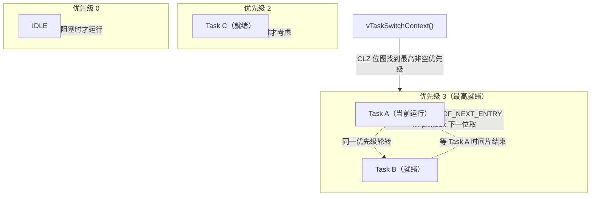

### 2.2 任务加入就绪链表

`prvAddTaskToReadyList`（`tasks.c:265`）做了两件事：

```c
taskRECORD_READY_PRIORITY( ( pxTCB )->uxPriority );
listINSERT_END( &( pxReadyTasksLists[ ( pxTCB )->uxPriority ] ), &( ( pxTCB )->xStateListItem ) );
```

- 更新 `uxTopReadyPriority`；
- 从链表尾部插入，保证同一优先级任务按 FIFO 加入。

### 2.3 选择最高优先级任务

本项目 [portmacro.h](../OS/port/portmacro.h:136) 默认开启 `configUSE_PORT_OPTIMISED_TASK_SELECTION`，任务选择走 CLZ 位图优化（`tasks.c:215`）：

```c
#define taskRECORD_READY_PRIORITY( uxPriority ) \
    portRECORD_READY_PRIORITY( ( uxPriority ), uxTopReadyPriority )

#define taskSELECT_HIGHEST_PRIORITY_TASK()                                       \
    do {                                                                          \
        UBaseType_t uxTopPriority;                                                \
        portGET_HIGHEST_PRIORITY( uxTopPriority, uxTopReadyPriority );            \
        configASSERT( listCURRENT_LIST_LENGTH( &( pxReadyTasksLists[ uxTopPriority ] ) ) > 0 ); \
        listGET_OWNER_OF_NEXT_ENTRY( pxCurrentTCB, &( pxReadyTasksLists[ uxTopPriority ] ) );   \
    } while( 0 )
```

`portRECORD_READY_PRIORITY` 在 `uxTopReadyPriority` 位图上置位；`portGET_HIGHEST_PRIORITY` 用 ARM `CLZ` 指令一次算出最高位。只要 `configMAX_PRIORITIES <= 32`，选择任务就是 O(1)。若不开启优化，则用通用代码从 `uxTopReadyPriority` 向下逐个找非空链表（`tasks.c:178`）。

### 2.4 同一优先级如何轮转

`listGET_OWNER_OF_NEXT_ENTRY`（`../OS/include/list.h:286`）不是取链表头，而是取 `pxIndex` 的下一个：

```c
( pxConstList )->pxIndex = ( pxConstList )->pxIndex->pxNext;
if( ( void * ) ( pxConstList )->pxIndex == ( void * ) &( ( pxConstList )->xListEnd ) )
{
    ( pxConstList )->pxIndex = ( pxConstList )->xListEnd.pxNext;
}
( pxTCB ) = ( pxConstList )->pxIndex->pvOwner;
```

`pxIndex` 每次都停在“上次选中的任务”上，下次从它后面选，因此同优先级任务轮流获得 CPU，这就是时间片轮转的基础。

### 2.5 抢占在哪里发生

- `xTaskIncrementTick()` 发现高优先级任务被解除阻塞时，返回 `pdTRUE`，SysTick 置 PendSV（`../OS/port/port.c:564`）。
- 队列/信号量/事件组/通知唤醒高优先级任务时，会调 `taskYIELD_IF_USING_PREEMPTION()` 或 `taskYIELD_WITHIN_API()`。
- 任务创建时，若新任务优先级高于当前任务，`prvAddNewTaskToReadyList` 也会请求调度（`tasks.c:90` 附近）。

面试时能说清“抢占不是软中断主动打断，而是通过 PendSV 在异常返回时完成切换”，就能体现出对 Cortex-M 移植层的理解。

### 2.5.1 形象化：抢占时序

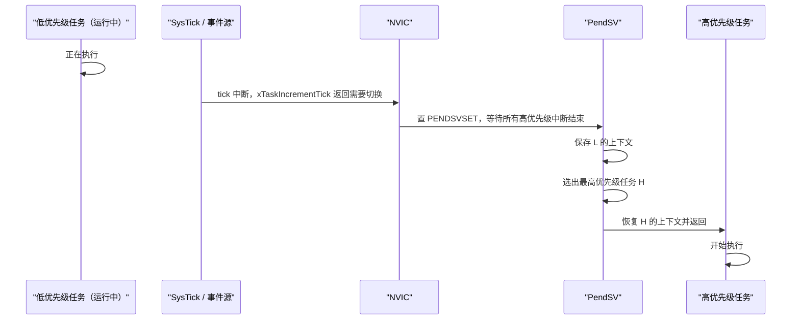

---

## 3. TCB 与任务状态机

### 3.1 TCB 结构

`../OS/src/tasks.c:358`：

```c
typedef struct tskTaskControlBlock
{
    volatile StackType_t * pxTopOfStack;   /* 必须是第一个成员，PendSV 直接用它 */
    ListItem_t xStateListItem;             /* 状态链表项 */
    ListItem_t xEventListItem;             /* 事件等待链表项 */
    UBaseType_t uxPriority;                /* 当前优先级 */
    StackType_t * pxStack;                 /* 栈底 */
    char pcTaskName[ configMAX_TASK_NAME_LEN ];
    UBaseType_t uxBasePriority;            /* 基础优先级，优先级继承用 */
    UBaseType_t uxMutexesHeld;             /* 持有的互斥量数量 */
    volatile uint32_t ulNotifiedValue[ configTASK_NOTIFICATION_ARRAY_ENTRIES ];
    volatile uint8_t ucNotifyState[ configTASK_NOTIFICATION_ARRAY_ENTRIES ];
} TCB_t;
```

关键设计：

- `pxTopOfStack` 必须是第一个成员，因为 [PendSV 汇编](../OS/port/port.c:507) 直接 `ldr r0, [r1]` 读第一个成员。
- `xStateListItem` 决定任务在哪个状态链表里；`xEventListItem` 决定任务在等哪个事件对象。
- 一个任务“同时在两条链表里”是常态：例如阻塞在队列上时，`xStateListItem` 在延时列表，`xEventListItem` 在队列的等待接收列表。

### 3.2 任务状态枚举

`../OS/include/task.h:104`：

```c
typedef enum
{
    eRunning = 0,
    eReady,
    eBlocked,
    eSuspended,
    eDeleted,
    eInvalid
} eTaskState;
```

`eTaskGetState`（`tasks.c:2495` 附近）通过判断 `xStateListItem` 属于哪条链表来推导状态：

- 属于 `pxReadyTasksLists[p]`：Ready，若等于 `pxCurrentTCB` 则 Running；
- 属于 `pxDelayedTaskList` / `pxOverflowDelayedTaskList`：Blocked；
- 属于 `xSuspendedTaskList`：Suspended（无限阻塞也归这里）；
- 属于 `xTasksWaitingTermination`：Deleted；
- 属于 `xPendingReadyList`：Ready（调度器恢复后立即就绪）。

### 3.3 状态迁移路径

- Running -> Ready：被更高优先级任务抢占，或时间片到期。
- Running -> Blocked：`vTaskDelay`、队列/信号量/事件组/通知等待。
- Running -> Suspended：`vTaskSuspend(NULL)`。
- Blocked -> Ready：等待条件满足（事件到达）或超时；若调度器挂起，则先进 `xPendingReadyList`。
- Running -> Deleted：`vTaskDelete(NULL)` 把 TCB 放进 `xTasksWaitingTermination`，空闲任务在 `prvCheckTasksWaitingTermination`（`tasks.c:6044`）里真正释放。

自删任务为什么不能立刻释放内存？因为当前任务的栈和 TCB 正在被 CPU 使用，必须先切换到别的任务，再由空闲任务回收。这就是 `vTaskDelete(NULL)` 后必须保证空闲任务有机会运行的根源。

### 3.3.1 形象化：任务状态机

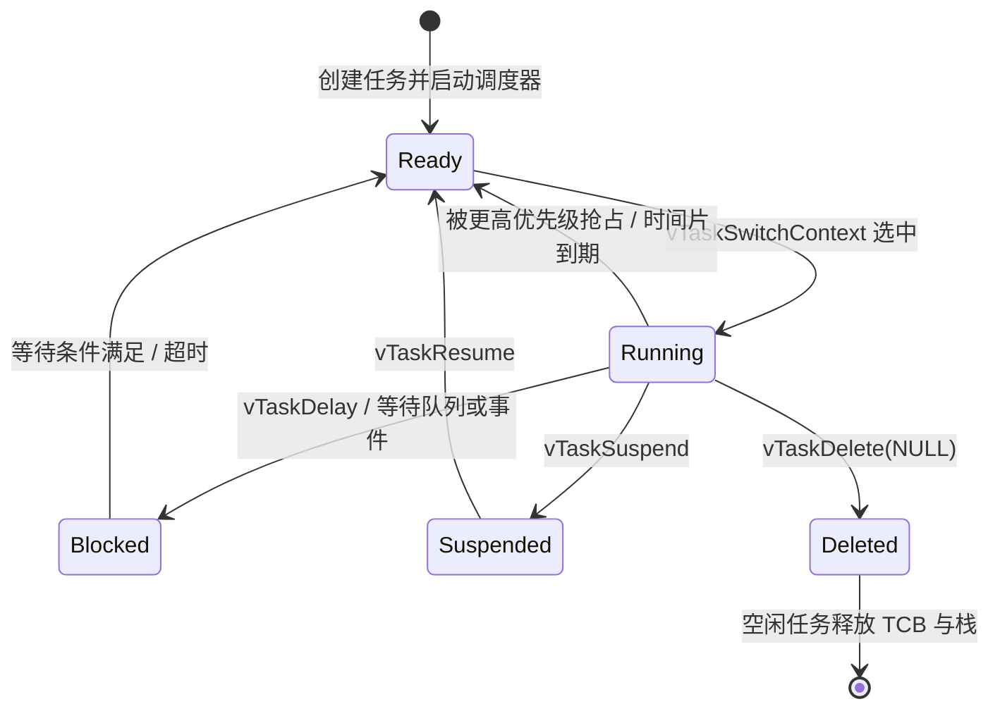

面试可以这样一句话概括：`xStateListItem` 决定“我在哪条队里”，`xEventListItem` 决定“我在等什么”。

---

## 4. 时间管理与延时

### 4.1 tick 递增与延时列表交换

`xTaskIncrementTick`（`tasks.c:4671`）是 SysTick 中断的核心：

```c
xTickCount = xConstTickCount;

if( xConstTickCount == ( TickType_t ) 0U )
{
    taskSWITCH_DELAYED_LISTS();
}
```

`taskSWITCH_DELAYED_LISTS`（`tasks.c:248`）：

```c
configASSERT( ( listLIST_IS_EMPTY( pxDelayedTaskList ) ) );
pxTemp = pxDelayedTaskList;
pxDelayedTaskList = pxOverflowDelayedTaskList;
pxOverflowDelayedTaskList = pxTemp;
xNumOfOverflows++;
prvResetNextTaskUnblockTime();
```

tick 从 `0xFFFFFFFF` 回绕到 0 时，把“当前延时列表”和“溢出延时列表”互换。设计上保证：当前列表里的任务一定已经到期并被清空，溢出列表承接的是“唤醒时间会回绕”的任务。

### 4.2 任务如何进入 Blocked

`prvAddCurrentTaskToDelayedList`（`tasks.c:8416`）：

```c
xTimeToWake = xConstTickCount + xTicksToWait;
listSET_LIST_ITEM_VALUE( &( pxCurrentTCB->xStateListItem ), xTimeToWake );

if( xTimeToWake < xConstTickCount )
{
    vListInsert( pxOverflowDelayedList, &( pxCurrentTCB->xStateListItem ) );
}
else
{
    vListInsert( pxDelayedList, &( pxCurrentTCB->xStateListItem ) );
    if( xTimeToWake < xNextTaskUnblockTime )
    {
        xNextTaskUnblockTime = xTimeToWake;
    }
}
```

计算 `xTimeToWake` 允许加法溢出：如果结果比当前 tick 小，说明唤醒时刻落在回绕之后，放进溢出列表。`xNextTaskUnblockTime` 是“最近一个要醒的任务时间”，tick 中断只检查它，避免每次遍历整条延时链表。

若 `xTicksToWait == portMAX_DELAY` 且允许无限阻塞，任务直接进 `xSuspendedTaskList`，不会因为 tick 回绕被误唤醒。

### 4.3 tick 中断如何解除阻塞

`xTaskIncrementTick` 中：

```c
pxTCB = listGET_OWNER_OF_HEAD_ENTRY( pxDelayedTaskList );
xItemValue = listGET_LIST_ITEM_VALUE( &( pxTCB->xStateListItem ) );
if( xConstTickCount < xItemValue )
{
    xNextTaskUnblockTime = xItemValue;
    break;
}
listREMOVE_ITEM( &( pxTCB->xStateListItem ) );
if( listLIST_ITEM_CONTAINER( &( pxTCB->xEventListItem ) ) != NULL )
{
    listREMOVE_ITEM( &( pxTCB->xEventListItem ) );
}
prvAddTaskToReadyList( pxTCB );
```

因为延时列表按唤醒时刻升序排列，只要队头没到时间，后面一定没到，直接 break。若被唤醒任务优先级高于当前任务，置 `xSwitchRequired = pdTRUE`，最后通过 PendSV 切换。

### 4.3.1 形象化：tick 中断如何唤醒延时任务

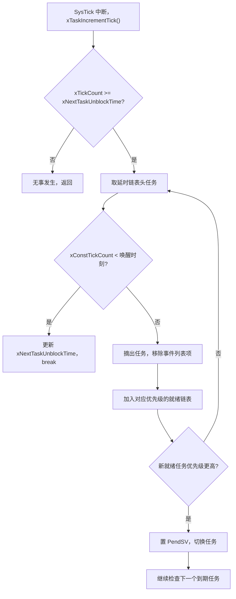

### 4.4 相对延时与绝对延时

`vTaskDelay`（`tasks.c:2435`）：把 `xTicksToDelay` 作为相对量，`prvAddCurrentTaskToDelayedList(xTicksToDelay, pdFALSE)`，唤醒点 = 当前 tick + 延时。若任务在执行过程中被高优先级任务抢占，实际唤醒会推迟。

`xTaskDelayUntil`（`tasks.c:2343`）：使用绝对唤醒点：

```c
xTimeToWake = *pxPreviousWakeTime + xTimeIncrement;
...
prvAddCurrentTaskToDelayedList( xTimeToWake - xConstTickCount, pdFALSE );
```

源码专门处理了 `xTickCount` 回绕的情况：

- tick 已回绕、唤醒点也回绕且仍在未来，则要延时；
- tick 未回绕，唤醒点已回绕，也要延时；
- 其他情况不延时（说明已经错过周期，直接执行并更新 `*pxPreviousWakeTime`）。

这就是周期任务用 `xTaskDelayUntil` 不会累积漂移的原因。

### 4.4.1 形象化：vTaskDelay 与 xTaskDelayUntil 对比

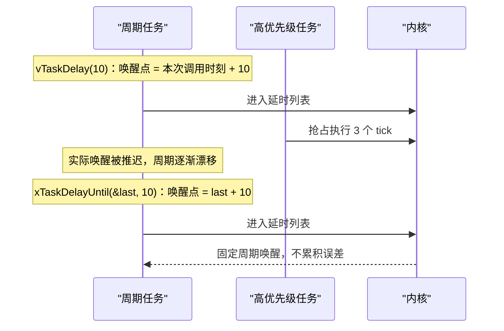

### 4.5 超时如何抗 tick 回绕

`TimeOut_t`（`task.h:125`）：

```c
typedef struct xTIME_OUT
{
    BaseType_t xOverflowCount;
    TickType_t xTimeOnEntering;
} TimeOut_t;
```

`xTaskCheckForTimeOut`（`tasks.c:5535`）：

```c
xElapsedTime = xConstTickCount - pxTimeOut->xTimeOnEntering;
if( ( xNumOfOverflows != pxTimeOut->xOverflowCount ) &&
    ( xConstTickCount >= pxTimeOut->xTimeOnEntering ) )
{
    /* 已经完整回绕过一圈，必超时 */
    xReturn = pdTRUE;
}
else if( xElapsedTime < *pxTicksToWait )
{
    /* 未超时，更新剩余时间 */
    *pxTicksToWait -= xElapsedTime;
    vTaskInternalSetTimeOutState( pxTimeOut );
    xReturn = pdFALSE;
}
```

阻塞 API 的多轮循环中，每次被唤醒后都会重新计算剩余时间，避免“每次重新开始计时”。

### 4.6 调度器挂起与补 tick

`vTaskSuspendAll`（`tasks.c:3811`）只做 `uxSchedulerSuspended++`；`xTaskResumeAll`（`tasks.c:3957`）在计数归零时：

1. 把 `xPendingReadyList` 里的任务搬进就绪链表；
2. 若有更高优先级任务，置 `xYieldPendings`；
3. 处理挂起期间累积的 `xPendedTicks`，逐个调用 `xTaskIncrementTick`，保证 tick 不丢。

这也是“在挂起调度器期间不能调用带非零阻塞时间的 API”的原因：`xTaskCheckForTimeOut` 依赖 tick 推进，而 `prvAddCurrentTaskToDelayedList` 修改链表时不能被打断。

---

## 5. Cortex-M 上下文切换

### 5.1 初始栈帧构造

`pxPortInitialiseStack`（`../OS/port/port.c:204`）按“异常返回时的栈帧”倒序填充：

```c
*pxTopOfStack = portINITIAL_XPSR;      /* xPSR */
*pxTopOfStack = pxCode & portSTART_ADDRESS_MASK;  /* PC */
*pxTopOfStack = portTASK_RETURN_ADDRESS;          /* LR */
pxTopOfStack -= 5;                                /* R12, R3, R2, R1 */
*pxTopOfStack = pvParameters;                     /* R0 */
*pxTopOfStack = portINITIAL_EXC_RETURN;           /* EXC_RETURN */
pxTopOfStack -= 8;                                /* R11-R4 */
```

`portINITIAL_EXC_RETURN = 0xfffffffd` 表示“返回线程模式、使用 PSP”。这样任务第一次被调度时，硬件和 PendSV 恢复寄存器后直接跳进任务函数，看起来就像一次普通的异常返回。

### 5.2 启动第一个任务

`vPortSVCHandler`（`port.c:262`）：

```asm
ldr r3, pxCurrentTCBConst2
ldr r1, [r3]
ldr r0, [r1]
ldmia r0!, {r4-r11, r14}
msr psp, r0
mov r0, #0
msr basepri, r0
bx r14
```

从第一个任务的 TCB 取出初始栈帧，恢复 `r4-r11` 和 EXC_RETURN，设置 PSP，然后 `bx r14` 触发异常返回，任务开始运行。

### 5.3 PendSV 完成上下文切换

`xPortPendSVHandler`（`port.c:507`）核心汇编：

```asm
mrs r0, psp
tst r14, #0x10
it eq
vstmdbeq r0!, {s16-s31}      /* 用到 FPU 才保存 S16-S31 */
stmdb r0!, {r4-r11, r14}     /* 保存剩余通用寄存器 */
str r0, [r2]                 /* r0 写入 pxCurrentTCB->pxTopOfStack */

msr basepri, r0              /* 关中断，保护就绪链表 */
bl vTaskSwitchContext        /* 选择新任务 */
mov r0, #0
msr basepri, r0              /* 重新开中断 */

ldr r1, [r3]
ldr r0, [r1]
ldmia r0!, {r4-r11, r14}     /* 恢复新任务上下文 */
tst r14, #0x10
it eq
vldmiaeq r0!, {s16-s31}
msr psp, r0
bx r14
```

注意：

- 硬件自动保存/恢复 `xPSR, PC, LR, R12, R3-R0`，PendSV 只负责 `R4-R11` 和 EXC_RETURN；
- `vTaskSwitchContext` 调用期间通过 BASEPRI 保护就绪链表，不让其他中断插入；
- FPU 采用 lazy stacking：只有 `EXC_RETURN` 的 bit4 为 0（任务真正用过 FPU）才保存/恢复 `S16-S31`，`S0-S15` 由硬件 lazy save 处理。

### 5.4 SysTick 与 PendSV 的关系

`xPortSysTickHandler`（`port.c:564`）：

```c
if( xTaskIncrementTick() != pdFALSE )
{
    portNVIC_INT_CTRL_REG = portNVIC_PENDSVSET_BIT;
}
```

SysTick 只负责“决定要不要切换”，真正的切换统一交给 PendSV。PendSV 被配置为最低优先级，多个中断可以“攒”到所有高优先级中断处理完后再统一切一次，避免切换抖动。

### 5.4.1 形象化：从请求切换到任务恢复

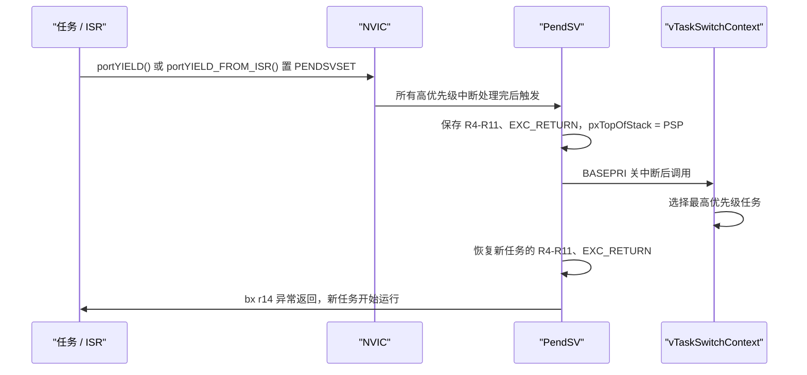

### 5.5 为什么 PendSV/SysTick 必须是低优先级

`xPortStartScheduler`（`port.c:308`）里：

```c
portNVIC_SHPR3_REG |= portNVIC_PENDSV_PRI;
portNVIC_SHPR3_REG |= portNVIC_SYSTICK_PRI;
portNVIC_SHPR2_REG = 0;
```

PendSV 和 SysTick 设为最低优先级，SVC 设为最高。这样应用中断可以嵌套在 tick 之上；而 PendSV 永远在应用中断之后执行，不会打断正在处理的中断。

---

## 6. 临界区与中断

### 6.1 BASEPRI 而不是关总中断

Cortex-M 移植不使用 `CPSID I`，而是操作 BASEPRI（`portmacro.h:213`）：

```c
__asm volatile
(
    "   mov %0, %1    \n"
    "   msr basepri, %0 \n"
    ...
    : "=r" ( ulNewBASEPRI ) : "i" ( configMAX_SYSCALL_INTERRUPT_PRIORITY ) : "memory"
);
```

BASEPRI 掩蔽“优先级数值 >= configMAX_SYSCALL_INTERRUPT_PRIORITY”的中断。数值越小逻辑优先级越高，因此真正的高优先级中断（数值小于阈值）在临界区内仍然可以响应。这就是为什么 `configMAX_SYSCALL_INTERRUPT_PRIORITY` 不能是 0：设成 0 等于不掩蔽任何中断。

### 6.1.1 形象化：BASEPRI 掩蔽范围

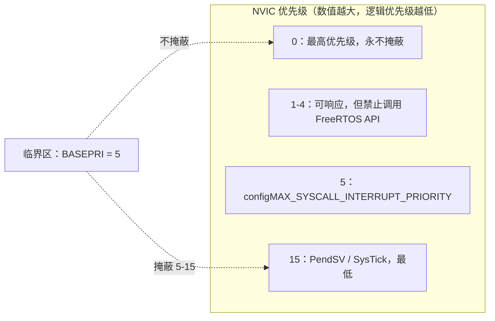

### 6.2 临界区嵌套计数

`vPortEnterCritical` / `vPortExitCritical`（`port.c:478`）：

```c
void vPortEnterCritical( void )
{
    portDISABLE_INTERRUPTS();
    uxCriticalNesting++;
}

void vPortExitCritical( void )
{
    configASSERT( uxCriticalNesting );
    uxCriticalNesting--;
    if( uxCriticalNesting == 0 )
    {
        portENABLE_INTERRUPTS();
    }
}
```

只有嵌套计数归零才真正恢复中断。任务上下文调 `taskENTER_CRITICAL()`；ISR 里必须用 `taskENTER_CRITICAL_FROM_ISR()`，它返回旧 BASEPRI，由 `taskEXIT_CRITICAL_FROM_ISR` 恢复。

### 6.3 ISR 优先级约束

`vPortValidateInterruptPriority`（`port.c:855`）会在每个 FromISR API 入口检查：

```c
configASSERT( ucCurrentPriority >= ucMaxSysCallPriority );
configASSERT( ( portAIRCR_REG & portPRIORITY_GROUP_MASK ) <= ulMaxPRIGROUPValue );
```

含义：

- NVIC 优先级数值必须不小于 `configMAX_SYSCALL_INTERRUPT_PRIORITY`，也就是逻辑优先级不高于它；
- 优先级分组必须把所有 bit 都用作抢占优先级，否则 BASEPRI 掩蔽行为会不符合预期；
- 默认优先级 0 的中断禁止调用 FreeRTOS API，因为它永远在临界区之上。

本项目配置 `configLIBRARY_MAX_SYSCALL_INTERRUPT_PRIORITY = 5`（`FreeRTOSConfig.h:110`），即 NVIC 数值 0-4 的中断只能做纯硬件处理，5-15 才能调 FromISR API。

### 6.4 ISR 为什么不能阻塞

所有 FromISR API 只做“尝试”，失败立即返回，不做 `vTaskSuspendAll`/`prvAddCurrentTaskToDelayedList`。它们通过 `pxHigherPriorityTaskWoken` 告诉调用方“是否唤醒了更高优先级任务”，由调用方在 ISR 末尾决定是否：

```c
portEND_SWITCHING_ISR( xSwitchRequired )
{
    if( xSwitchRequired != pdFALSE )
    {
        portYIELD();   /* 写 ICSR 的 PENDSVSET 位 */
    }
}
```

### 6.5 队列锁与待处理就绪列表

中断在调度器挂起期间唤醒任务时，不能直接改就绪链表，于是把任务放进 `xPendingReadyList`（`tasks.c:5342` 的 `xTaskRemoveFromEventList`）。同时队列用 `cTxLock/cRxLock` 记录“锁定时被 ISR 改写了几次”，等 `prvUnlockQueue` 时再补唤醒（`queue.c:2498`）。

这保证了三条并发路径安全：

- 任务正在进入阻塞（临界区已退出、调度器已挂起）；
- ISR 正在发送/接收；
- 恢复调度器时统一处理 pending ready。

---

## 7. 队列实现

### 7.1 Queue_t 结构

`../OS/src/queue.c:103`：

```c
typedef struct QueueDefinition
{
    int8_t * pcHead;
    int8_t * pcWriteTo;
    union
    {
        QueuePointers_t xQueue;      /* 普通队列：pcTail / pcReadFrom */
        SemaphoreData_t xSemaphore;  /* 信号量/互斥量：xMutexHolder / uxRecursiveCallCount */
    } u;
    List_t xTasksWaitingToSend;
    List_t xTasksWaitingToReceive;
    volatile UBaseType_t uxMessagesWaiting;
    UBaseType_t uxLength;
    UBaseType_t uxItemSize;
    volatile int8_t cRxLock;
    volatile int8_t cTxLock;
} Queue_t;
```

`QueuePointers_t`（`queue.c:69`）：

```c
int8_t * pcTail;      /* 存储区末尾标记 */
int8_t * pcReadFrom;  /* 上一次读出的位置 */
```

### 7.2 环形缓冲与按值拷贝

队列存储区大小 = `uxLength * uxItemSize`，多分配一个字节的尾标记。写数据在 `prvCopyDataToQueue`（`queue.c:2394`）：

```c
memcpy( ( void * ) pxQueue->pcWriteTo, pvItemToQueue, ( size_t ) pxQueue->uxItemSize );
pxQueue->pcWriteTo += pxQueue->uxItemSize;
if( pxQueue->pcWriteTo >= pxQueue->u.xQueue.pcTail )
{
    pxQueue->pcWriteTo = pxQueue->pcHead;
}
```

读数据在 `prvCopyDataFromQueue`（`queue.c:2477`）：

```c
pxQueue->u.xQueue.pcReadFrom += pxQueue->uxItemSize;
if( pxQueue->u.xQueue.pcReadFrom >= pxQueue->u.xQueue.pcTail )
{
    pxQueue->u.xQueue.pcReadFrom = pxQueue->pcHead;
}
memcpy( ( void * ) pvBuffer, ( void * ) pxQueue->u.xQueue.pcReadFrom, ( size_t ) pxQueue->uxItemSize );
```

FreeRTOS 队列传的是“数据的拷贝”，不是指针。对单片机来说，这避免了“发送方栈变量失效”的经典错误，代价是多一次 memcpy。

### 7.2.1 形象化：环形缓冲读写

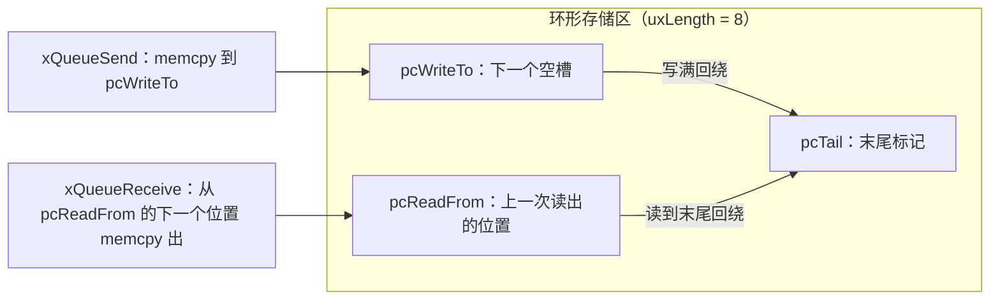

### 7.3 阻塞发送/接收流程

`xQueueGenericSend`（`queue.c:939`）：

1. 临界区内先试一次：有空间就 `prvCopyDataToQueue`，唤醒等待接收的最高优先级任务，成功返回；
2. 队列满且 `xTicksToWait == 0`，返回 `errQUEUE_FULL`；
3. 否则先 `vTaskInternalSetTimeOutState` 记录起点，退出临界区；
4. `vTaskSuspendAll()` + `prvLockQueue()` 锁队列；
5. `xTaskCheckForTimeOut` 检查是否超时；
6. 未超时且仍满，`vTaskPlaceOnEventList(&xTasksWaitingToSend, xTicksToWait)`，把自己挂到事件列表并进入 Blocked；
7. `prvUnlockQueue()` 补处理锁定期内的事件；
8. `xTaskResumeAll()` 返回后决定是否 yield；循环重新尝试。

`xQueueReceive`（`queue.c:1504`）是对称流程，只是挂在 `xTasksWaitingToReceive`。

### 7.3.1 形象化：发送成功后的唤醒链

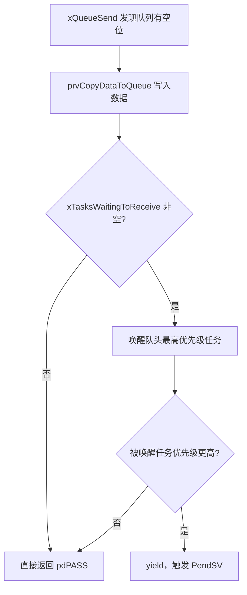

### 7.4 事件列表按优先级排序

`vTaskPlaceOnEventList`（`tasks.c:5244`）：

```c
vListInsert( pxEventList, &( pxCurrentTCB->xEventListItem ) );
prvAddCurrentTaskToDelayedList( xTicksToWait, pdTRUE );
```

事件列表项的值是：

```c
xItemValue = configMAX_PRIORITIES - uxPriority
```

所以值越小优先级越高，`vListInsert` 升序插入后，队头就是最高优先级等待者。`xTaskRemoveFromEventList` 只取队头，因此唤醒顺序天然“高优先级优先”。

### 7.5 FromISR 路径与锁计数

`xQueueGenericSendFromISR`（`queue.c:1159`）：

```c
const int8_t cTxLock = pxQueue->cTxLock;
( void ) prvCopyDataToQueue( pxQueue, pvItemToQueue, xCopyPosition );

if( cTxLock == queueUNLOCKED )
{
    /* 队列没被锁，直接唤醒等待者 */
    if( listLIST_IS_EMPTY( &( pxQueue->xTasksWaitingToReceive ) ) == pdFALSE )
    {
        if( xTaskRemoveFromEventList( ... ) != pdFALSE )
        {
            *pxHigherPriorityTaskWoken = pdTRUE;
        }
    }
}
else
{
    /* 队列被锁，只记录，等 prvUnlockQueue 补唤醒 */
    prvIncrementQueueTxLock( pxQueue, cTxLock );
}
```

`prvUnlockQueue`（`queue.c:2498`）在调度器挂起期间补处理 `cTxLock/cRxLock` 中累积的事件。

---

## 8. 互斥量与优先级继承

### 8.1 互斥量就是特殊队列

创建互斥量 `xQueueCreateMutex`（`queue.c:644`）时，队列长度 1、`uxItemSize=0`，`pcHead` 复用为 `uxQueueType = queueQUEUE_IS_MUTEX`。`SemaphoreData_t`（`queue.c:76`）：

```c
TaskHandle_t xMutexHolder;
UBaseType_t uxRecursiveCallCount;
```

`xQueueSemaphoreTake` 成功拿锁后（`queue.c:1705`）：

```c
pxQueue->u.xSemaphore.xMutexHolder = pvTaskIncrementMutexHeldCount();
```

`prvCopyDataToQueue` 给锁时（`queue.c:2412`）：

```c
xReturn = xTaskPriorityDisinherit( pxQueue->u.xSemaphore.xMutexHolder );
pxQueue->u.xSemaphore.xMutexHolder = NULL;
```

普通二进制信号量没有 `xMutexHolder` 逻辑，也不会触发优先级继承。

### 8.2 优先级继承的触发点

`xQueueSemaphoreTake` 发现锁被占、准备阻塞时（`queue.c:1790`）：

```c
xInheritanceOccurred = xTaskPriorityInherit( pxQueue->u.xSemaphore.xMutexHolder );
```

`xTaskPriorityInherit`（`tasks.c:6581`）：

```c
if( pxMutexHolderTCB->uxPriority < pxCurrentTCB->uxPriority )
{
    if( listIS_CONTAINED_WITHIN( &( pxReadyTasksLists[ pxMutexHolderTCB->uxPriority ] ),
                                 &( pxMutexHolderTCB->xStateListItem ) ) != pdFALSE )
    {
        uxListRemove( &( pxMutexHolderTCB->xStateListItem ) );
        portRESET_READY_PRIORITY( pxMutexHolderTCB->uxPriority, uxTopReadyPriority );
    }
    pxMutexHolderTCB->uxPriority = pxCurrentTCB->uxPriority;
    prvAddTaskToReadyList( pxMutexHolderTCB );
}
```

关键点：

- 从旧优先级就绪链表摘出，修改 `uxPriority`，再按新优先级插入；
- `uxBasePriority` 保持创建/设置时的基础优先级不变；
- 持有者从阻塞等待者那里“继承”优先级，低优先级任务不会饿死高优先级任务；
- 如果持有者当前优先级已经不低（之前继承过），只更新 `uxPriority`，不重复挪链表。

### 8.2.1 形象化：优先级继承

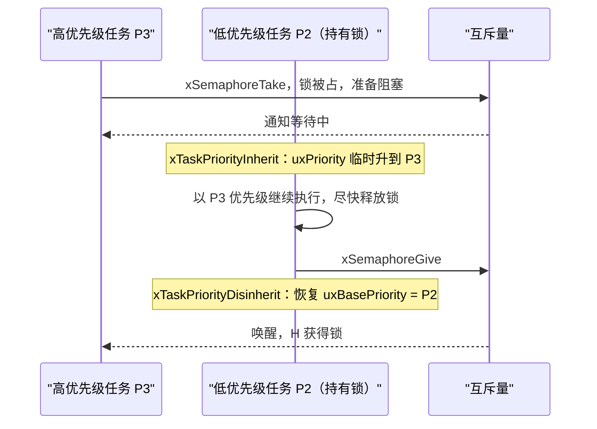

### 8.3 释放时的去继承

`xTaskPriorityDisinherit`（`tasks.c:6684`）：

```c
( pxTCB->uxMutexesHeld )--;
if( pxTCB->uxPriority != pxTCB->uxBasePriority )
{
    if( pxTCB->uxMutexesHeld == 0 )
    {
        uxListRemove( &( pxTCB->xStateListItem ) );
        portRESET_READY_PRIORITY( pxTCB->uxPriority, uxTopReadyPriority );
        pxTCB->uxPriority = pxTCB->uxBasePriority;
        listSET_LIST_ITEM_VALUE( &( pxTCB->xEventListItem ),
                                 configMAX_PRIORITIES - pxTCB->uxPriority );
        prvAddTaskToReadyList( pxTCB );
    }
}
```

只有“不再持有任何互斥量”时才恢复基础优先级，避免“先给 A 再给 B”导致优先级提前跌落。

### 8.4 超时后的去继承

如果等待者超时，持有者的优先级不能简单恢复，还要看“下一个最高优先级的等待者”。`xQueueSemaphoreTake` 超时路径（`queue.c:1858`）调用 `vTaskPriorityDisinheritAfterTimeout`（`tasks.c:6778`），把持有者优先级恢复为：

```c
uxPriorityToUse = max( uxBasePriority, 剩余等待者中的最高优先级 )
```

### 8.5 递归互斥量

`xQueueTakeMutexRecursive`（`queue.c:815`）：

```c
if( pxMutex->u.xSemaphore.xMutexHolder == xTaskGetCurrentTaskHandle() )
{
    ( pxMutex->u.xSemaphore.uxRecursiveCallCount )++;
    return pdPASS;
}
```

同一任务重复 take 只加计数；`xQueueGiveMutexRecursive`（`queue.c:756`）减到 0 才真正释放锁。

---

## 9. 任务通知

### 9.1 数据结构

TCB 里直接内嵌（`tasks.c:419`）：

```c
volatile uint32_t ulNotifiedValue[ configTASK_NOTIFICATION_ARRAY_ENTRIES ];
volatile uint8_t ucNotifyState[ configTASK_NOTIFICATION_ARRAY_ENTRIES ];
```

通知状态（`tasks.c:112`）：

```c
#define taskNOT_WAITING_NOTIFICATION   0
#define taskWAITING_NOTIFICATION       1
#define taskNOTIFICATION_RECEIVED      2
```

通知不需要创建内核对象，接收方就是任务本身。

### 9.2 发送方：xTaskGenericNotify

`xTaskGenericNotify`（`tasks.c:7833`）：

```c
taskENTER_CRITICAL();
{
    ucOriginalNotifyState = pxTCB->ucNotifyState[ uxIndexToNotify ];
    pxTCB->ucNotifyState[ uxIndexToNotify ] = taskNOTIFICATION_RECEIVED;

    switch( eAction )
    {
        case eSetBits:                  pxTCB->ulNotifiedValue[ uxIndexToNotify ] |= ulValue; break;
        case eIncrement:                ( pxTCB->ulNotifiedValue[ uxIndexToNotify ] )++;     break;
        case eSetValueWithOverwrite:    pxTCB->ulNotifiedValue[ uxIndexToNotify ] = ulValue; break;
        case eSetValueWithoutOverwrite:
            if( ucOriginalNotifyState != taskNOTIFICATION_RECEIVED )
            {
                pxTCB->ulNotifiedValue[ uxIndexToNotify ] = ulValue;
            }
            else
            {
                xReturn = pdFAIL;
            }
            break;
        case eNoAction:                 break;
    }

    if( ucOriginalNotifyState == taskWAITING_NOTIFICATION )
    {
        listREMOVE_ITEM( &( pxTCB->xStateListItem ) );
        prvAddTaskToReadyList( pxTCB );
        taskYIELD_ANY_CORE_IF_USING_PREEMPTION( pxTCB );
    }
}
taskEXIT_CRITICAL();
```

源码细节：

- 先改 `ucNotifyState` 再改值，`eSetValueWithoutOverwrite` 通过原始状态判断“上一次通知是否已被消费”；
- 接收任务正在 `taskWAITING_NOTIFICATION` 时，直接把它从延时链表摘出放进就绪链表；
- 整个操作在临界区内完成，避免与接收方的“先检查再置等待标志”竞争丢通知。

### 9.2.1 形象化：一次任务通知

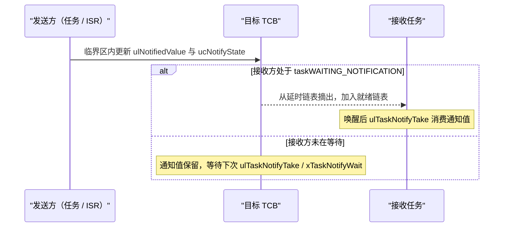

### 9.3 ISR 版本

`xTaskGenericNotifyFromISR`（`tasks.c:7953`）结构相同，但在调度器挂起时：

```c
if( uxSchedulerSuspended == 0 )
{
    listREMOVE_ITEM( &( pxTCB->xStateListItem ) );
    prvAddTaskToReadyList( pxTCB );
}
else
{
    listINSERT_END( &( xPendingReadyList ), &( pxTCB->xEventListItem ) );
}
```

并且如果唤醒的任务优先级更高，置 `*pxHigherPriorityTaskWoken = pdTRUE`，同时 `xYieldPendings[0] = pdTRUE` 兜底。

### 9.4 接收方：Take / Wait

`ulTaskGenericNotifyTake`（`tasks.c:7615`）：

```c
vTaskSuspendAll();
{
    taskENTER_CRITICAL();
    {
        if( pxCurrentTCB->ulNotifiedValue[ uxIndexToWaitOn ] == 0U )
        {
            pxCurrentTCB->ucNotifyState[ uxIndexToWaitOn ] = taskWAITING_NOTIFICATION;
            xShouldBlock = ( xTicksToWait > 0 );
        }
    }
    taskEXIT_CRITICAL();
    ...
    prvAddCurrentTaskToDelayedList( xTicksToWait, pdTRUE );
}
xAlreadyYielded = xTaskResumeAll();
```

检查值和“标记自己在等通知”必须原子，否则 ISR 在两行之间发通知就会丢。唤醒后：

```c
ulReturn = pxCurrentTCB->ulNotifiedValue[ uxIndexToWaitOn ];
if( xClearCountOnExit )  ulNotifiedValue = 0;
else                     ulNotifiedValue = ulReturn - 1;
```

`xTaskGenericNotifyWait`（`tasks.c:7718`）用于位掩码等待，支持 `ulBitsToClearOnEntry/Exit`，返回是否收到通知而不是通知值。

### 9.5 适合场景与限制

- 优点：无内核对象、无队列 memcpy、无优先级继承，最快；
- 限制：接收方是单个任务，不能广播；`eSetValueWithoutOverwrite` 在未消费时会失败；
- 新版本支持 `configTASK_NOTIFICATION_ARRAY_ENTRIES` 多个通知槽位，本项目默认 1。

---

## 10. 软件定时器

### 10.1 组件组成

`../OS/src/timers.c`：

- `Timer_t`：定时器对象，含 `xTimerListItem`、`xTimerPeriodInTicks`、回调函数、`ucStatus`（`timers.c:125`）；
- `xTimerQueue`：命令队列（`timers.c:149`），长度由 `configTIMER_QUEUE_LENGTH` 决定；
- `xActiveTimerList1/2`：活跃定时器按到期时刻排序（`timers.c:143`）；
- `prvTimerTask`：定时器守护任务（`timers.c:748`），优先级 `configTIMER_TASK_PRIORITY`。

### 10.2 守护任务主循环

```c
for( ; configCONTROL_INFINITE_LOOP(); )
{
    xNextExpireTime = prvGetNextExpireTime( &xListWasEmpty );
    prvProcessTimerOrBlockTask( xNextExpireTime, xListWasEmpty );
    prvProcessReceivedCommands();
}
```

流程：

1. 取最近到期时间；
2. 到期则 `prvProcessExpiredTimer` 执行回调；
3. 未到期则用 `vQueueWaitForMessageRestricted` 阻塞在 `xTimerQueue` 上，等待“到期时间”或“新命令”先到；
4. 醒来后清空命令队列。

所以定时器回调运行在守护任务上下文，而不是中断上下文；回调里长时间阻塞会拖死所有定时器。

### 10.2.1 形象化：定时器守护任务循环

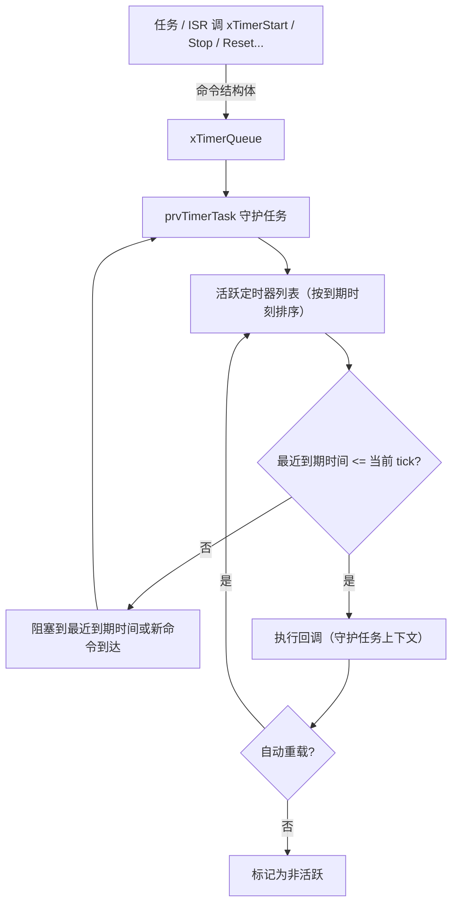

### 10.3 到期处理与自动重载

`prvProcessExpiredTimer`（`timers.c:718`）：

```c
uxListRemove( &( pxTimer->xTimerListItem ) );
if( ( pxTimer->ucStatus & tmrSTATUS_IS_AUTORELOAD ) != 0U )
{
    prvReloadTimer( pxTimer, xNextExpireTime, xTimeNow );
}
else
{
    pxTimer->ucStatus &= ~tmrSTATUS_IS_ACTIVE;
}
pxTimer->pxCallbackFunction( ( TimerHandle_t ) pxTimer );
```

`prvReloadTimer`（`timers.c:699`）处理“守护任务被高优先级任务拖住，错过多个周期”的情况：

```c
while( prvInsertTimerInActiveList( pxTimer, xExpiredTime + pxTimer->xTimerPeriodInTicks,
                                   xTimeNow, xExpiredTime ) != pdFALSE )
{
    xExpiredTime += pxTimer->xTimerPeriodInTicks;
    pxTimer->pxCallbackFunction( ( TimerHandle_t ) pxTimer );
}
```

它会连续补调用错过的周期回调，而不是把时间折叠到一次。

### 10.4 命令如何传递

`xTimerGenericCommandFromTask`（`timers.c:448`）把命令结构体发到 `xTimerQueue`；`xTimerGenericCommandFromISR`（`timers.c:499`）调用 `xQueueSendToBackFromISR`，唤醒守护任务。`prvProcessReceivedCommands`（`timers.c:938`）按 `xMessageID` 分派 `START/RESET/STOP/CHANGE_PERIOD/DELETE`，并处理 tick 回绕导致“启动命令到达时已到期”的边界。

### 10.5 tick 回绕

`prvSampleTimeNow`（`timers.c:871`）发现 `xTimeNow < xLastTime` 时调 `prvSwitchTimerLists`（`timers.c:1086`）交换两条活跃列表；切换前先把当前列表里已到期的定时器全部处理完。这就是定时器也用双列表处理 tick 回绕的原因。

---

## 11. 事件组

### 11.1 数据结构

`../OS/src/event_groups.c:50`：

```c
typedef struct EventGroupDef_t
{
    EventBits_t uxEventBits;
    List_t xTasksWaitingForBits;
} EventGroup_t;
```

就是 32 位事件位 + 等待链表。

### 11.2 控制位

`../OS/include/event_groups.h:43`：

```c
#define eventCLEAR_EVENTS_ON_EXIT_BIT    0x01000000UL
#define eventUNBLOCKED_DUE_TO_BIT_SET    0x02000000UL
#define eventWAIT_FOR_ALL_BITS           0x04000000UL
#define eventEVENT_BITS_CONTROL_BYTES    0xff000000UL
```

高 8 位被内核占用，用户只能使用低 24 位。这些控制位被“借用”存放在任务的 `xEventListItem` 里，所以事件组等待链表不按优先级排序，而是使用 `vTaskPlaceOnUnorderedEventList`（`tasks.c:5273`），并置 `taskEVENT_LIST_ITEM_VALUE_IN_USE`，防止任务优先级变化时覆盖这些位。

### 11.3 等待条件

`prvTestWaitCondition`（`event_groups.c:775`）：

```c
if( xWaitForAllBits == pdFALSE )
{
    xWaitConditionMet = ( ( uxCurrentEventBits & uxBitsToWaitFor ) != 0 );
}
else
{
    xWaitConditionMet = ( ( uxCurrentEventBits & uxBitsToWaitFor ) == uxBitsToWaitFor );
}
```

`xEventGroupWaitBits`（`event_groups.c:312`）：

- 条件已满足：直接返回，可选清位；
- 条件不满足且 `xTicksToWait == 0`：返回当前值；
- 否则把 `uxBitsToWaitFor | xClearOnExit | xWaitForAllBits` 写进 `xEventListItem`，进入 Blocked；
- 唤醒后取回事件项值，若没有 `eventUNBLOCKED_DUE_TO_BIT_SET` 说明是超时；
- 最后清掉控制位，只返回真正的位值。

### 11.4 设置位

`xEventGroupSetBits`（`event_groups.c:547`）：

```c
pxEventBits->uxEventBits |= uxBitsToSet;

while( pxListItem != pxListEnd )
{
    pxNext = listGET_NEXT( pxListItem );
    uxBitsWaitedFor = listGET_LIST_ITEM_VALUE( pxListItem );
    uxControlBits = uxBitsWaitedFor & eventEVENT_BITS_CONTROL_BYTES;
    uxBitsWaitedFor &= ~eventEVENT_BITS_CONTROL_BYTES;

    if( ( uxControlBits & eventWAIT_FOR_ALL_BITS ) == 0 )
    {
        xMatchFound = ( ( uxBitsWaitedFor & pxEventBits->uxEventBits ) != 0 );
    }
    else
    {
        xMatchFound = ( ( uxBitsWaitedFor & pxEventBits->uxEventBits ) == uxBitsWaitedFor );
    }

    if( xMatchFound )
    {
        if( uxControlBits & eventCLEAR_EVENTS_ON_EXIT_BIT )
        {
            uxBitsToClear |= uxBitsWaitedFor;
        }
        vTaskRemoveFromUnorderedEventList( pxListItem,
                                           pxEventBits->uxEventBits | eventUNBLOCKED_DUE_TO_BIT_SET );
    }
    pxListItem = pxNext;
}
pxEventBits->uxEventBits &= ~uxBitsToClear;
```

源码值得讲的三点：

- 先设置事件位，再逐个扫描等待者；
- 用 `pxNext` 而不是 `pxListItem->pxNext`，因为被唤醒的任务可能已经被摘出事件列表；
- 多个等待者可能同时满足，事件组会一次性全部唤醒，这比“一个事件只唤醒一个任务”的通知更接近广播语义。

### 11.4.1 形象化：设置事件位并唤醒等待者

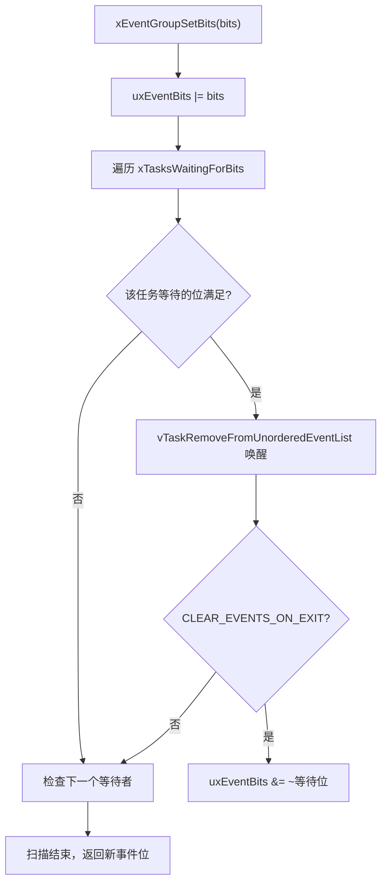

### 11.5 同步屏障

`xEventGroupSync`（`event_groups.c:185`）是 `xEventGroupWaitBits` 的变体：

- 先设置自己的 `uxBitsToSet`；
- 再等 `uxBitsToWaitFor` 全部就绪；
- 唤醒后无条件清除这些位，实现“多人到齐后一起继续”的 rendezvous。

### 11.6 ISR 使用限制

ISR 不能直接遍历事件组等待链表，`xEventGroupSetBitsFromISR`（`event_groups.c:814`）只是把回调挂到软件定时器守护任务：

```c
xReturn = xTimerPendFunctionCallFromISR( vEventGroupSetBitsCallback, ... );
```

所以它依赖 `configUSE_TIMERS` 和守护任务，延迟取决于定时器任务优先级。

---

## 附：面试追问参考

- `uxTopReadyPriority` 在优化选任务模式下为什么是位图，而不是数值？
- 为什么事件组等待链表不用 `vListInsert` 按优先级排序？
- 为什么队列阻塞时先 `vTaskSuspendAll` 再 `prvLockQueue`？
- 为什么 PendSV 里要先用 BASEPRI 关中断，再调 `vTaskSwitchContext`？
- `xTaskDelayUntil` 在 tick 回绕时为什么还能正确计算？
- 互斥量释放时为什么必须检查 `uxMutexesHeld` 和剩余等待者优先级？
- 定时器回调里调用 `vTaskDelay(portMAX_DELAY)` 会有什么后果？
