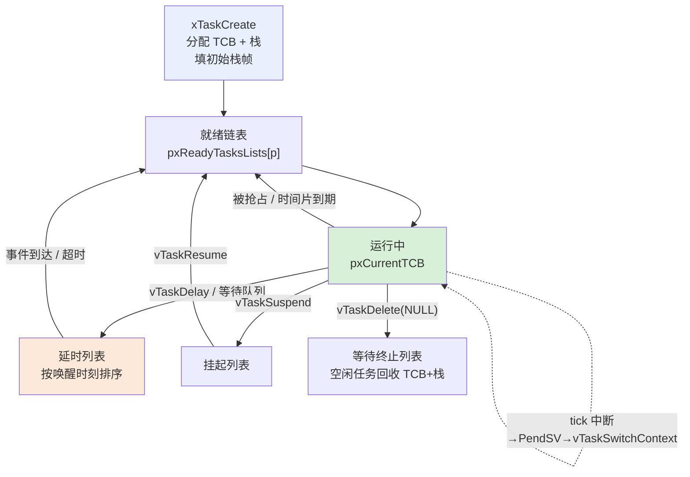

# FreeRTOS 核心机制直观化补充讲义

> 配套《FreeRTOS 核心机制源码级讲解（第 2-11 点）》。
> 目标：把源码翻译成"看得见的画面"——链表指针往哪儿指、栈里每块是什么、PendSV 切换时寄存器怎么搬家。
> 建议配合 `FreeRTOS直观化演示.html` 一起看，文档讲"为什么"，页面让你"动手玩"。

---

## 目录

0. 一张总图：任务的"一生"
1. 内存视角：链表和 TCB 到底长什么样
2. 任务栈：一张图看懂栈帧
3. 上下文切换慢动作（6 步）
4. 调度器的三个关键时刻
5. 时间机制：闹钟模型
6. 优先级继承：一场"插队"大戏
7. 队列：环形缓冲的物理本质
8. 四种同步原语怎么选
9. 常见误区速查
10. 动手实验：用调试器"看见"这些机制

---

## 0. 一张总图：任务的"一生"

先建立全局观，后面每一节都是这张图某一段的放大：



**一句话记住**：任务 = TCB（身份证）+ 栈（工作台）。TCB 里 `xStateListItem` 决定"我在哪条队里"，`xEventListItem` 决定"我在等什么"。调度的本质就是**把任务从一条链表摘下来、挂到另一条链表上**。

---

## 1. 内存视角：链表和 TCB 到底长什么样

源码讲解里反复出现 `List_t`、`ListItem_t`、`vListInsert`，但链表在内存里长什么样、指针怎么串，是文字最难讲清的。

### 1.1 一个节点 = 4 个字段

```c
typedef struct xLIST_ITEM
{
    configLIST_VOLATILE TickType_t xItemValue;  /* 排序用的键值 */
    struct xLIST_ITEM * pxNext;                  /* 指向下一个 */
    struct xLIST_ITEM * pxPrev;                  /* 指向上一个 */
    void * pvOwner;                              /* 指向"属于谁"（TCB） */
} ListItem_t;
```

内存里画出来：

```
ListItem_t（链表节点）
┌─────────────────────────────┐
│ xItemValue   键值（排序用）   │
│ pxNext  ──────────────→ 下一个节点
│ pxPrev  ←────────────── 上一个节点
│ pvOwner ──────────────→ TCB（真正的主人）
└─────────────────────────────┘
```

**关键认知**：链表节点里存的不是任务本身，而是 `pvOwner` 这个**指向任务的指针**。任务在内存里是独立的 TCB 结构，链表只是用 `ListItem_t` 把它们"串"起来。

### 1.2 链表头 = 哨兵节点 + 游标

```c
typedef struct xLIST
{
    UBaseType_t uxNumberOfItems;  /* 链上节点个数 */
    ListItem_t * pxIndex;         /* 轮转游标 */
    MiniListItem_t xListEnd;      /* 哨兵节点（链表的地板） */
} List_t;
```

```
List_t（链表头）
┌──────────────────────────────────────┐
│ uxNumberOfItems = 2                    │
│ pxIndex ──→ 轮转游标（上次选中的任务）   │
│ xListEnd   哨兵节点（值 = 0xFFFF）      │
└──────────────────────────────────────┘
```

三个要点：

- **xListEnd 是哨兵**：空链表也有它，`pxNext`/`pxPrev` 都指向自己。遍历时遇到它就知道"到底了"。
- **pxIndex 是游标**：它停留在"上次选中的任务"上，下次从它的下一个开始选——这就是同优先级轮转的实现。
- **vListInsert 按 xItemValue 升序插入**：所以延时列表的队头永远是"最快醒来的任务"。

### 1.3 一个 TCB 怎么"一脚踩两条船"

原文档说"一个任务同时在两条链表里是常态"。画出来：

```
场景：TaskB（P2）阻塞在队列 Q 上等待数据

        ┌───────── 就绪链表 pxReadyTasksLists[3] ─────────┐
        │  [TaskA·P3]                                     │
        └────────────────────────────────────────────────┘

        ┌───────── 延时列表（Blocked 状态） ────────────────┐
        │  [TaskB] ◄── xStateListItem 挂在"状态链表"        │
        └────────────────────────────────────────────────┘

        ┌───────── 队列 Q 的 xTasksWaitingToReceive ────────┐
        │  [TaskB] ◄── xEventListItem 挂在"事件链表"        │
        └────────────────────────────────────────────────┘

内存中的 TaskB TCB：
┌───────────────────────────────────┐
│ pxTopOfStack                      │
│ xStateListItem  ←→ 延时列表        │  ← 决定状态：Blocked
│ xEventListItem  ←→ 队列等待列表    │  ← 决定等谁：队列 Q
│ uxPriority = 2                    │
│ pxStack                           │
│ ...                               │
└───────────────────────────────────┘
```

**面试一句话**：`xStateListItem` 决定"我在哪条队里"（状态），`xEventListItem` 决定"我在等什么"（事件源）。唤醒 = 从两条链表都摘下来，再挂回就绪链表。

### 1.4 就绪队列完整物理图（3 任务实例）

假设 3 个任务：TaskA(P3, 运行中)、TaskB(P3)、TaskC(P1)，IDLE(P0)：

```
pxReadyTasksLists[]（数组，每个元素是一个 List_t）
│
├── [0] ── List_t ──→ [IDLE]                        ← 最低优先级
├── [1] ── List_t ──→ [TaskC]
├── [2] ── List_t ──→ （空，哨兵自环）
└── [3] ── List_t ──→ [TaskB] ⇄ [TaskA]（pxIndex 停在 TaskA）
                        ↑ 尾部（listINSERT_END）    ↑ 队头
uxTopReadyPriority = 0b1011（bit0, bit1, bit3 置位 → 最高非空 = 3）
```

注意：同优先级用 `listINSERT_END` **从尾部插入**，保证 FIFO；而选任务用 `listGET_OWNER_OF_NEXT_ENTRY` **从 pxIndex 的下一个取**，实现轮转。

---

## 2. 任务栈：一张图看懂栈帧

`pxPortInitialiseStack` 干的活，本质是**伪造一个"刚被打断的现场"**，让任务第一次运行看起来像一次普通的异常返回。

### 2.1 初始栈帧完整布局（高地址 → 低地址）

```
内存地址递减方向（栈向下生长）
▲
│ 高地址
│  ┌─────────────────────────────────┐
│  │ xPSR = 0x01000000  （Thumb 位） │ ←─┐
│  │ PC   = 任务函数入口              │   │
│  │ LR   = prvTaskExitError         │   │ 硬件自动压栈的
│  │ R12                             │   │ 8 个寄存器（异常返回时
│  │ R3                              │   │ 由硬件自动弹出，顺序固定）
│  │ R2                              │   │
│  │ R1                              │   │
│  │ R0   = pvParameters             │ ←─┘
│  │ EXC_RETURN = 0xFFFFFFFD         │ ←─┐
│  │ R11                             │   │
│  │ R10                             │   │
│  │ R9                              │   │ PendSV 软件保存的
│  │ R8                              │   │ 部分（R4-R11 + EXC_RETURN）
│  │ R7                              │   │
│  │ R6                              │   │
│  │ R5                              │   │
│  │ R4                              │ ←─┘
│ 低地址 └─────────────────────────────────┘
│
└ pxTopOfStack 最终指向这里（最低地址）
```

**源码对照**（port.c 的 `pxPortInitialiseStack`，从高地址往低地址填）：

```c
*pxTopOfStack = portINITIAL_XPSR;     /* xPSR：先填最高地址 */
*pxTopOfStack = pxCode & portSTART_ADDRESS_MASK;   /* PC */
*pxTopOfStack = portTASK_RETURN_ADDRESS;           /* LR */
pxTopOfStack -= 5;                    /* 跳过 R12, R3, R2, R1 */
*pxTopOfStack = pvParameters;         /* R0 */
*pxTopOfStack = portINITIAL_EXC_RETURN;             /* EXC_RETURN */
pxTopOfStack -= 8;                    /* 跳过 R11-R4，pxTopOfStack 落在 R4 */
```

### 2.2 为什么"第一个成员是 pxTopOfStack"是硬性约定

PendSV 汇编只靠偏移 0 拿栈顶：

```asm
ldr r3, pxCurrentTCBConst2   ; r3 = &pxCurrentTCB
ldr r1, [r3]                 ; r1 = pxCurrentTCB（TCB 地址）
ldr r0, [r1]                 ; r0 = TCB 第一个成员 = pxTopOfStack ★
```

如果 `pxTopOfStack` 不是第一个成员，这条 `ldr r0, [r1]` 就取错数据。这是移植层和上层**用结构体字段顺序达成的隐式契约**。

### 2.3 运行中被打断的栈长什么样

任务运行到一半被 PendSV 抢走，栈里多出来的部分：

```
任务栈（从下往上）：
┌─────────────────────────────────┐
│ 任务自己的局部变量                 │ ← 任务执行期间压的
│ R4-R11、EXC_RETURN（PendSV 压的） │
│ xPSR PC LR R12 R3 R2 R1 R0       │ ← 进入中断时硬件压的
└─────────────────────────────────┘
                    ↑
            pxTopOfStack 此时指向这里
```

- **硬件自动压**：进异常时压 xPSR/PC/LR/R12/R3-R0（8 个），出异常自动弹。
- **PendSV 软件压**：R4-R11 + EXC_RETURN（`stmdb r0!, {r4-r11, r14}`）。
- 两边加起来，任务的**全部寄存器现场**都在这块栈上，所以换栈顶 = 换任务。

---

## 3. 上下文切换慢动作（6 步）

场景：TaskA（P3）正在跑，SysTick 到点，决定切换到 TaskB（P2）。

```
第 0 步：TaskA 运行中
   PSP → TaskA 栈顶；pxCurrentTCB = TaskA 的 TCB

第 1 步：SysTick 中断
   硬件自动压栈：PSP -= 32，写入 xPSR/PC/LR/R12/R3/R2/R1/R0
   （此时 TaskA 的"硬件现场"已完整存到它自己的栈上）

第 2 步：xTaskIncrementTick() 返回 pdTRUE → 写 PENDSVSET
   SysTick 返回（继续跑 TaskA），NVIC 看到 PendSV 挂起

第 3 步：PendSV 执行（所有高优先级中断都结束后）
   mrs  r0, psp                  ; r0 = TaskA 栈顶
   stmdb r0!, {r4-r11, r14}      ; 压 R4-R11 + EXC_RETURN
   str  r0, [r2]                 ; 新栈顶存回 TaskA TCB → 保存完成 ★
   msr  basepri, r0              ; 关中断（保护就绪链表）
   bl   vTaskSwitchContext       ; 选新任务 → pxCurrentTCB = TaskB
   msr  basepri, r0              ; 开中断

第 4 步：恢复 TaskB
   ldr  r1, [r3]                 ; r1 = TaskB TCB
   ldr  r0, [r1]                 ; r0 = TaskB 栈顶
   ldmia r0!, {r4-r11, r14}      ; 弹 R4-R11 + EXC_RETURN
   msr  psp, r0                  ; PSP = TaskB 栈（剩余部分留给硬件）

第 5 步：bx r14（异常返回）
   硬件自动弹出 TaskB 的 xPSR/PC/LR/R12/R3-R0
   → 直接跳进 TaskB 的 PC 继续执行（就像它从未被打断）
```

```
内存视角的浓缩版：

TaskA 栈                    TaskB 栈
┌─────────────────┐        ┌─────────────────┐
│ 局部变量          │        │ 局部变量          │
│ R4-R11+EXC_RETURN│ ←保存  │ R4-R11+EXC_RETURN│
│ 硬件8寄存器       │ ←硬件  │ 硬件8寄存器       │ ←硬件弹
└─────────────────┘        └─────────────────┘
  PSP ↑（切走）               PSP ↑（切来）
```

**最反直觉的一点**：切换期间 PendSV 里那几行汇编，CPU 用的是**主栈 MSP**（中断栈），而任务的现场都在**进程栈 PSP** 上。所以任务的栈和中断的栈是分开的——这也是为什么任务栈溢出检测要看 PSP 范围，而不是 SP。

---

## 4. 调度器的三个关键时刻

抢占不是"某个软中断主动打断任务"，而是**在三个位置发出"该换人了"的请求，最后由 PendSV 在异常返回边界统一执行**：

```
触发点                        内部动作                    最终效果
─────────────────────────────────────────────────────────────────────
① 创建了更高优先级任务         prvAddNewTaskToReadyList     → portYIELD() 置 PENDSVSET
   （xTaskCreate 内部）         里比较优先级后
─────────────────────────────────────────────────────────────────────
② SysTick 到点                 xTaskIncrementTick()         → 返回 pdTRUE 时
   （每 1ms）                   发现高优先级任务被唤醒         写 PENDSVSET
─────────────────────────────────────────────────────────────────────
③ 队列/信号量/事件组/通知       xTaskRemoveFromEventList     → taskYIELD_IF_USING_
   唤醒了一个高优先级任务       返回"是否唤醒更高优先级"          PREEMPTION()
─────────────────────────────────────────────────────────────────────
```

`uxTopReadyPriority` 位图变化示例（假设 4 个优先级，bit 编号 = 优先级）：

```
初始（只有 IDLE 就绪）       位图 = 0b0001   uxTopReadyPriority = 0
TaskC（P2）创建              位图 = 0b0101   uxTopReadyPriority = 2
TaskA（P3）创建              位图 = 0b1101   uxTopReadyPriority = 3
TaskA 调用 vTaskDelay 阻塞    位图 = 0b0101   uxTopReadyPriority = 2

选最高优先级：
  32 - CLZ(0b1101) - 1 = 3   → 直接定位到 pxReadyTasksLists[3]
```

**为什么 O(1)**：CLZ（Count Leading Zeros）是 ARM 单条指令，一次算出最高置位 bit。只要 `configMAX_PRIORITIES <= 32`，选任务不用遍历。

---

## 5. 时间机制：闹钟模型

把延时机制翻译成生活场景，全部概念一次说清：

### 5.1 延时列表 = 一个按"起床时间"排序的闹钟架

```
闹钟架（xDelayedTaskList，按起床时间升序）
┌──────┬──────┬──────┬──────┐
│ 100  │ 105  │ 110  │ 120  │   ← 每张闹钟 = 一个任务的 xStateListItem
└──────┴──────┴──────┴──────┘
  ↑xNextTaskUnblockTime = 100（最早的一张）

tick 中断每次只做两件事：
1. 看第一张闹钟（100）：tick 到了吗？
   - 没到 → 后面 105/110/120 更没到，直接收工（O(1)）★
   - 到了 → 叫醒（摘出→加入就绪链表），再看下一张
2. 更新 xNextTaskUnblockTime = 下一张未响的闹钟时间
```

**为什么只看第一张**：列表按唤醒时刻升序，队头没到，后面必然没到。这是 `xTaskIncrementTick` 里 `break` 的逻辑。

### 5.2 双列表 = 两个闹钟架轮换（应对 tick 回绕）

问题：`TickType_t`（32 位）计数到 `0xFFFFFFFF` 会回绕到 0。任务睡 1000 tick，入睡时 tick = `0xFFFFFF00`，起床时间 = `0xFFFFFF00 + 1000 = 0x000002E8`——**一个看起来很小的时间**。如果只用一个列表按值排序，这个任务会被排到最前面，立刻被误唤醒。

解法：两个闹钟架轮换。

```
平时：所有任务挂"架 A"（pxDelayedTaskList）
     架 B（pxOverflowDelayedTaskList）为空

tick 从 0xFFFFFFFF 回绕到 0 的那一刻：
   taskSWITCH_DELAYED_LISTS()
   → A、B 互换：A 里已到期的任务早被清空，现在架 B 承接
     "起床时间会落在回绕之后"的任务

新任务入睡时判断（prvAddCurrentTaskToDelayedList）：
   xTimeToWake = tick + xTicksToWait
   if (xTimeToWake < tick)  → 加法溢出了 → 挂"溢出架 B"
   else                     → 挂"当前架 A"
```

**一句话**：回绕把时间轴"折"了一下，双列表就是给折叠后的两个区间各准备一个架子。

### 5.3 vTaskDelay vs xTaskDelayUntil：相对闹钟 vs 绝对闹钟

```
时间轴（每格 = 1 tick，周期 = 10 tick）

vTaskDelay(10) —— 相对闹钟：
任务执行:   [█      ]         [█      ]         [█      ]
            ↑入睡         ↑实际醒(12)      周期漂移累积 → 越来越晚
                     ←高优先级抢走 2 tick→

xTaskDelayUntil(&last, 10) —— 绝对闹钟：
任务执行:   [█      ]        [█      ]        [█      ]
            ↑醒来即设定       ↑固定 10 tick    ↑永不漂移
            下次唤醒 = last+10
```

- `vTaskDelay(10)`：唤醒点 = **本次调用时刻** + 10，被抢占就推迟 → 漂移。
- `xTaskDelayUntil(&last, 10)`：唤醒点 = **上次唤醒点** + 10（绝对），被抢占只影响本次执行时长，不改变下次唤醒时刻 → 不漂移。
- 所以**周期任务必须用 xTaskDelayUntil**，这是它存在的全部意义。

### 5.4 超时抗回绕（TimeOut_t）：电梯里的计时器

```c
typedef struct xTIME_OUT
{
    BaseType_t xOverflowCount;   /* 记录进电梯时内核回绕过几次 */
    TickType_t xTimeOnEntering;  /* 进电梯时的 tick */
} TimeOut_t;
```

类比：你在电梯里用手机计时等超时。**手机日历翻了一天（tick 回绕），电梯还没到** → 必超时，别管剩余时间了。这就是 `xNumOfOverflows != xOverflowCount && tick >= xTimeOnEntering` 判断的含义。

---

## 6. 优先级继承：一场"插队"大戏

场景设定（3 个任务 + 1 个互斥量 M 保护共享资源）：

- **H**：P4 高优先级，想用共享资源（拿 M）
- **M**：P3 中优先级，纯计算任务（跟 M 无关）
- **L**：P2 低优先级，正拿着 M 在用共享资源

### 幕一：H 拿不到锁，阻塞

```
H → xSemaphoreTake(M)：锁被 L 占着 → H 阻塞在 M 的等待列表
（此时如果 M 就绪，M 会抢走 CPU —— 因为 M 是 P3，L 才 P2）

后果：L 永远没机会跑完、释放锁 → H 永远等不到 → 饿死
```

### 幕二：内核启动优先级继承（插队开始）

`xTaskPriorityInherit` 发现持有者 L 的优先级低于等待者 H：

```
L 的 uxPriority：P2 → P4（临时升高，uxBasePriority 仍是 P2）
L 从就绪链表 [2] 摘出 → 插入就绪链表 [4]
```

现在 CPU 上跑的是 L（P4），M（P3）想抢也抢不过——**M 被 L 插队了**。

### 幕三：L 以高优先级快速跑完

```
L（此刻是 P4）继续用共享资源 → 尽快完成任务
M（P3）干着急，但抢不过 P4
```

### 幕四：L 释放锁，去继承

`xTaskPriorityDisinherit` + `prvCopyDataToQueue`：

```
L → xSemaphoreGive(M)
  uxMutexesHeld-- → 0（L 不再持有任何互斥量）
  L 的 uxPriority：P4 → P2（恢复 uxBasePriority）
  L 从就绪链表 [4] 摘出 → 插回 [2]
  H 被唤醒 → H 拿到锁，以 P4 继续跑
```

### 幕五（进阶）：超时后的去继承要"看全场"

如果 H 等锁**超时放弃了**，L 的优先级不能简单恢复 P2——万一还有别的等待者呢？所以走 `vTaskPriorityDisinheritAfterTimeout`：

```
L 的新优先级 = max( uxBasePriority, 剩余等待者中的最高优先级 )
```

**为什么要检查 uxMutexesHeld == 0**：L 可能先拿 M1 再拿 M2。释放 M1 时如果还有 M2 没释放，继承的优先级必须保留（H2 还等着呢），否则优先级提前跌落，H2 又会被饿死。

**没有继承会怎样**（对比图）：

```
有继承：   L(P4)跑完→释放→H(P4)跑    M(P3)最后跑
无继承：   M(P3)插队→H(P4)饿死等着   ← 高优先级被低优先级任务间接拖死
```

---

## 7. 队列：环形缓冲的物理本质

### 7.1 一张图看懂读写指针

假设 `uxLength = 8`、`uxItemSize = 4`（每个槽 4 字节）：

```
存储区 = 8 槽 × 4B + 1B 尾标记 = 33 字节

pcHead ──→ ┌────┬────┬────┬────┬────┬────┬────┬────┬────┐
            │ D1 │ D2 │ D3 │    │    │    │    │    │ ★  │ ← pcTail 标记末尾
            └────┴────┴────┴────┴────┴────┴────┴────┴────┘
              ↑              ↑
         pcReadFrom     pcWriteTo
         （上次读出的位置）（下一个写入位置）

发送：memcpy(pcWriteTo, 数据) → pcWriteTo += 4 → 越界则回绕到 pcHead
接收：pcReadFrom += 4 → 越界则回绕 → memcpy(数据, pcReadFrom)
              （注意：读是先移动再读，因为 pcReadFrom 总是指向"上一次读的位置"）
```

**源码对照**（prvCopyDataToQueue / prvCopyDataFromQueue）：`>= pcTail` 就回绕到 `pcHead`。尾标记那个 `★` 字节不存数据，只用来做边界判断。

### 7.2 按值拷贝：为什么 FreeRTOS 敢这么做

```
发送方任务（栈上局部变量）        队列存储区              接收方任务
┌──────────────────┐    memcpy   ┌──────────┐   memcpy  ┌──────────────────┐
│ uint32_t data=42; │ ──────────→ │  [ 42 ]  │ ────────→ │ uint32_t got;    │
└──────────────────┘             └──────────┘           │ got == 42 ✓      │
        ↑ 函数返回后这块内存就没了                        └──────────────────┘
        （但 42 已经拷贝走了，安全）
```

- **为什么必须按值拷贝**：发送方栈变量在函数返回后失效。如果队列存指针，接收方拿到的是悬垂指针 → 经典 bug。按值拷贝从根上杜绝。
- **代价**：一次 memcpy。4 字节 = 几条 LDR/STR 指令，Cortex-M4F 上可忽略。
- **面试进阶**：所以队列里**不要传大结构体**（拷贝开销大），传指针/句柄即可。需要"数据流 + 大块数据"时用队列传缓冲地址 + 内存池管理生命周期。

### 7.3 满/空判断的物理含义

```
uxMessagesWaiting = 0        → 空：接收会阻塞（等待接收列表）
uxMessagesWaiting = uxLength → 满：发送会阻塞（等待发送列表）
```

队列头里那两个等待列表 `xTasksWaitingToSend` / `xTasksWaitingToReceive`，本质上就是**因为队列满/空而被拦下的任务队列**。队列一空出位置，就从"等待发送列表"里叫醒一个。

---

## 8. 四种同步原语怎么选

| 维度 | 队列 | 信号量 / 互斥量 | 任务通知 | 事件组 |
|---|---|---|---|---|
| 内核对象 | 需要 | 需要 | **不需要** | 需要 |
| 传输内容 | 按值拷贝的数据 | 只有状态（有/无） | 32 位值 / 位 | 24 位事件位 |
| 唤醒 | 单任务（最高优先级等待者） | 单任务 | 单任务 | **可广播**（多个等待者） |
| 优先级继承 | 无 | **互斥量有** | 无 | 无 |
| 开销 | 高（memcpy + 链表） | 中（互斥量有继承开销） | **最低** | 中 |
| 典型场景 | 数据流、命令传递 | 资源互斥（互斥量）/ 事件计数（信号量） | 轻量信号、ISR→任务 | 多条件"任意/全部"组合 |
| ISR 可用 | FromISR 版 | FromISR 版 | FromISR 版 | 受限（走定时器守护任务） |

**选型口诀**：

```
要传数据      → 队列
要保护资源    → 互斥量（有优先级继承，防饿死）
要计数事件    → 计数信号量
只发个信号    → 任务通知（最快，无对象无拷贝）
多个条件组合  → 事件组（任意 / 全部 / 唤醒后清位）
```

**任务通知 vs 信号量的性能差距来源**：通知直接改目标任务的 TCB 字段（临界区 + 链表操作），信号量要走队列机制（`prvCopyDataToQueue` + 事件列表）。所以"无对象、无拷贝"不是营销话术，是真实的结构优势。

---

## 9. 常见误区速查

| # | 误区 | 真相 |
|---|---|---|
| 1 | "上下文切换是在 PendSV 中断里完成的" | 寄存器保存/恢复在 PendSV 里，但**真正切换（改 pxCurrentTCB）发生在 `bx r14` 异常返回边界** |
| 2 | "BASEPRI=5 是关掉优先级低于 5 的中断" | 反了：掩蔽**数值 ≥ 5**（逻辑优先级不高于 5）的中断；数值 0-4（逻辑更高）照常响应 |
| 3 | "互斥量比二进制信号量快" | 相反。互斥量多了一堆持有者追踪 + 优先级继承逻辑，更慢但更安全 |
| 4 | "任务通知是功能受限的慢信号量" | 相反：通知**最快**（无对象无拷贝），代价是只能单播、不能广播 |
| 5 | "vTaskDelay(1) 保证睡 1 个 tick" | 实际睡 **1~2 个 tick**（取决于调用点在 tick 周期的位置，醒来点永远是 tick 边界） |
| 6 | "ISR 里能直接调 xQueueReceive 带超时" | 不行。ISR 必须用 FromISR 版本，且只能"尝试"，失败立即返回 |
| 7 | "事件组有 32 个事件位可用" | 只有**低 24 位**，高 8 位被控制位（`0xFF000000`）占用 |
| 8 | "软件定时器回调在中断里执行" | 在**定时器守护任务**上下文执行，回调里不能长时间阻塞，否则拖死所有定时器 |
| 9 | "uxTopReadyPriority 是个数值" | 在 CLZ 优化模式下是**位图**，靠 `portRECORD_READY_PRIORITY` 置位 |
| 10 | "uxTopReadyPriority 可以小于 0 表示没有就绪任务" | 永远有 IDLE 任务垫底，位图最低位（P0）恒为 1 |

---

## 10. 动手实验：用调试器"看见"这些机制

### 10.1 断点建议（照抄即可用）

| 断点位置 | 观察什么 |
|---|---|
| `vTaskSwitchContext`（tasks.c） | 每次进入都代表一次切换；watch `pxCurrentTCB->pcTaskName` 看换了谁 |
| `xTaskIncrementTick` 里 `xConstTickCount == 0` 分支 | tick 回绕 + 双列表交换（可以把 `TickType_t` 改成 16 位加速触发） |
| `xTaskPriorityInherit`（tasks.c） | watch `pxMutexHolderTCB->uxPriority` 被抬高 |
| `prvCopyDataToQueue`（queue.c） | watch `pxQueue->pcWriteTo` 每次 + uxItemSize，越界回绕 |
| `listGET_OWNER_OF_NEXT_ENTRY` 展开处 | 看 `pxIndex` 游标在同优先级任务间轮转 |

### 10.2 printf 实验清单

```
实验 1：时间片轮转
  两个同优先级任务，各自打印名字。观察打印顺序交替 —— pxIndex 游标在转。

实验 2：优先级继承（3 任务）
  L(P2) 拿锁后 printf("L got lock, pri=%d\n", uxTaskPriorityGet(NULL));
  H(P4) 尝试拿锁 → L 再次 printf 应显示 pri 已被抬到 4
  L 释放锁 → printf 应显示 pri 恢复 2

实验 3：xTaskDelayUntil 不漂移
  周期任务累计 100 个周期，统计实际周期抖动：vTaskDelay 抖动会累积，
  xTaskDelayUntil 抖动恒定在 1 tick 以内。

实验 4：tick 回绕（把 configTICK_RATE_HZ 调大或 TickType_t 改小）
  观察 xTaskIncrementTick 的 xConstTickCount == 0 分支是否触发，
  xNumOfOverflows 是否递增。
```

### 10.3 一个"必考"的现场题

> 在 PendSV 里打断点，为什么 `SP` 不是任务栈顶？

答：PendSV 运行在**主栈 MSP**（中断栈）上，任务的现场在**进程栈 PSP** 上。要观察任务栈，看 `pxCurrentTCB->pxTopOfStack`，而不是当前 SP。

---

## 附：与原文档的对照索引

| 本节 | 对应原文档章节 |
|---|---|
| §1 内存视角 | 第 2 点（调度器与就绪队列）、第 3 点（TCB） |
| §2 任务栈 | 第 5 点 §5.1（初始栈帧构造） |
| §3 切换慢动作 | 第 5 点 §5.2/§5.3（SVC/PendSV） |
| §4 调度关键时刻 | 第 2 点 §2.3/§2.5（选任务、抢占） |
| §5 闹钟模型 | 第 4 点（时间管理与延时） |
| §6 插队大戏 | 第 8 点（互斥量与优先级继承） |
| §7 队列物理本质 | 第 7 点（队列实现） |
| §8 选型对比 | 第 7/8/9/11 点综合 |
| §9 误区速查 | 全文综合 |
