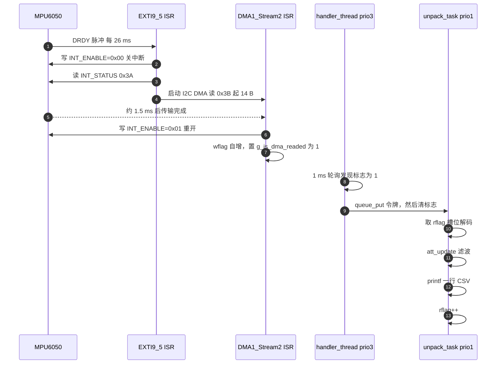

# MPU6050 `unpack_task` 任务逻辑详解

> 适用代码：`Core/Src/FreeRTOS_tasks.c:452-505`（`unpack_task`），依赖 `bsp_mpu6050_handler.c`、`bsp_mpu6050_driver.c`、`bsp_circular_buffer.c`、`Core/Src/iic.c`、`System/OSAL/osal_freertos.c`
> 记录时间：2026-10-18　｜　固件版本：当前工作区（`MPU6050_TEST` 打开，未启用 OTA / LED / 温湿度）

---

## 0. 一句话结论

`unpack_task` 本身只做四件事：**收令牌 → 解 14 字节原始包 → 算 dt 与姿态 → 串口吐一行 CSV**。

它不碰硬件、不读寄存器、不开中断——真正把数据搬进内存的，是 EXTI 中断里发起的一次 I2C DMA。理解这个任务，80% 的难度不在它自己那 50 行，而在**它和三个上游上下文之间的契约**：谁写缓冲区、谁推进指针、谁负责唤醒它，以及这些契约在哪几个点上并不成立。

---

## 1. 它在整条链路里的位置

### 1.1 五个执行上下文

| # | 上下文 | 优先级 | 职责 | 关键代码 |
|---|---|---|---|---|
| 1 | `EXTI9_5_IRQHandler`（PB5，MPU INT 引脚） | NVIC 5 | 关 MPU 中断 → 读中断状态 → 启动 14 字节 I2C DMA | `FreeRTOS_tasks.c:543` / `driver.c:1336` |
| 2 | `DMA1_Stream2_IRQHandler`（I2C2_RX） | NVIC 5 | 收尾 I2C、重开 MPU 中断、推进写指针、置标志 | `iic.c:1290` / `driver.c:1433` |
| 3 | `mpuxxx_handler_thread` | 任务 3 | 每 1 ms 轮询标志，投递一个"令牌"到队列 | `handler.c:237`、`326-340` |
| 4 | **`unpack_task`** | **任务 1** | 等令牌 → 解码 → 滤波 → 输出 | `FreeRTOS_tasks.c:452` |
| 5 | I2C 外设（DMA 引擎） | 硬件 | 100 kHz 把 0x3B 起 14 字节搬进 `circular_buf` 的写槽 | `iic.c:1150-1285` |

注意第 3 个：**handler 线程才是把 `unpack_task` 叫醒的人**，不是中断。中断只置了一个 `uint32_t` 全局标志。

### 1.2 数据流



### 1.3 共享资源清单

| 资源 | 定义位置 | 谁创建 | 谁写 | 谁读 | 容量 | 并发保护 |
|---|---|---|---|---|---|---|
| `circular_buf.buffer` | `bsp_circular_buffer.c:43` | handler 线程 `buffer_init(&circular_buf, 10)` | DMA（只有写槽） | unpack | 10 槽 × 14 B = 140 B（malloc） | **无** |
| `circular_buf.wflag` | 同上 | — | DMA ISR | （无人读） | uint8_t | 8 位写入天然原子 |
| `circular_buf.rflag` | 同上 | — | unpack | unpack | uint8_t | 只有读者碰 |
| `g_is_dma_readed` | `driver.c:12` | 静态 0 | DMA ISR | handler | uint32_t | **无（读-清非原子）** |
| `p_unpack_queue_handle` | `handler.c:107` 创建 | handler 线程 | handler | unpack | 20 项 × 1 B | FreeRTOS 队列 |
| `handler_instance` | `handler.c:11` | 全局零初始化 | handler 线程 | unpack / EXTI | 结构体 | 事实上"初始化期间只写" |

---

## 2. `unpack_task` 逐段拆解

### 2.1 函数骨架与静态上下文

```c
void unpack_task(void *pvParameters) {
    static att_ctx_t att;                       /* 453 */
    float    acc[3], gyro[3];
    uint32_t tick_now = 0, tick_last = 0;
    float    dt;

    log_i("unpack task start");
    for (;;) {
        ...
    }
}
```

四个要点：

1. **`att` 是 `static`**，不在栈上。它必须跨越 `for(;;)` 的每次迭代保存 roll/pitch/yaw 与零偏，用 static 是合理的；副作用是**这个任务天然只能有一个实例**（多实例会共享同一份姿态）。任务栈 1024 字（4 KB）里放不下也没必要。
2. `acc`/`gyro`/`dt` 是普通局部变量，每次迭代重建。
3. `tick_last` 会跨迭代保存，初值 0 —— 这让**第一帧的 dt 会是一个巨大值**（上电到首帧的毫秒数），靠后面第 2.7 节的 clamp 兜住。
4. `log_i("unpack task start")` 走 easylogger，最终是 `printf`。它带 ANSI 颜色码与前缀，所以**只能打这种一次性提示，绝不能用来发数据帧**（见 2.10）。

### 2.2 启动闸门：等队列句柄

```c
if (NULL == handler_instance.p_unpack_queue_handle) {   /* 461 */
    vTaskDelay(1);
    continue;
}
```

- 目的：`unpack_task` 在 `app_task_create()` 里被创建（`FreeRTOS_tasks.c:593`），而队列是在 **handler 线程内部**才创建的（`handler.c:107`）。两个任务都只是被创建、还没跑；调度器启动后 handler（prio 3）先跑，创建队列，unpack（prio 1）后跑。
- 因此正常情况下这一句**一次都不会命中**。它存在的意义是：如果有人把 `unpack_task` 的优先级调到 3 以上，或改成先创建 unpack，这里能避免空指针。
- 代价：一旦命中，就是 `vTaskDelay(1)` 的 1 ms 轮询；不命中则零开销。
- 注意它是**只读**判断，没有锁。`handler_instance` 在初始化期间被写，初始化完成后不再变，所以不需要锁。

### 2.3 阻塞取令牌

```c
uint8_t data = 0;
if (handler_instance.p_input_args->p_queue->queue_get(
        handler_instance.p_unpack_queue_handle, &data, portMAX_DELAY) != 0) {
    continue;                                            /* 469 */
}
```

| 细节 | 说明 |
|---|---|
| 调用路径 | `osal_queue_freertos.queue_get` → `xQueueReceive`（`osal_freertos.c:100-116`） |
| `portMAX_DELAY` | `0xFFFFFFFF`，OSAL 里被特判成 `portMAX_DELAY`（真无限等），不是 `pdMS_TO_TICKS(0xFFFFFFFF)` |
| 返回值 | `OSAL_OK == 0` 才算成功；超时/空句柄返回非 0。这里 `!= 0` 就 `continue` |
| `data` 的用途 | **完全没用**。令牌值是 `handler` 里的 `uint8_t data = 1`，内容是垃圾，语义只是"来了一个事件" |
| 队列规格 | 20 项 × 1 字节（`handler.c:266-267`） |

这里的 `data` 变量是一个可以简化掉的冗余（直接传一个 dummy 即可），但也无害。

一个隐藏风险：如果 `xQueueReceive` 因为句柄非法立刻返回错误，这个循环会**空转烧 CPU**（没有 delay）。当前不会发生，因为句柄在 2.2 已判非空。

### 2.4 取读槽地址与 14 字节布局

```c
uint8_t *addr = circular_buf.pf_get_rbuffer_addr(&circular_buf);   /* 472 */
```

`get_rbuffer_addr()` 的实现只有一行（`bsp_circular_buffer.c:12`）：

```c
return buffer->buffer + buffer->rflag * MPU6050_DATA_PACKET_SIZE;   /* 14 */
```

包是从 **0x3B（ACCEL_XOUT_H）** 开始的一次 burst 读，14 字节，顺序由芯片固定：

| 索引 | 内容 | `unpack_task` 是否使用 | 说明 |
|---|---|---|---|
| `[0] [1]` | AX_H / AX_L | ✅ | 大端补码 |
| `[2] [3]` | AY_H / AY_L | ✅ | |
| `[4] [5]` | AZ_H / AZ_L | ✅ | |
| `[6] [7]` | TEMP_H / TEMP_L | ❌ **跳过** | 温补没用上，见 P2-12 |
| `[8] [9]` | GX_H / GX_L | ✅ | 注意从 8 开始，不是 6 |
| `[10] [11]` | GY_H / GY_L | ✅ | |
| `[12] [13]` | GZ_H / GZ_L | ✅ | |

**为什么陀螺从 `[8]` 开始**：温度占了 6、7 两字节。这是全函数最容易写错的地方——写成 `[6]` 起就会把温度当 GX。

burst 读还有一个重要性质（RM §4.24）：芯片内部有"用户可见寄存器"的影子副本，**串口空闲时才整体拷贝**，所以一次连续读 14 字节保证所有轴来自同一采样时刻。如果拆成 3 次单字节读，就会读到跨采样时刻的混合数据。

### 2.5 解码：大端补码 → 物理量

```c
acc[0]  = (int16_t)((uint16_t)addr[0] << 8 | addr[1]) / MPU_ACC_LSB_PER_G;
...
gyro[0] = (int16_t)((uint16_t)addr[8] << 8 | addr[9])  / MPU_GYRO_LSB_PER_DPS;
```

逐层拆开这个表达式：

1. `addr[0]` 是 `uint8_t` → 整型提升为 `int`。
2. `(uint16_t)addr[0]` 先截回 16 位无符号，`<< 8` 把它放进高字节。**必须先转 `uint16_t`**：若直接 `addr[0] << 8` 得到 `int`，值永远非负，后面转 `int16_t` 也救不回符号（虽然这里最终结果一样，但换成 `int8_t` 缓冲区就是灾难）。
3. `| addr[1]` 拼低字节，得到 16 位无符号位模式。
4. `(int16_t)` 把位模式按二进制补码解释 → 有符号原码。
5. 除以灵敏度系数转物理量（单精度浮点，走 F411 的硬件 FPU）。

**换算系数（必须与初始化写入的量程严格一致）**：

| 量 | 宏 | 当前值 | 对应量程 | 1 LSB 分辨率 | 满量程码值 |
|---|---|---|---|---|---|
| 加速度 | `MPU_ACC_LSB_PER_G` | 16384.0f | ±2 g（`AFS_SEL=0`，`driver.c:1197`） | 61 µg | ±32768 → ±2.0 g |
| 角速度 | `MPU_GYRO_LSB_PER_DPS` | 16.4f | ±2000 dps（`FS_SEL=3`，`driver.c:1186`） | 0.061 dps | ±32768 → ±1998 dps |

> **历史坑（已修）**：曾出现 `FS_SEL=3`（16.4）却除以 `131.0`，所有角速度小 8 倍，yaw 转 90° 只显示 11.3°。今天已在 `driver.c:15`、`driver.c:130/181` 一并修正。这两个宏与量程是**强耦合**的，改一处必须改另一处。

解码示例（便于手算核对）：

| 原始字节 | 位模式 | `int16_t` | acc（÷16384） | gyro（÷16.4） |
|---|---|---|---|---|
| `00 00` | 0x0000 | 0 | 0.000 g | 0.00 dps |
| `40 00` | 0x4000 | 16384 | +1.000 g | +999.0 dps |
| `C0 00` | 0xC000 | -16384 | -1.000 g | -999.0 dps |
| `FF 9C` | 0xFF9C | -100 | -0.006 g | **-6.10 dps** |
| `7F FF` | 0x7FFF | +32767 | +2.000 g | +1998.0 dps |
| `80 00` | 0x8000 | -32768 | -2.000 g | -1998.0 dps |

### 2.6 释放槽位

```c
circular_buf.pf_data_readed(&circular_buf);   /* rflag = (rflag + 1) % 10 */
```

位置很关键：**在读完之后、任何 `continue` 之前**。这意味着即使后面因为标定或异常提前 `continue`，槽位也已经归还——不会卡住生产者。

但它是**无条件推进**的：函数不检查"这个槽位是否真的被写过"（`bsp_circular_buffer.c:24-29` 里的 `todo: 没有可读数据` 一直没实现）。它之所以成立，完全依赖"令牌数 == 已写槽位数"这个不变量，而这个不变量有一个会破的地方（见第 4 章）。

### 2.7 dt：为什么必须实测

```c
osal_time_base_freertos.get_tick_ms(&tick_now);   /* 486 */
dt = (tick_now - tick_last) / 1000.0f;
tick_last = tick_now;
if (dt <= 0.0f || dt > 0.2f) dt = 0.02f;          /* 489 */
```

`get_tick_ms()` = `pdTICKS_TO_MS(xTaskGetTickCount())`（`osal_freertos.c:40-50`），tick 频率 1000 Hz，**分辨率 1 ms**。

为什么不能写死 `0.02f`：

1. **实际周期不是 20 ms**。`SMPLRT_DIV = 0x19 = 25`，DLPF 开启时陀螺输出率 1 kHz → `1000/(1+25) = 38.46 Hz` → **26.0 ms**。写死 0.02 会让积分量少 23%。
2. **中断不是等间隔**。DMA 完成到任务被唤醒之间有 0~1 ms 的轮询量化，加上 printf 阻塞，帧间隔会在 25~29 ms 之间抖动。固定 dt 会把这些抖动累积成角度误差。
3. **断点、串口阻塞、调度抖动**都会让个别帧间隔异常。

clamp 的语义：

| 情形 | `dt` 计算值 | 处理 | 后果 |
|---|---|---|---|
| 正常帧 | 0.026 s | 原样使用 | 正确 |
| 丢 1 帧 | 0.052 s | 原样使用 | 正确（补回丢掉的角度） |
| 丢 ≥ 8 帧 | > 0.2 s | 强制 0.02 | 丢掉 0.18 s 的转动，**角度偏小** |
| 首帧（`tick_last=0`） | 上电毫秒数 | 强制 0.02 | 首帧积分量可忽略，无害 |
| tick 回绕 | 无符号相减 | 正确 | `uint32_t` 相减自动取模，49.7 天一次 |

**已知精度上限**：1 ms 分辨率 / 26 ms 周期 → 单帧 dt 量化误差最大 ±1.9%；对 yaw 是**累积偏差**（每帧都偏一点），对 roll/pitch 由重力校正吃掉。

### 2.8 标定分支：上电静止 13 秒

```c
if (!att.bias_ready) {            /* 492 */
    att_calib_gyro(&att, gyro);
    continue;
}
```

`att_calib_gyro()`（`FreeRTOS_tasks.c:404-418`）只做累加平均：

```c
if (p->bias_ready) return;
for (i<3) p->bias_acc[i] += gyro[i];
if (++p->bias_cnt >= ATT_CALIB_FRAMES) {          /* 500 */
    for (i<3) p->gyro_bias[i] = p->bias_acc[i] / 500.0f;
    p->bias_ready = 1;
}
```

关键数字：

- `ATT_CALIB_FRAMES = 500`，实际帧率 38.46 Hz ⇒ **13.0 秒**（注释写"50Hz 约 10s"，是按错误的 50 Hz 算的）。
- 这 13 秒里 `continue` 跳过了解算与输出，**串口一个字节都没有**。调参时最容易误判为"程序没跑起来"。
- 标定期间的 dt 仍然被计算、`tick_last` 仍然更新（第 2.7 节在 `continue` 之前），所以标定结束后的第一帧 dt 是正常值，不会因为"跳过了 500 帧"而爆成一个巨大 dt。**这个顺序不能调换**。
- 标定采用**无条件前 500 帧平均**：如果上电时板子在动，零偏就带进运动分量，而且**一辈子不会再校正**（`bias_ready` 是单向门）。
- 手册依据：MPU-6050 PS §6.1，`Initial ZRO Tolerance ±20 °/s`。±20 dps 的初始零偏如果不标，yaw 一分钟就能漂几百度——所以这一步是必需的，不是可选优化。

### 2.9 姿态解算 `att_update`

```c
att_update(&att, acc, gyro, dt);   /* 498 */
```

函数体 28 行（`FreeRTOS_tasks.c:421-448`），四个阶段：

#### ① 去零偏 + 死区

```c
w[i] = gyro[i] - p->gyro_bias[i];
if (fabsf(w[i]) < ATT_GYRO_DEADBAND_DPS) w[i] = 0.0f;   /* 0.20 dps */
```

- 去零偏是**必须**的：残余 0.6 dps 的零偏，60 秒就能让 yaw 漂 36°。
- 死区 0.2 dps 的作用是压住静止时的量化抖动（±2.4 LSB 噪声在 ±2000 量程下约 ±0.15 dps）。
- **代价**：真实转速小于 0.2 dps 的转动会被完全吃掉（0.2 dps = 3 分钟转 36°）。慢速转动手表时 yaw 会"卡住不动"，这是死区的直接后果，不是算法坏。
- 死区对 **yaw 也生效**，而 yaw 没有任何绝对参考来纠错，所以慢转丢失在 yaw 上是**不可恢复**的。

#### ② 陀螺积分

```c
roll  = p->roll  + w[0] * dt;
pitch = p->pitch + w[1] * dt;
yaw   = p->yaw   + w[2] * dt;
```

这是**小角度近似**：直接把机体角速度的三个分量当作欧拉角速率。严格做法需要乘以方向余弦矩阵（`φ̇ = p + q·sinφ·tanθ + r·cosφ·tanθ` 等）。近似误差量级：

| 倾角 | 用近似式积分 45° 的误差（估） |
|---|---|
| < 10° | < 1% |
| 30° | 约 5~10% |
| 60° | 约 30%，且 yaw 与 roll 交叉污染 |

手表抬腕场景倾角通常 < 45°，可以接受；做全姿态（如体感手柄）就不够，需要 Mahony/四元数。

#### ③ 加速度计校正：模长门控

```c
float n = sqrtf(ax² + ay² + az²);
if (fabsf(n - 1.0f) <= ATT_ACC_TOL_G) {   /* 0.25 g */
    ...
}
```

- 静止时加速度模长应为 1 g。偏离 0.25 g 以上说明存在**线性加速度**（晃、摔、抬腕加速），此时重力矢量的方向被污染，不能用来校正。
- 门控命中时**这一帧完全不做校正**，只靠陀螺积分——短时间没问题，长时间被拒会导致 roll/pitch 也缓慢漂移。
- 阈值 0.25 g 是经验值：太严（0.05）会被噪声误触发，太松（0.5）会把真实运动当成重力。

#### ④ 反三角 + 一阶互补

```c
float a_roll  = atan2f(ay, az) * 57.29578f;
float a_pitch = atan2f(-ax, sqrtf(ay*ay + az*az)) * 57.29578f;
float k = ATT_TAU_S / (ATT_TAU_S + dt);        /* 0.5/(0.5+0.026) = 0.9506 */
roll  += (1.0f - k) * att_wrap180(a_roll  - roll);
pitch += (1.0f - k) * att_wrap180(a_pitch - pitch);
```

- **`atan2f` 而不是 `asin`**：`atan2` 在 ±180° 全范围有效且不会因除法溢出，`asin` 在 ±90° 边界会炸。
- **`att_wrap180(diff)`** 是必须的：如果 roll 在 +179°、测量值在 -179°，直接相减得 358°，校正会把角度瞬间拽向反方向。取回绕后差值变成 -2°，才是正确的短路径。
- **k 的物理含义**：一阶低通/高通互补结构，`k = τ/(τ+dt)`，`τ = 0.5 s`。等效于"陀螺积分占 95%，加速度计每帧拉回 4.94%"。
  - 时间常数 0.5 s = 校正到 63% 所需时间；完全收敛约 2~3 s。
  - τ 越大越信陀螺（抗晃、但校正慢、上电收敛慢）；τ 越小越信加速度计（跟得快、但被线性加速度骗）。0.5 s 对 38 Hz 采样是合理值。
  - 稳态卡尔曼增益这组参数下约为 0.043，与 `1-k = 0.049` 几乎等价——**换成卡尔曼在一维静止场景基本看不出差别**。
- **roll 与 pitch 的公式不对称**：`roll = atan2(ay, az)` 以 az 为分母，pitch 用 `sqrt(ay²+az²)` 做分母。这是标准约定（先绕 Z 轴转 roll，再绕 Y 轴转 pitch），与 `+X 向前、+Z 向下` 的机体定义配套。
- **符号约定**：绕 +X 轴正转（右手定则）会得到**负的 roll**。若发现 cube 转向相反，是符号约定问题，不是算法错，取反即可。

#### ⑤ 回绕与钳位

```c
p->roll  = att_wrap180(roll);
p->pitch = (pitch > 89) ? 89 : (pitch < -89) ? -89 : pitch;
p->yaw   = att_wrap180(yaw);
```

- `att_wrap180` 用 `while` 循环（`FreeRTOS_tasks.c:396-401`）。因为每帧都回绕，最多循环 1~2 次，开销可忽略。
- **pitch 钳到 ±89°**：pitch 的物理范围只有 ±90°，钳位是防止数值在边界抖动导致 `atan2` 跳变。
- 钳位有个副作用：`p->pitch` 被钳后，下一帧仍以钳位值为积分起点，**真实角度超过 89° 时会被"粘住"**，直到陀螺把它拉回来。这不是 bug，是欧拉角在万向节锁附近的固有缺陷（用四元数可解）。

### 2.10 输出：为什么必须是 `printf`

```c
printf("%.2f,%.2f,%.2f\r\n", att.roll, att.pitch, att.yaw);   /* 503 */
```

| 事实 | 依据 |
|---|---|
| 输出走 USART1，**115200 8N1** | `usart.c:221` |
| `printf` → `_write` → `__io_putchar` → `USART1_SendByte` | `syscalls.c:80-87`、`main.c:99` |
| `USART1_SendByte` 是**阻塞**的，每字符等 TXE | `usart.c:176-181` |
| 单字符耗时 ≈ 10 bit / 115200 = **86.8 µs** | — |
| 一行 `"12.34,56.78,-123.45\r\n"` ≈ 23 字符 ⇒ **≈ 2.0 ms** | 实测可测 |
| 浮点支持来自链接参数 `-u _printf_float` | `cmake/gcc-arm-none-eabi.cmake:44` |

**绝不能用 `log_i`**：easylogger 会加 `[时间] I(unpack_task):` 前缀和 ANSI 颜色码（`elog.c` 的 `ELOG_COLOR_ENABLE`），VOFA+ 的 FireWater 协议靠逗号与换行解析，前缀会直接破坏帧结构。

**协议选择**：当前用 FireWater（纯文本 CSV），优点是肉眼可读、VOFA+ 直接认；缺点是**没有帧同步标记**，一旦串口丢一个字节，后续所有帧错位且无法自恢复。若发现数据错乱，优先怀疑这里——或换 JustFloat（帧尾 `00 00 80 7F` 自同步）。

**单写者假设**：`elog_port_output_lock()` 是空实现，`printf` 没有互斥。当前只有这个任务在周期打印，所以安全。一旦其它任务也开始打印，就会出现**两个任务交错输出、帧被切碎**。这是必须记住的约束。

---

## 3. 一次采样的完整时序与预算

```
t=0    DRDY 上升 → 50 µs 脉冲（INT 引脚默认配置：推挽、高有效、非锁存）
t=50µs 脉冲下降沿 → EXTI9_5 触发
       ├─ 关 MPU 中断         I2C 写 1 字节  ≈ 0.30 ms
       ├─ 读 INT_STATUS(0x3A) I2C 读 1 字节  ≈ 0.36 ms
       └─ 启动 DMA（写寄存器+重启读地址）    ≈ 0.27 ms
                                          小计 ≈ 0.93 ms  ← 在 ISR 里！
t≈1.0ms I2C DMA 搬 14 字节 (126 SCL 周期)     ≈ 1.5 ms（代码注释实测值）
t≈2.5ms DMA ISR：重开中断(0.30ms) + wflag++ + flag=1
t≈2.5~3.5ms handler 1 ms 轮询命中 → queue_put
t≈3.5ms unpack_task 被唤醒（优先级 1 < handler 3，等 handler vTaskDelay 后才轮到）
        ├─ 解码 12 个 int16 + 6 次除法 ≈ 10 µs (-O0)
        ├─ att_update（含 2 次 atan2f + 2 次 sqrtf）≈ 8.5 µs (-O0)
        └─ printf 23 字节              ≈ 2.0 ms
t≈5.5ms VOFA+ 收到这一帧
```

| 指标 | 数值 | 说明 |
|---|---|---|
| 采样周期 | **26.0 ms**（38.46 Hz） | `1000/(1+25)`，**不是注释里的 50 Hz** |
| 端到端延迟 | **≈ 4.5~5.5 ms** | DRDY 到串口出数，主要由 I2C 1.5 ms + 轮询 1 ms + printf 2 ms 构成 |
| 吞吐占用 | 23 B / 26 ms ≈ **8.8 kbit/s**，占 115200 的 7.7% | 余量充足 |
| `unpack_task` CPU 占用 | (10+8.5+2000) µs / 26 ms ≈ **7.8%** | printf 占其中 99% |
| handler CPU | 1000 次/s 唤醒 ≈ 无法忽略 | 空转轮询，见 P1-7 |
| 任务栈 | 各 1024 字 = 4 KB × 2 | 堆总量 75 KB（`FreeRTOSConfig.h:63`） |

> 上述 µs 级数字按 100 kHz I2C 与 100 MHz 主频**估算**，其中 I2C 14 字节的 1.5 ms 有代码注释佐证（`iic.c:1165`）。要精确请按第 6 章的方法实测。

---

## 4. 并发与正确性分析（重点）

### 4.1 令牌与槽位的 1:1 契约

整条链路隐含一个不变式：

> **`queue_put` 的次数 == `wflag` 自增的次数 == `rflag` 自增的次数**

成立时，`rflag` 永远指向"最老的未读槽"，读者拿到的就是最新的未消费样本。

这个不变式有**三个破坏点**：

| # | 破坏点 | 位置 | 后果 |
|---|---|---|---|
| A | 标志读-清非原子 | `handler.c:326` / `339` | 丢 1 个令牌 → 读指针**永久**落后 1 槽 |
| B | 队列满（20 深） | `handler.c:329` | 丢令牌，同上 |
| C | 标志本身只有 1 bit | `driver.c:12` | 若 1 ms 内来两包（当前不可能）会合并 |

**A 的时序细节**：

```c
if (1 == mpuxxx_flag_read()) {        // ① 读到 1（样本 n 就绪）
                                      // ← DMA ISR 在此刻插入：wflag++ 且 flag=1（样本 n+1）
    queue_put(..., &data, 0);         // ② 为样本 n 投递令牌
    mpuxxx_flag_set(0);               // ③ 把样本 n+1 的标志一起清掉了！
}
```

结果：样本 n+1 没有令牌，但它**已经写进了槽位**。于是 `wflag - rflag` 从 1 变成 2，且**永远不会自愈**（生产 1 个、消费 1 个，差值恒定）。

量化：竞争窗口 ≈ `xQueueSend` 的几条指令 + 两次内存访问 ≈ **1~2 µs**；事件周期 26 ms ⇒ 命中概率 ≈ 4~8 × 10⁻⁵/样本 ⇒ 期望值约 **5~10 分钟命中一次**。

> 注：MPU 内部采样时钟有 ±1% 误差，实际周期是 26 ms ± 0.26 ms，与 1 ms 的 tick 网格之间相位缓慢扫动。所以命中不是均匀随机，而是"扫到窗口就中、扫不到就一直不中"。上式的期望值仍然成立，但实测可能表现为几十分钟一次、然后连续几次。**无论如何，只要跑够久就会中。**

后果不是"丢数据"，而是**延迟阶梯式增长**：

| 命中次数 | 读指针落后 | 表现 |
|---|---|---|
| 1 | 1 槽 = 26 ms | 无感 |
| 5 | 130 ms | 仍无感 |
| 10 | 满缓冲 | **读者开始读正在被 DMA 写的槽** → 撕裂帧（高低字节来自不同采样）→ 偶发角度跳变 |
| ≥10 | 持续 | 数据永远是 260 ms 前的，且随机撕裂 |

这条链路上**唯一**正确的部分是无锁读写指针本身：`rflag` 只有读者写、`wflag` 只有 ISR 写，`uint8_t` 单字节访问在 Cortex-M 上是原子的，不需要临界区。问题全在"多出来的那个布尔标志"和"多出来的那个队列"上——两套簿记各自独立，必然失步。

### 4.2 为什么现在"看起来没问题"

- 单次命中只造成 26 ms 额外延迟，肉眼与 VOFA+ 都看不出来；
- 撕裂帧要等缓冲满了才出现，通常要跑十几分钟到一小时；
- 一旦出现，表现是"偶尔抖一下"，很容易归因于"传感器噪声"或"死区没调好"。

### 4.3 其余并发细节

| 观察 | 判断 |
|---|---|
| EXTI 与 DMA 同为 NVIC 优先级 5 | **同优先级不能互相抢占**，所以 `dma_interrupt_callback` 里"先重开中断、后 `wflag++`"这个看似危险的顺序暂时安全（若哪天把 EXTI 提到 4，这里立刻变成撕裂 bug） |
| `dma_interrupt_callback` 在 ISR 里调 `xTaskGetTickCount()` | 非 ISR 版本 API，读操作实际安全，但不是官方保证；应换 `xTaskGetTickCountFromISR()` |
| `dma_interrupt_callback` 在 ISR 里写 I2C 寄存器 | 阻塞轮询 ~0.3 ms，拉长 ISR |
| `int_interrupt_callback` 在 ISR 里做 3 次阻塞 I2C | ISR 总长约 0.9~1.2 ms，**与 1 ms 的 SysTick 同量级**，存在吞 tick 风险（见 6.2） |
| `handler_instance` 初始化后不再写 | 读者不加锁可接受 |
| unpack 优先级 1 低于 handler 3 | 任何时刻 handler 都能抢占 unpack，unpack 的长 printf 不会挡住采集 |

---

## 5. 已知问题清单与修复建议

### P0 — 会导致长时间运行异常

**P0-1 标志读-清非原子，令牌可能丢失**

最小修复（handler 侧做成原子取走，`queue_put` 放在临界区外）：

```c
uint32_t primask = __get_PRIMASK();
__disable_irq();
uint32_t pending = g_is_dma_readed;
g_is_dma_readed  = 0;
__set_PRIMASK(primask);

if (pending) {
    handler_instance.p_input_args->p_queue->queue_put(
        handler_instance.p_unpack_queue_handle, &data, 0);
}
```

临界区只有 3 条指令，不影响中断实时性。

更彻底的做法：干掉标志，让 DMA ISR 直接 `queue_put_from_isr`（OSAL 已有 `osal_freertos_queue_put_from_isr`），并让队列深度 ≥ 缓冲深度。

**P0-2 DMA 启动失败会让数据流永久停摆**

`int_interrupt_callback` 的顺序是"先关 MPU 中断 → 读状态 → 启动 DMA"。如果 `pf_iic_mem_read_dma` 因为 `s_dma_busy != 0` 返回 -2（`iic.c:1165`），函数只打日志（DEBUG 还没开，连日志都没有），**MPU 中断保持关闭**，此后永远收不到数据。

修复：失败分支里补一次 `mpuxxx_set_interrupt_enable(p, DATA_RDY_EN_BIT(1))`，或加看门狗式超时重启。

### P1 — 影响精度与可用性

| 编号 | 问题 | 建议 |
|---|---|---|
| P1-3 | 采样率实际 38.46 Hz，注释写 50 Hz；标定 13 s 而非 10 s | 要 50 Hz 就把 `SMPLRT_DIV_BIT(0x19)` 改成 `0x13`（`driver.c:1212`），并同步更新注释 |
| P1-4 | 零偏只在上电标定一次，无温补 | 手册 PS §6.1：ZRO 随温度 ±20 dps。用芯片 §8.4 的 zero-motion 中断做"静止时重新标定" |
| P1-5 | 0.2 dps 死区吃掉慢转，yaw 不可恢复 | 死区只作用于 roll/pitch 陀螺，yaw 用更小死区（0.05）或不设 |
| P1-6 | 标定 13 s 内无任何输出 | 期间打印一次状态（`printf` 或 LED），避免误判死机 |
| P1-7 | handler 每 1 ms 空转轮询，1000 次唤醒/s | 改成信号量/队列阻塞，或 `delay_ms(2)`（26 ms 周期下 2 ms 轮询足够） |

### P2 — 代码质量与隐患

| 编号 | 问题 | 位置 |
|---|---|---|
| P2-8 | `if (NULL == mpu_driver)` 只打印不 `return`，随后仍解引用 | `driver.c:1344`、`1441` |
| P2-9 | `buffer_init` 的 `malloc` 未判空；`data_writed/data_readed` 无满/空检查（代码里留着 `todo`） | `bsp_circular_buffer.c:31-48` |
| P2-10 | `mpuxxx_data_t` 的 `kalman_angle_x/y` 无任何实现，纯占位 | `driver.h:100-102` |
| P2-11 | 小角度近似当欧拉角速率用，大倾角交叉污染 | `FreeRTOS_tasks.c:430-432` |
| P2-12 | INT 引脚默认推挽高有效，空闲被驱动低电平，40 kΩ 上拉持续灌 ≈82 µA | 未调用 `mpuxxx_set_INT_level`；手表场景建议改开漏 + 低有效 |
| P2-13 | 温度两字节丢弃，未用于温补 | `unpack_task` 跳过 `[6][7]` |

---

## 6. 怎么验证它真的在正常跑

### 6.1 三个不花钱的观测点

1. **`dt` 分布**：临时把 `dt*1000` 作为第 4 通道发给 VOFA+。正常应是集中在 **26±1 ms** 的窄带；出现 52 ms 说明丢帧，出现 0.02 说明触发了 clamp。
2. **读写指针差**（最直接的不变式探针）：

   ```c
   int lag = (int)circular_buf.wflag - (int)circular_buf.rflag;
   if (lag < 0) lag += 10;
   /* 正常应恒为 0 或 1；若随运行时间缓慢增大 → P0-1 中标 */
   ```
3. **静止 10 分钟看 yaw**：标定后静止，yaw 应停在 ±1° 内。若持续单向漂，是零偏标定没抓住（板子在动）或温漂。

### 6.2 量 ISR 时长（验证是否吞 tick）

在 `EXTI9_5_IRQHandler` 入口把一个空闲 IO 拉高、`dma_interrupt_callback` 出口拉低，示波器量脉宽：

- < 500 µs：安全；
- 0.9~1.2 ms：与 1 ms tick 同量级，**可能偶尔吞一个 tick**（`SysTick` 优先级 15，无法抢占优先级 5 的 EXTI）；
- 吞 tick 的表现：`get_tick_ms()` 每秒只走 ~960 ms，dt 系统性偏小 ~4%，**yaw 会少转 4%**。这条目前只有估算，**必须实测确认**。

若确认超标，修复方向：把"关中断 / 读 INT_STATUS"从 EXTI ISR 挪进 handler 任务，ISR 里只置一个标志。

### 6.3 用 DWT 量周期数（不用示波器）

```c
CoreDebug->DEMCR |= CoreDebug_DEMCR_TRCENA_Msk;
DWT->CYCCNT = 0; DWT->CTRL |= DWT_CTRL_CYCCNTENA_Msk;
uint32_t t0 = DWT->CYCCNT;
/* 被测代码 */
uint32_t cycles = DWT->CYCCNT - t0;   /* 100 MHz 下 1 cycle = 10 ns */
```

---

## 7. 改造这块代码前必须知道的四件事

1. **改量程必须同时改两个地方**：`driver.c:1186/1197` 的 `FS_SEL/AFS_SEL` 与 `FreeRTOS_tasks.c:378-379` 的 `MPU_*_LSB_PER_*`。历史上这里错过一次，症状是 yaw 小 8 倍。
2. **`unpack_task` 的优先级必须低于 handler**。反过来的话，printf 的 2 ms 会阻塞投递，队列积压，缓冲更快溢出。
3. **不要在 `unpack_task` 里加 `log_i`**。elog 的锁是空的，且带前缀，会破坏 VOFA 帧。
4. **`att` 是 static 单例**。要做多传感器融合，必须把它改成传入的上下文指针，否则两个实例互相覆盖。

---

## 8. 参数速查

| 常量 | 值 | 位置 | 含义 |
|---|---|---|---|
| `MPU_ACC_LSB_PER_G` | 16384.0f | `FreeRTOS_tasks.c:378` | ±2 g |
| `MPU_GYRO_LSB_PER_DPS` | 16.4f | `:379` | ±2000 dps |
| `ATT_TAU_S` | 0.5f | `:380` | 互补滤波时间常数 |
| `ATT_GYRO_DEADBAND_DPS` | 0.20f | `:381` | 陀螺死区 |
| `ATT_ACC_TOL_G` | 0.25f | `:382` | 加速度模长门限 |
| `ATT_CALIB_FRAMES` | 500 | `:383` | 标定帧数（实际 13 s） |
| `ATT_RAD_TO_DEG` | 57.29577951f | `:384` | 弧度转度 |
| `MPU6050_DATA_PACKET_SIZE` | 14 | `bsp_circular_buffer.h:10` | 一包字节数 |
| `circular_buf` 槽位数 | 10 | `handler.c:257` | 260 ms 缓冲 |
| 队列深度 | 20 | `handler.c:267` | 令牌容量（大于缓冲，形同虚设） |
| `SMPLRT_DIV` | 0x19 = 25 | `driver.c:1212` | 实际 38.46 Hz |
| `DLPF_CFG` | 4 | `driver.c:1223` | accel 21 Hz / gyro 20 Hz，延迟 8.5/8.3 ms |
| FreeRTOS tick | 1000 Hz | `FreeRTOSConfig.h:60` | dt 分辨率 1 ms |
| 串口 | 115200 8N1 | `usart.c:221` | 786 B/s |

---

## 9. 相关文件索引

| 文件 | 关注点 |
|---|---|
| `Core/Src/FreeRTOS_tasks.c` | `unpack_task:452-505`、`att_*:396-448`、EXTI:543、任务创建:588-596 |
| `BSP/MPU6050/bsp_mpu6050_handler.c` | 队列创建:107、轮询与投递:326-344 |
| `BSP/MPU6050/bsp_mpu6050_driver.c` | 标志:37-43、EXTI 回调:1336-1420、DMA 回调:1433-1540、init:1146-1299 |
| `BSP/MPU6050/bsp_circular_buffer.c` | 读写指针:7-29、初始化:31-48 |
| `Core/Src/iic.c` | `iic_mem_read_dma:1150-1285`、DMA ISR:1290-1351 |
| `Core/Src/gpio.c` | `mpu_int_init:76-101`（PB5、下降沿、上拉） |
| `System/OSAL/osal_freertos.c` | `queue_get:100`、`get_tick_ms:40` |
| `Core/Src/syscalls.c` / `main.c:99` | printf 重定向 |
